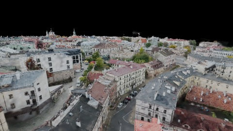
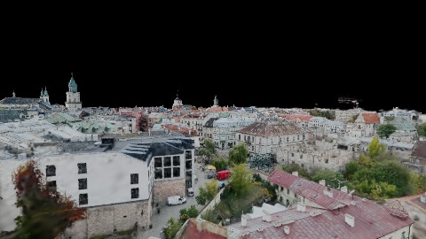
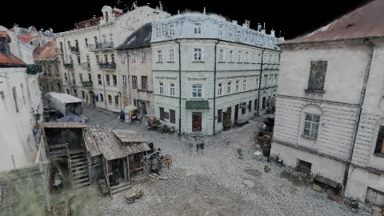
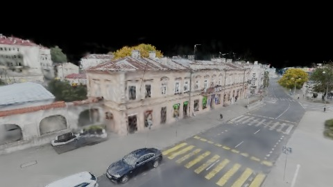

# Scene Profile Benchmark — 2026-06-22

## 本轮维度: profile

Suite: `public/benchmark-suites/scene-downtown-like.json`

Renderer: `webgpu`

## 运行条件

- Cold start: yes
- Browser session: fresh-chromium-per-case
- Chromium HTTP cache: disabled-cdp-clearBrowserCache-zero-disk-cache
- Cold start (default): fresh Chromium per case, HTTP cache disabled
- OS 页缓存 / GPU 编译缓存：脚本不控制，跨次运行可能仍有差异

| label | presetId | budget | firstFrameMs | jsHeap@1st | vram@1st | jsHeapPeak | vramPeak | fpsP50 | fpsP95 | gsplatsAvgM |
|-------|----------|--------|--------------|------------|----------|------------|----------|--------|--------|-------------|
| downtown-like-current-profile | desktop-mega-medium | 8 | 65944.89999997616 | 177 | 444 | 359 | 683 | 60.0 | 60.0 | 3.71 |

## 交互巡检（糊→清晰）

### downtown-like-current-profile

播放段 FPS: P50=60.0, P95=60.0, min=47.0, 总播放=5854ms

| waypoint | animTimeSec | moveMs | pendingPeak | blurToClearMs | fpsP50(refine) | fpsP95(refine) | fpsMin | gsplatsAtClearM | jsHeap@clear | vram@clear | jsHeapPeak | vramPeak | timeout |
|----------|-------------|--------|-------------|---------------|----------------|----------------|--------|-----------------|--------------|------------|------------|----------|---------|
| kf-0 | 0.00 | 0 | 12 | 4350 | 60.0 | 60.0 | 59.0 | 3.33 | 197 | 456 | 255 | 458 | N |
| kf-1 | 1.73 | 1683 | 11 | 8906 | 60.0 | 60.0 | 59.0 | 3.73 | 240 | 504 | 274 | 506 | N |
| kf-2 | 4.57 | 2778 | 14 | 17482 | 60.0 | 60.0 | 59.0 | 3.89 | 300 | 590 | 304 | 592 | N |
| kf-3 | 6.00 | 1393 | 6 | 16845 | 60.0 | 60.0 | 59.0 | 3.90 | 340 | 683 | 359 | 683 | N |

变清晰截图（480×270 JPEG）：

**kf-0**

**kf-1**

**kf-2**

**kf-3**

## 结论

- （填写本轮发现与推荐 preset）