# Scene Profile Benchmark — 2026-06-22

## 本轮维度: profile

Suite: `public/benchmark-suites/scene-nanguangchang-packed-p0.json`

Renderer: `webgpu`

## 运行条件

- Cold start: yes
- Browser session: fresh-chromium-per-case
- Chromium HTTP cache: disabled-cdp-clearBrowserCache-zero-disk-cache
- Cold start (default): fresh Chromium per case, HTTP cache disabled
- OS 页缓存 / GPU 编译缓存：脚本不控制，跨次运行可能仍有差异

| label | presetId | budget | firstFrameMs | jsHeap@1st | vram@1st | jsHeapPeak | vramPeak | fpsP50 | fpsP95 | gsplatsAvgM |
|-------|----------|--------|--------------|------------|----------|------------|----------|--------|--------|-------------|
| nanguangchang-packed-current-profile | desktop-standard | 4 | 45269.10000002384 | 436 | 358 | 772 | 628 | 58.0 | 60.0 | 3.54 |

## 交互巡检（糊→清晰）

### nanguangchang-packed-current-profile

播放段 FPS: P50=58.0, P95=60.0, min=47.0, 总播放=29387ms

| waypoint | animTimeSec | moveMs | pendingPeak | blurToClearMs | fpsP50(refine) | fpsP95(refine) | fpsMin | gsplatsAtClearM | jsHeap@clear | vram@clear | jsHeapPeak | vramPeak | timeout |
|----------|-------------|--------|-------------|---------------|----------------|----------------|--------|-----------------|--------------|------------|------------|----------|---------|
| kf-0 | 0.00 | 0 | 2 | 1368 | 56.0 | 56.0 | 53.0 | 3.50 | 435 | 388 | 467 | 397 | N |
| kf-1 | 2.13 | 2084 | 4 | 16620 | 58.0 | 60.0 | 51.0 | 3.73 | 531 | 493 | 594 | 501 | N |
| kf-2 | 4.30 | 2133 | 2 | 9267 | 60.0 | 60.0 | 49.0 | 3.82 | 564 | 543 | 662 | 559 | N |
| kf-3 | 6.43 | 2096 | 1 | 717 | 57.0 | 57.0 | 57.0 | 3.73 | 579 | 537 | 727 | 541 | N |
| kf-4 | 8.57 | 2090 | 0 | 0 | 60.0 | 60.0 | 60.0 | 3.70 | 566 | 517 | 590 | 517 | N |
| kf-5 | 10.70 | 2082 | 0 | 0 | 60.0 | 60.0 | 60.0 | 3.56 | 638 | 517 | 638 | 517 | N |
| kf-6 | 12.87 | 2127 | 0 | 0 | 59.0 | 59.0 | 59.0 | 2.96 | 616 | 517 | 622 | 517 | N |
| kf-7 | 15.00 | 2079 | 0 | 0 | 59.0 | 59.0 | 59.0 | 3.08 | 602 | 507 | 602 | 507 | N |
| kf-8 | 17.13 | 2106 | 1 | 473 | 59.0 | 60.0 | 59.0 | 2.99 | 581 | 527 | 581 | 535 | N |
| kf-9 | 19.30 | 2108 | 2 | 1455 | 60.0 | 60.0 | 59.0 | 3.20 | 665 | 537 | 682 | 546 | N |
| kf-10 | 21.43 | 2106 | 1 | 1812 | 57.0 | 59.0 | 57.0 | 3.49 | 595 | 558 | 671 | 566 | N |
| kf-11 | 23.57 | 2083 | 2 | 1252 | 54.0 | 54.0 | 54.0 | 3.75 | 670 | 578 | 684 | 586 | N |
| kf-12 | 25.70 | 2112 | 2 | 3409 | 57.0 | 57.0 | 47.0 | 3.78 | 700 | 609 | 757 | 617 | N |
| kf-13 | 27.87 | 2120 | 0 | 0 | 47.0 | 47.0 | 47.0 | 3.94 | 652 | 609 | 664 | 609 | N |
| kf-14 | 29.97 | 2062 | 0 | 0 | 52.0 | 52.0 | 52.0 | 3.93 | 756 | 619 | 765 | 619 | N |

变清晰截图（480×270 JPEG）：

**kf-0**

**kf-1**

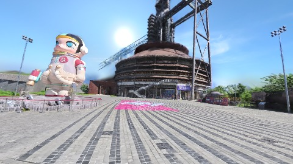

**kf-2**

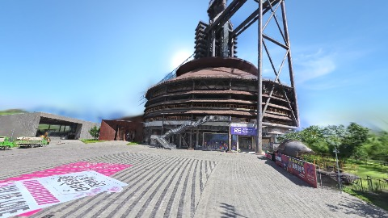

**kf-3**

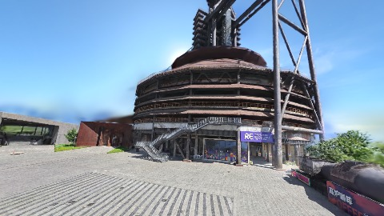

**kf-4**

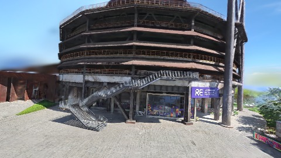

**kf-5**

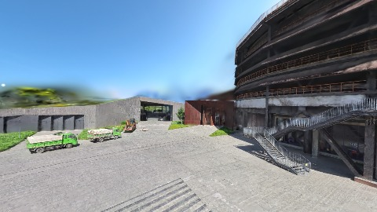

**kf-6**

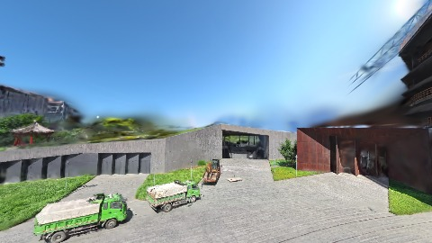

**kf-7**

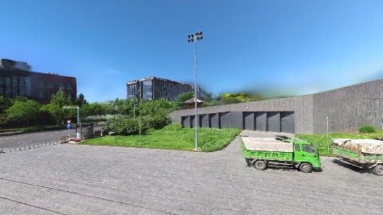

**kf-8**

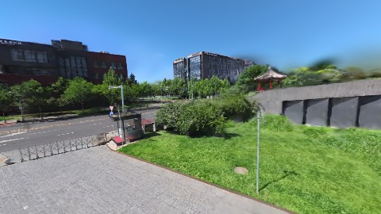

**kf-9**

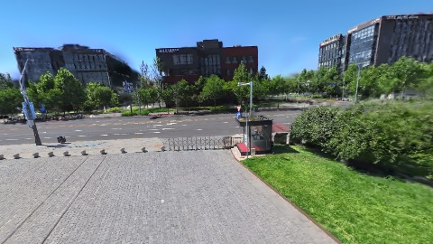

**kf-10**

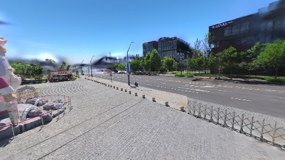

**kf-11**

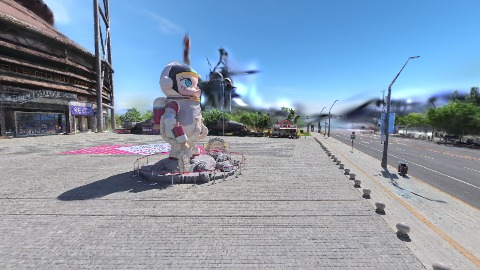

**kf-12**

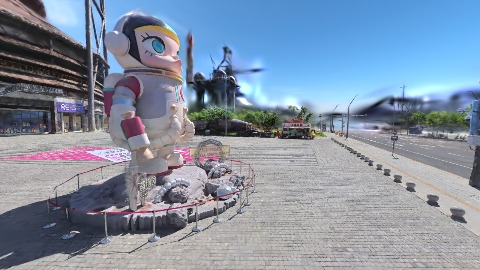

**kf-13**

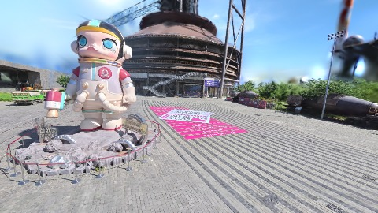

**kf-14**

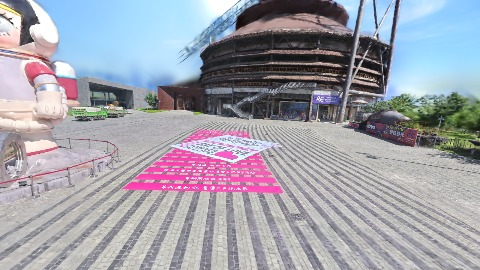

## 结论

- （填写本轮发现与推荐 preset）