# Scene Profile Benchmark — 2026-06-22

## 本轮维度: profile

Suite: `public/benchmark-suites/scene-nanguangchang-profiles.json`

Renderer: `webgpu`

## 运行条件

- Cold start: yes
- Browser session: fresh-chromium-per-case
- Chromium HTTP cache: disabled-cdp-clearBrowserCache-zero-disk-cache
- Cold start (default): fresh Chromium per case, HTTP cache disabled
- OS 页缓存 / GPU 编译缓存：脚本不控制，跨次运行可能仍有差异

| label | presetId | budget | firstFrameMs | jsHeap@1st | vram@1st | jsHeapPeak | vramPeak | fpsP50 | fpsP95 | gsplatsAvgM |
|-------|----------|--------|--------------|------------|----------|------------|----------|--------|--------|-------------|
| v6-legacy-baseline | desktop-standard | 4 | 23618 | 303 | 261 | 554 | 435 | 54.0 | 60.0 | 3.05 |
| v6-profile-perf | desktop-standard | 4 | 26971.899999976158 | 305 | 274 | 589 | 433 | 54.0 | 60.0 | 3.04 |
| v6-profile-quality | desktop-large | 6 | 27219.399999976158 | 274 | 323 | 563 | 484 | 52.0 | 60.0 | 3.86 |

## 交互巡检（糊→清晰）

### v6-legacy-baseline

播放段 FPS: P50=54.0, P95=60.0, min=41.0, 总播放=29372ms

| waypoint | animTimeSec | moveMs | pendingPeak | blurToClearMs | fpsP50(refine) | fpsP95(refine) | fpsMin | gsplatsAtClearM | jsHeap@clear | vram@clear | jsHeapPeak | vramPeak | timeout |
|----------|-------------|--------|-------------|---------------|----------------|----------------|--------|-----------------|--------------|------------|------------|----------|---------|
| kf-0 | 0.00 | 0 | 6 | 1613 | 52.0 | 54.0 | 46.0 | 2.67 | 268 | 278 | 360 | 280 | N |
| kf-1 | 2.13 | 2115 | 14 | 9828 | 52.0 | 53.0 | 46.0 | 3.11 | 294 | 326 | 428 | 328 | N |
| kf-2 | 4.30 | 2127 | 5 | 4584 | 55.0 | 57.0 | 45.0 | 3.24 | 386 | 316 | 456 | 332 | N |
| kf-3 | 6.43 | 2076 | 2 | 502 | 49.0 | 53.0 | 49.0 | 3.16 | 426 | 318 | 428 | 320 | N |
| kf-4 | 8.57 | 2084 | 0 | 0 | 52.0 | 52.0 | 52.0 | 2.81 | 417 | 309 | 426 | 309 | N |
| kf-5 | 10.70 | 2094 | 1 | 187 | 55.0 | 59.0 | 55.0 | 3.16 | 423 | 305 | 432 | 306 | N |
| kf-6 | 12.87 | 2124 | 0 | 0 | 55.0 | 55.0 | 55.0 | 2.33 | 343 | 307 | 355 | 307 | N |
| kf-7 | 15.00 | 2100 | 6 | 1414 | 55.0 | 60.0 | 55.0 | 2.69 | 343 | 323 | 412 | 324 | N |
| kf-8 | 17.13 | 2087 | 2 | 462 | 54.0 | 54.0 | 54.0 | 2.53 | 399 | 336 | 399 | 338 | N |
| kf-9 | 19.30 | 2121 | 3 | 727 | 55.0 | 55.0 | 54.0 | 2.91 | 419 | 342 | 431 | 344 | N |
| kf-10 | 21.43 | 2095 | 4 | 1138 | 49.0 | 53.0 | 49.0 | 3.20 | 350 | 360 | 510 | 362 | N |
| kf-11 | 23.57 | 2098 | 10 | 3738 | 49.0 | 49.0 | 46.0 | 3.38 | 430 | 390 | 489 | 392 | N |
| kf-12 | 25.70 | 2069 | 5 | 906 | 43.0 | 47.0 | 43.0 | 3.45 | 514 | 413 | 532 | 414 | N |
| kf-13 | 27.87 | 2105 | 1 | 350 | 41.0 | 41.0 | 41.0 | 3.52 | 450 | 429 | 450 | 431 | N |
| kf-14 | 29.97 | 2079 | 0 | 0 | 41.0 | 41.0 | 41.0 | 3.63 | 454 | 434 | 454 | 434 | N |

变清晰截图（480×270 JPEG）：

**kf-0**

**kf-1**

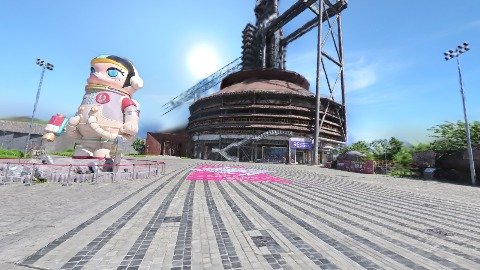

**kf-2**

**kf-3**

**kf-4**

**kf-5**

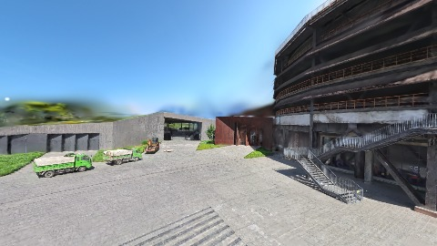

**kf-6**

**kf-7**

**kf-8**

**kf-9**

**kf-10**

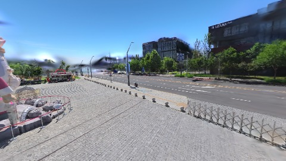

**kf-11**

**kf-12**

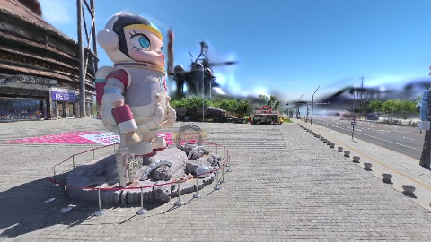

**kf-13**

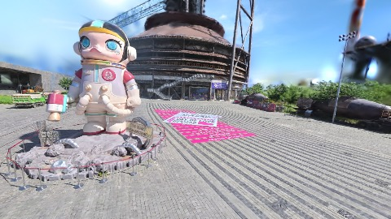

**kf-14**

### v6-profile-perf

播放段 FPS: P50=54.0, P95=60.0, min=43.0, 总播放=29375ms

| waypoint | animTimeSec | moveMs | pendingPeak | blurToClearMs | fpsP50(refine) | fpsP95(refine) | fpsMin | gsplatsAtClearM | jsHeap@clear | vram@clear | jsHeapPeak | vramPeak | timeout |
|----------|-------------|--------|-------------|---------------|----------------|----------------|--------|-----------------|--------------|------------|------------|----------|---------|
| kf-0 | 0.00 | 0 | 4 | 1289 | 47.0 | 47.0 | 46.0 | 2.68 | 299 | 282 | 360 | 285 | N |
| kf-1 | 2.13 | 2079 | 11 | 5878 | 55.0 | 57.0 | 46.0 | 3.09 | 360 | 319 | 422 | 320 | N |
| kf-2 | 4.30 | 2138 | 4 | 2313 | 50.0 | 54.0 | 45.0 | 3.14 | 377 | 302 | 439 | 326 | N |
| kf-3 | 6.43 | 2087 | 2 | 504 | 51.0 | 51.0 | 51.0 | 3.01 | 267 | 302 | 429 | 304 | N |
| kf-4 | 8.57 | 2097 | 0 | 0 | 53.0 | 53.0 | 53.0 | 2.76 | 289 | 292 | 289 | 292 | N |
| kf-5 | 10.70 | 2095 | 1 | 170 | 58.0 | 58.0 | 58.0 | 3.10 | 259 | 290 | 278 | 291 | N |
| kf-6 | 12.87 | 2125 | 0 | 0 | 60.0 | 60.0 | 57.0 | 2.30 | 276 | 294 | 291 | 294 | N |
| kf-7 | 15.00 | 2105 | 7 | 1859 | 57.0 | 57.0 | 54.0 | 2.67 | 340 | 312 | 397 | 313 | N |
| kf-8 | 17.13 | 2098 | 4 | 1096 | 55.0 | 57.0 | 55.0 | 2.63 | 369 | 323 | 384 | 325 | N |
| kf-9 | 19.30 | 2108 | 3 | 833 | 59.0 | 59.0 | 59.0 | 3.00 | 330 | 337 | 429 | 339 | N |
| kf-10 | 21.43 | 2092 | 5 | 1474 | 51.0 | 51.0 | 51.0 | 3.27 | 406 | 355 | 420 | 357 | N |
| kf-11 | 23.57 | 2090 | 7 | 2794 | 50.0 | 51.0 | 47.0 | 3.42 | 373 | 381 | 492 | 383 | N |
| kf-12 | 25.70 | 2093 | 5 | 1551 | 42.0 | 51.0 | 42.0 | 3.49 | 405 | 405 | 531 | 407 | N |
| kf-13 | 27.87 | 2110 | 4 | 1337 | 49.0 | 50.0 | 43.0 | 3.44 | 549 | 429 | 557 | 430 | N |
| kf-14 | 29.97 | 2061 | 0 | 0 | 43.0 | 43.0 | 43.0 | 3.62 | 470 | 432 | 478 | 432 | N |

变清晰截图（480×270 JPEG）：

**kf-0**

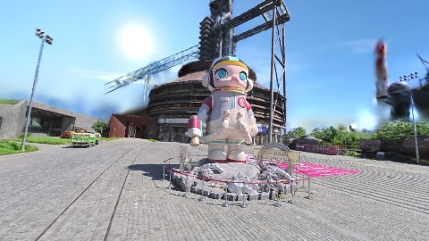

**kf-1**

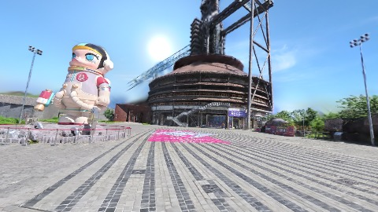

**kf-2**

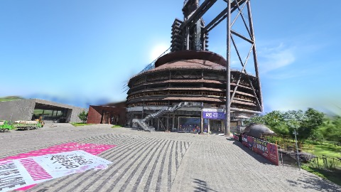

**kf-3**

**kf-4**

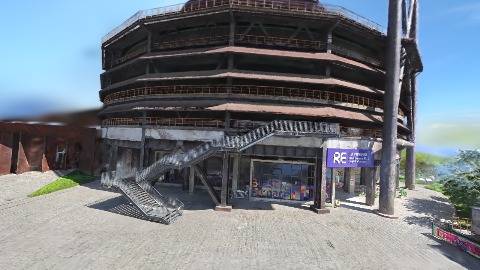

**kf-5**

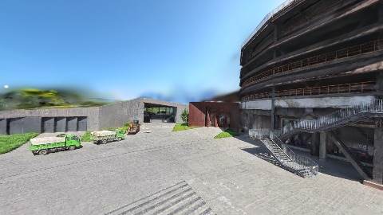

**kf-6**

**kf-7**

**kf-8**

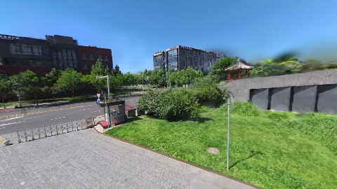

**kf-9**

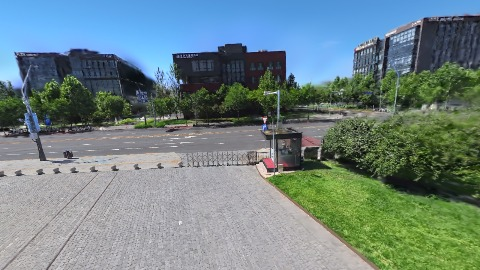

**kf-10**

**kf-11**

**kf-12**

**kf-13**

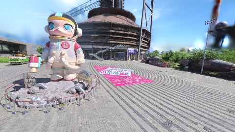

**kf-14**

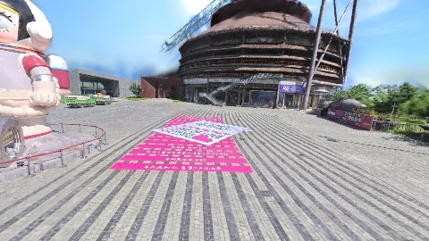

### v6-profile-quality

播放段 FPS: P50=52.0, P95=60.0, min=38.0, 总播放=29501ms

| waypoint | animTimeSec | moveMs | pendingPeak | blurToClearMs | fpsP50(refine) | fpsP95(refine) | fpsMin | gsplatsAtClearM | jsHeap@clear | vram@clear | jsHeapPeak | vramPeak | timeout |
|----------|-------------|--------|-------------|---------------|----------------|----------------|--------|-----------------|--------------|------------|------------|----------|---------|
| kf-0 | 0.00 | 0 | 5 | 2721 | 52.0 | 54.0 | 39.0 | 3.17 | 334 | 335 | 364 | 336 | N |
| kf-1 | 2.13 | 2091 | 10 | 6594 | 51.0 | 53.0 | 46.0 | 3.83 | 345 | 373 | 409 | 375 | N |
| kf-2 | 4.30 | 2107 | 5 | 1931 | 49.0 | 55.0 | 47.0 | 3.72 | 307 | 379 | 424 | 389 | N |
| kf-3 | 6.43 | 2109 | 2 | 543 | 47.0 | 51.0 | 47.0 | 3.74 | 320 | 385 | 448 | 386 | N |
| kf-4 | 8.57 | 2094 | 0 | 0 | 53.0 | 53.0 | 53.0 | 3.53 | 330 | 378 | 330 | 380 | N |
| kf-5 | 10.70 | 2087 | 1 | 323 | 60.0 | 60.0 | 60.0 | 3.59 | 390 | 372 | 406 | 374 | N |
| kf-6 | 12.87 | 2123 | 0 | 0 | 59.0 | 59.0 | 59.0 | 3.23 | 379 | 376 | 379 | 376 | N |
| kf-7 | 15.00 | 2105 | 6 | 826 | 54.0 | 56.0 | 54.0 | 3.60 | 427 | 398 | 444 | 399 | N |
| kf-8 | 17.13 | 2111 | 2 | 478 | 52.0 | 52.0 | 52.0 | 3.31 | 339 | 409 | 452 | 411 | N |
| kf-9 | 19.30 | 2137 | 3 | 742 | 56.0 | 56.0 | 56.0 | 3.84 | 388 | 423 | 389 | 425 | N |
| kf-10 | 21.43 | 2099 | 3 | 1005 | 48.0 | 48.0 | 48.0 | 4.19 | 454 | 439 | 454 | 442 | N |
| kf-11 | 23.57 | 2104 | 6 | 1662 | 47.0 | 47.0 | 46.0 | 4.36 | 443 | 459 | 503 | 461 | N |
| kf-12 | 25.70 | 2104 | 1 | 407 | 38.0 | 38.0 | 38.0 | 4.39 | 470 | 468 | 470 | 469 | N |
| kf-13 | 27.87 | 2143 | 0 | 0 | 42.0 | 42.0 | 42.0 | 4.54 | 463 | 480 | 463 | 480 | N |
| kf-14 | 29.97 | 2090 | 0 | 0 | 41.0 | 41.0 | 41.0 | 4.92 | 436 | 483 | 436 | 483 | N |

变清晰截图（480×270 JPEG）：

**kf-0**

**kf-1**

**kf-2**

**kf-3**

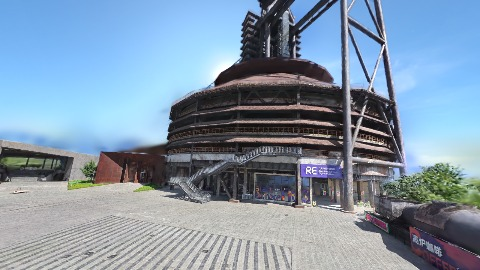

**kf-4**

**kf-5**

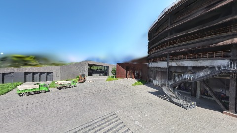

**kf-6**

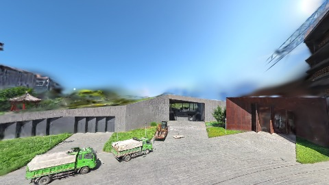

**kf-7**

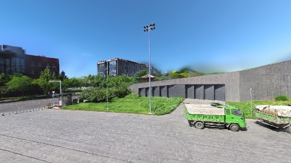

**kf-8**

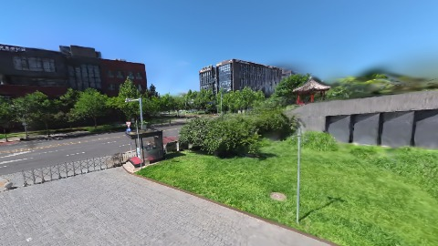

**kf-9**

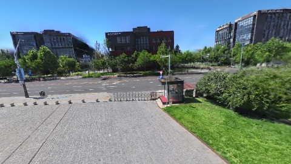

**kf-10**

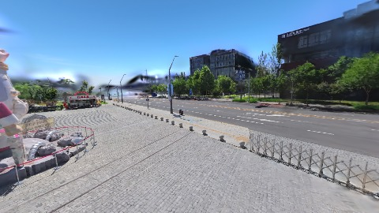

**kf-11**

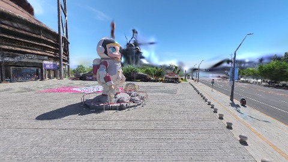

**kf-12**

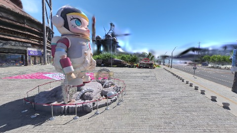

**kf-13**

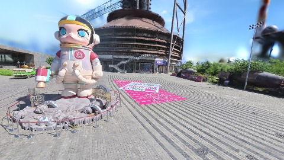

**kf-14**

## 优化前 vs 优化后

### nanguangchang-v6（基线 `v6-legacy-baseline`）

| case | scheduler | lodMode | firstFrameMs | kf-1 blur | kf-2 blur | blur P90 | vramPeak | poolEvictions |
|------|-----------|---------|--------------|-----------|-----------|----------|----------|---------------|
| v6-legacy-baseline | legacy | performanceFirst | 23618 (—) | 9828 (—) | 4584 | 4584 | 435 | 0 |
| v6-profile-perf | profile | performanceFirst | 26972 (14.2%) | 5878 (-40.2%) | 2313 | 2794 | 433 | 44 |
| v6-profile-quality | profile | qualityFirst | 27219 (15.2%) | 6594 (-32.9%) | 1931 | 2721 | 484 | 0 |

## 结论

- 见上方对比表；`bottleneckHint` 见 `results.json`（scheduler / asset-http / mixed）