# Scene Profile Benchmark — 2026-06-22

## 本轮维度: profile

Suite: `public/benchmark-suites/scene-nanguangchang.json`

Renderer: `webgpu`

## 运行条件

- Cold start: yes
- Browser session: fresh-chromium-per-case
- Chromium HTTP cache: disabled-cdp-clearBrowserCache-zero-disk-cache
- Cold start (default): fresh Chromium per case, HTTP cache disabled
- OS 页缓存 / GPU 编译缓存：脚本不控制，跨次运行可能仍有差异

| label | presetId | budget | firstFrameMs | jsHeap@1st | vram@1st | jsHeapPeak | vramPeak | fpsP50 | fpsP95 | gsplatsAvgM |
|-------|----------|--------|--------------|------------|----------|------------|----------|--------|--------|-------------|
| nanguangchang-current-profile | desktop-standard | 4 | 23554.200000047684 | 245 | 256 | 616 | 443 | 56.0 | 60.0 | 3.26 |

## 交互巡检（糊→清晰）

### nanguangchang-current-profile

播放段 FPS: P50=56.0, P95=60.0, min=44.0, 总播放=29381ms

| waypoint | animTimeSec | moveMs | pendingPeak | blurToClearMs | fpsP50(refine) | fpsP95(refine) | fpsMin | gsplatsAtClearM | jsHeap@clear | vram@clear | jsHeapPeak | vramPeak | timeout |
|----------|-------------|--------|-------------|---------------|----------------|----------------|--------|-----------------|--------------|------------|------------|----------|---------|
| kf-0 | 0.00 | 0 | 7 | 2801 | 55.0 | 59.0 | 49.0 | 2.67 | 328 | 278 | 354 | 280 | N |
| kf-1 | 2.13 | 2093 | 13 | 9556 | 55.0 | 58.0 | 52.0 | 3.26 | 305 | 328 | 423 | 330 | N |
| kf-2 | 4.30 | 2140 | 5 | 5179 | 55.0 | 56.0 | 48.0 | 3.56 | 322 | 348 | 446 | 349 | N |
| kf-3 | 6.43 | 2081 | 4 | 2582 | 56.0 | 59.0 | 52.0 | 3.30 | 469 | 352 | 482 | 354 | N |
| kf-4 | 8.57 | 2091 | 4 | 2220 | 58.0 | 59.0 | 56.0 | 2.91 | 435 | 362 | 499 | 364 | N |
| kf-5 | 10.70 | 2090 | 0 | 0 | 59.0 | 59.0 | 57.0 | 3.46 | 412 | 366 | 528 | 368 | N |
| kf-6 | 12.87 | 2141 | 0 | 0 | 58.0 | 58.0 | 58.0 | 2.53 | 360 | 379 | 374 | 379 | N |
| kf-7 | 15.00 | 2078 | 7 | 4003 | 60.0 | 60.0 | 58.0 | 2.93 | 494 | 388 | 517 | 391 | N |
| kf-8 | 17.13 | 2076 | 2 | 2288 | 54.0 | 58.0 | 54.0 | 2.92 | 433 | 386 | 574 | 387 | N |
| kf-9 | 19.30 | 2141 | 2 | 1691 | 58.0 | 58.0 | 58.0 | 3.35 | 418 | 400 | 515 | 402 | N |
| kf-10 | 21.43 | 2095 | 3 | 1700 | 56.0 | 56.0 | 52.0 | 3.46 | 422 | 415 | 544 | 416 | N |
| kf-11 | 23.57 | 2076 | 4 | 1590 | 48.0 | 49.0 | 48.0 | 3.65 | 472 | 420 | 558 | 427 | N |
| kf-12 | 25.70 | 2091 | 1 | 1463 | 46.0 | 56.0 | 46.0 | 3.59 | 569 | 431 | 569 | 434 | N |
| kf-13 | 27.87 | 2131 | 0 | 0 | 46.0 | 46.0 | 46.0 | 3.60 | 616 | 441 | 616 | 443 | N |
| kf-14 | 29.97 | 2057 | 0 | 0 | 42.0 | 44.0 | 42.0 | 3.68 | 438 | 439 | 460 | 439 | N |

变清晰截图（480×270 JPEG）：

**kf-0**

**kf-1**

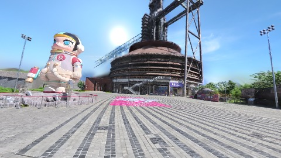

**kf-2**

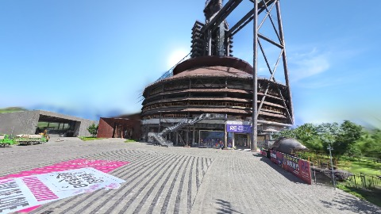

**kf-3**

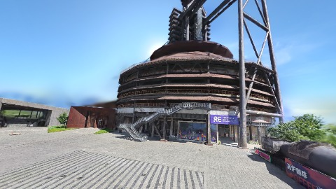

**kf-4**

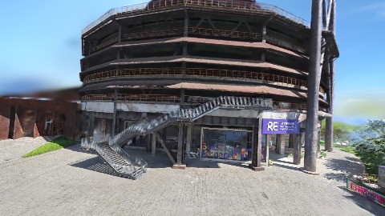

**kf-5**

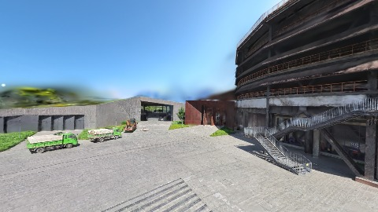

**kf-6**

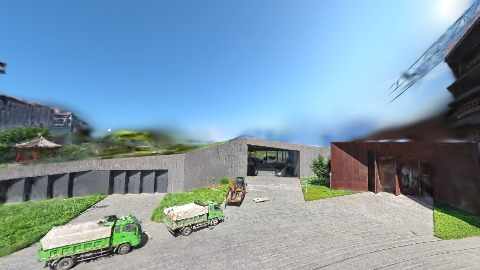

**kf-7**

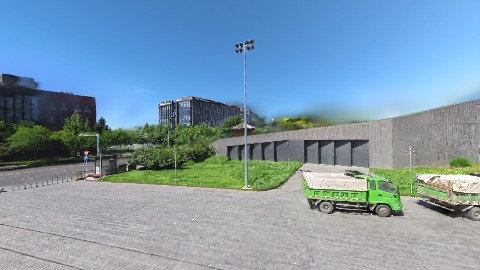

**kf-8**

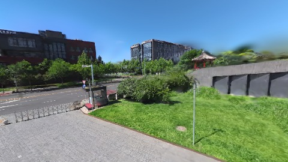

**kf-9**

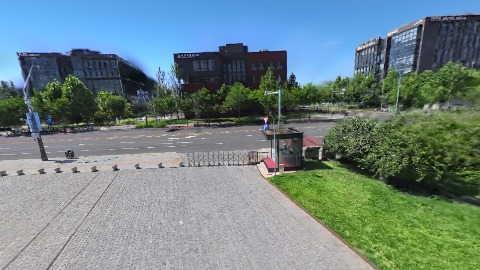

**kf-10**

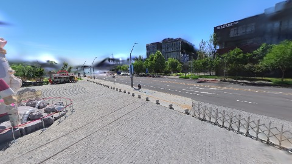

**kf-11**

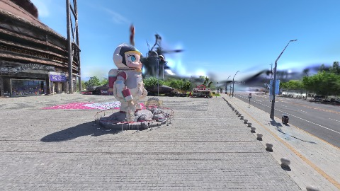

**kf-12**

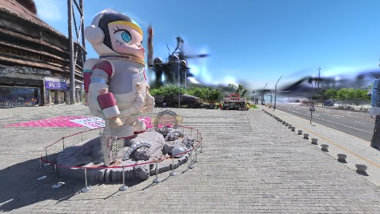

**kf-13**

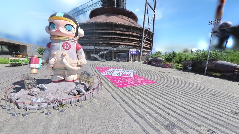

**kf-14**

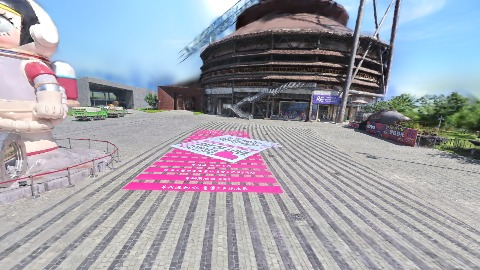

## 结论

- （填写本轮发现与推荐 preset）