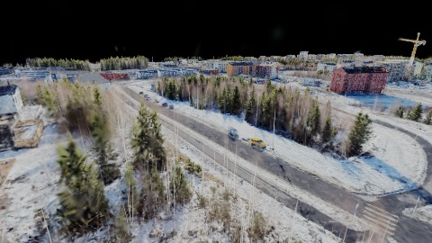
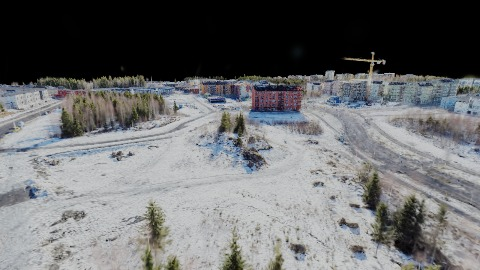
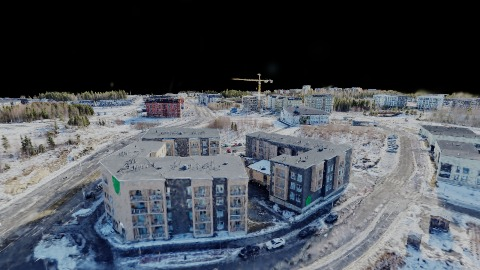
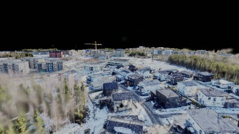
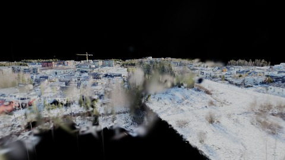
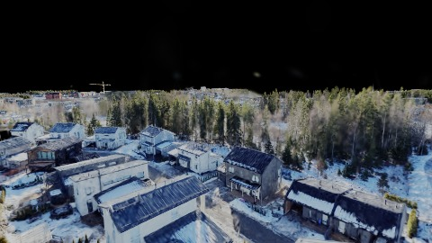
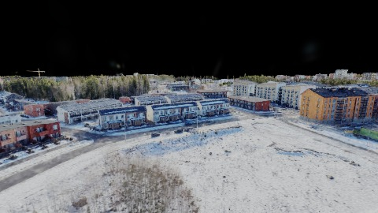
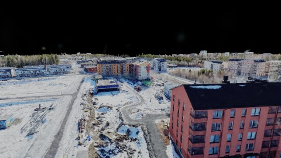

# Scene Profile Benchmark — 2026-06-26

## 本轮维度: profile

Suite: `public/benchmark-suites/scene-finland-native-2p-quality.json`

Renderer: `webgpu`

## 运行条件

- Cold start: yes
- Browser session: fresh-chromium-per-case
- Chromium HTTP cache: disabled-cdp-clearBrowserCache-zero-disk-cache
- Cold start (default): fresh Chromium per case, HTTP cache disabled
- OS 页缓存 / GPU 编译缓存：脚本不控制，跨次运行可能仍有差异

| label | presetId | budget | lodMode | lodRuntime | firstFrameMs | jsHeap@1st | vram@1st | jsHeapPeak | vramPeak | fpsP50 | fpsP95 | gsplatsAvgM |
|-------|----------|--------|---------|------------|--------------|------------|----------|------------|----------|--------|--------|-------------|
| finland-2p-quality-native | desktop-mega-low | 4 | quality | native | 19375.09999999404 | 266 | 77 | 970 | 224 | 36.0 | 49.0 | 2.61 |

## 交互巡检（糊→清晰）

### finland-2p-quality-native

播放段 FPS: P50=36.0, P95=49.0, min=24.0, 总播放=10252ms

| waypoint | animTimeSec | moveMs | pendingPeak | blurToClearMs | fpsP50(refine) | fpsP95(refine) | fpsMin | gsplatsAtClearM | jsHeap@clear | vram@clear | jsHeapPeak | vramPeak | timeout |
|----------|-------------|--------|-------------|---------------|----------------|----------------|--------|-----------------|--------------|------------|------------|----------|---------|
| kf-0 | 0.00 | 0 | 28 | 28001 | 33.0 | 36.0 | 11.0 | 2.59 | 853 | 196 | 854 | 196 | N |
| kf-1 | 1.50 | 1450 | 4 | 10201 | 36.0 | 39.0 | 27.0 | 2.67 | 538 | 201 | 848 | 209 | N |
| kf-2 | 3.00 | 1458 | 4 | 11400 | 36.0 | 38.0 | 31.0 | 2.61 | 355 | 190 | 857 | 210 | N |
| kf-3 | 4.50 | 1467 | 3 | 11963 | 29.0 | 32.0 | 27.0 | 2.45 | 748 | 183 | 865 | 201 | N |
| kf-4 | 6.00 | 1450 | 5 | 10201 | 30.0 | 39.0 | 25.0 | 2.36 | 507 | 187 | 873 | 188 | N |
| kf-5 | 7.50 | 1511 | 5 | 19402 | 29.0 | 52.0 | 25.0 | 2.64 | 401 | 205 | 948 | 207 | N |
| kf-6 | 9.00 | 1466 | 6 | 19201 | 25.0 | 37.0 | 21.0 | 2.73 | 725 | 216 | 951 | 216 | N |
| kf-7 | 10.50 | 1450 | 4 | 12201 | 25.0 | 47.0 | 22.0 | 2.82 | 490 | 222 | 970 | 224 | N |

变清晰截图（480×270 JPEG）：

**kf-0**

**kf-1**

**kf-2**

**kf-3**

**kf-4**

**kf-5**

**kf-6**

**kf-7**

## 优化前 vs 优化后

### finland-native-2p（基线 `finland-2p-quality-native`）

| case | lodMode | lodRuntime | firstFrameMs | kf-1 blur | kf-2 blur | blur P90 | vramPeak | poolEvictions |
|------|---------|------------|--------------|-----------|-----------|----------|----------|---------------|
| finland-2p-quality-native | quality | native | 19375 (—) | 10201 (—) | 11400 | 28001 | 224 | - |

## 结论

- 见上方对比表；`bottleneckHint` 见 `results.json`（scheduler / asset-http / mixed）