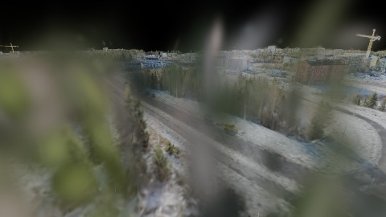
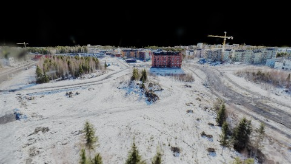
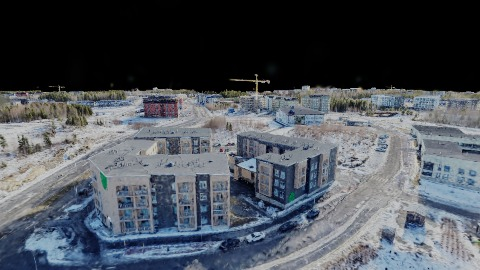
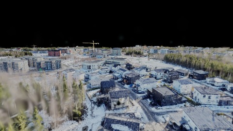
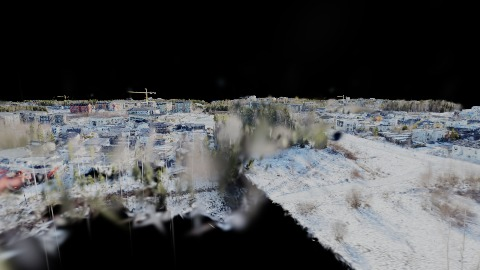
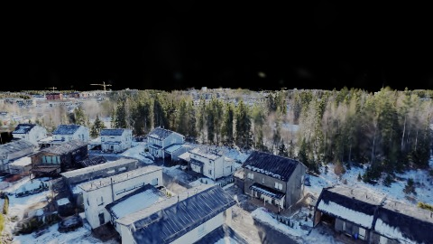
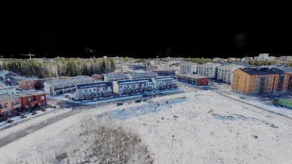
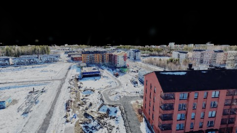

# Scene Profile Benchmark — 2026-06-26

## 本轮维度: profile

Suite: `public/benchmark-suites/scene-finland-native-5p-quality.json`

Renderer: `webgpu`

## 运行条件

- Cold start: yes
- Browser session: fresh-chromium-per-case
- Chromium HTTP cache: disabled-cdp-clearBrowserCache-zero-disk-cache
- Cold start (default): fresh Chromium per case, HTTP cache disabled
- OS 页缓存 / GPU 编译缓存：脚本不控制，跨次运行可能仍有差异

| label | presetId | budget | lodMode | lodRuntime | firstFrameMs | jsHeap@1st | vram@1st | jsHeapPeak | vramPeak | fpsP50 | fpsP95 | gsplatsAvgM |
|-------|----------|--------|---------|------------|--------------|------------|----------|------------|----------|--------|--------|-------------|
| finland-5p-quality-native | desktop-mega-low | 4 | quality | native | 17484.90000000596 | 301 | 151 | 1284 | 321 | 7.0 | 40.0 | 5.18 |

## 交互巡检（糊→清晰）

### finland-5p-quality-native

播放段 FPS: P50=7.0, P95=40.0, min=2.0, 总播放=11303ms

| waypoint | animTimeSec | moveMs | pendingPeak | blurToClearMs | fpsP50(refine) | fpsP95(refine) | fpsMin | gsplatsAtClearM | jsHeap@clear | vram@clear | jsHeapPeak | vramPeak | timeout |
|----------|-------------|--------|-------------|---------------|----------------|----------------|--------|-----------------|--------------|------------|------------|----------|---------|
| kf-0 | 0.00 | 0 | 34 | - | 3.0 | 4.0 | 2.0 | - | - | - | 1083 | 230 | Y |
| kf-1 | 1.50 | 1617 | 7 | - | 3.0 | 3.0 | 3.0 | - | - | - | 1208 | 292 | Y |
| kf-2 | 3.00 | 1495 | 4 | 30392 | 3.0 | 4.0 | 2.0 | 5.29 | 1049 | 277 | 1269 | 307 | N |
| kf-3 | 4.50 | 1516 | 3 | 32898 | 3.0 | 32.0 | 2.0 | 5.07 | 1091 | 271 | 1247 | 299 | N |
| kf-4 | 6.00 | 1600 | 5 | 24387 | 3.0 | 24.0 | 2.0 | 4.94 | 706 | 277 | 1257 | 291 | N |
| kf-5 | 7.50 | 1584 | 5 | - | 3.0 | 3.0 | 2.0 | - | - | - | 1271 | 293 | Y |
| kf-6 | 9.00 | 1759 | 6 | - | 3.0 | 4.0 | 2.0 | - | - | - | 1284 | 303 | Y |
| kf-7 | 10.50 | 1734 | 4 | 29935 | 3.0 | 22.0 | 2.0 | 5.41 | 1096 | 292 | 1278 | 321 | N |

变清晰截图（480×270 JPEG）：

**kf-0**

**kf-1**

**kf-2**

**kf-3**

**kf-4**

**kf-5**

**kf-6**

**kf-7**

## 优化前 vs 优化后

### finland-native-scale（基线 `finland-5p-quality-native`）

| case | lodMode | lodRuntime | firstFrameMs | kf-1 blur | kf-2 blur | blur P90 | vramPeak | poolEvictions |
|------|---------|------------|--------------|-----------|-----------|----------|----------|---------------|
| finland-5p-quality-native | quality | native | 17485 (—) | - (—) | 30392 | 32898 | 321 | - |

## 结论

- 见上方对比表；`bottleneckHint` 见 `results.json`（scheduler / asset-http / mixed）