# Scene Profile Benchmark — 2026-06-26

## 本轮维度: profile

Suite: `public/benchmark-suites/scene-finland-native-scale.json`

Renderer: `webgpu`

## 运行条件

- Cold start: yes
- Browser session: fresh-chromium-per-case
- Chromium HTTP cache: disabled-cdp-clearBrowserCache-zero-disk-cache
- Cold start (default): fresh Chromium per case, HTTP cache disabled
- OS 页缓存 / GPU 编译缓存：脚本不控制，跨次运行可能仍有差异

| label | presetId | budget | lodMode | lodRuntime | firstFrameMs | jsHeap@1st | vram@1st | jsHeapPeak | vramPeak | fpsP50 | fpsP95 | gsplatsAvgM |
|-------|----------|--------|---------|------------|--------------|------------|----------|------------|----------|--------|--------|-------------|
| finland-2p-perf-native | desktop-mega-low | 4 | performance | native | 19857.90000000596 | 289 | 81 | 992 | 236 | 37.0 | 55.0 | 2.61 |
| finland-5p-perf-native | desktop-mega-low | 4 | performance | native | 18369 | 678 | 158 | 1306 | 307 | 9.0 | 36.0 | 5.18 |

## 交互巡检（糊→清晰）

### finland-2p-perf-native

播放段 FPS: P50=37.0, P95=55.0, min=25.0, 总播放=10168ms

| waypoint | animTimeSec | moveMs | pendingPeak | blurToClearMs | fpsP50(refine) | fpsP95(refine) | fpsMin | gsplatsAtClearM | jsHeap@clear | vram@clear | jsHeapPeak | vramPeak | timeout |
|----------|-------------|--------|-------------|---------------|----------------|----------------|--------|-----------------|--------------|------------|------------|----------|---------|
| kf-0 | 0.00 | 0 | 28 | 25801 | 34.0 | 36.0 | 14.0 | 2.60 | 834 | 195 | 826 | 195 | N |
| kf-1 | 1.50 | 1426 | 5 | 9801 | 36.0 | 55.0 | 32.0 | 2.67 | 597 | 201 | 857 | 201 | N |
| kf-2 | 3.00 | 1450 | 3 | 9401 | 35.0 | 55.0 | 33.0 | 2.61 | 353 | 188 | 870 | 210 | N |
| kf-3 | 4.50 | 1466 | 3 | 10601 | 33.0 | 56.0 | 30.0 | 2.45 | 654 | 180 | 860 | 195 | N |
| kf-4 | 6.00 | 1467 | 5 | 9401 | 30.0 | 51.0 | 27.0 | 2.36 | 411 | 184 | 863 | 186 | N |
| kf-5 | 7.50 | 1450 | 5 | 16801 | 27.0 | 30.0 | 24.0 | 2.64 | 709 | 201 | 855 | 202 | N |
| kf-6 | 9.00 | 1422 | 6 | 18201 | 27.0 | 32.0 | 22.0 | 2.75 | 556 | 225 | 942 | 225 | N |
| kf-7 | 10.50 | 1486 | 5 | 10801 | 27.0 | 40.0 | 23.0 | 2.83 | 823 | 218 | 992 | 236 | N |

变清晰截图（480×270 JPEG）：

**kf-0**

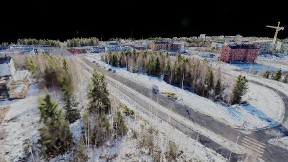

**kf-1**

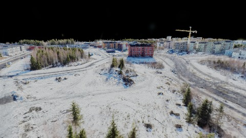

**kf-2**

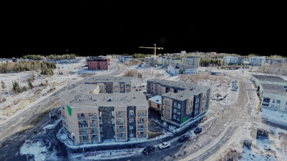

**kf-3**

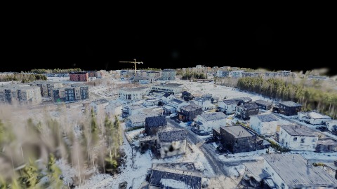

**kf-4**

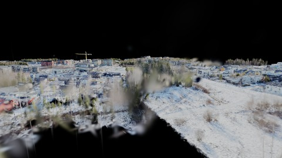

**kf-5**

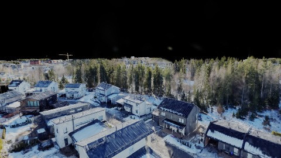

**kf-6**

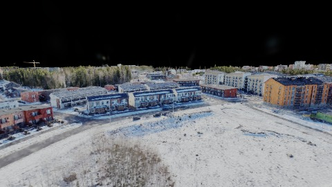

**kf-7**

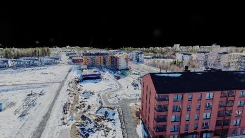

### finland-5p-perf-native

播放段 FPS: P50=9.0, P95=36.0, min=2.0, 总播放=11925ms

| waypoint | animTimeSec | moveMs | pendingPeak | blurToClearMs | fpsP50(refine) | fpsP95(refine) | fpsMin | gsplatsAtClearM | jsHeap@clear | vram@clear | jsHeapPeak | vramPeak | timeout |
|----------|-------------|--------|-------------|---------------|----------------|----------------|--------|-----------------|--------------|------------|------------|----------|---------|
| kf-0 | 0.00 | 0 | 34 | - | 3.0 | 3.0 | 2.0 | - | - | - | 1111 | 230 | Y |
| kf-1 | 1.50 | 1716 | 6 | - | 3.0 | 4.0 | 2.0 | - | - | - | 1199 | 288 | Y |
| kf-2 | 3.00 | 1582 | 4 | 42874 | 3.0 | 18.0 | 2.0 | 5.30 | 888 | 281 | 1302 | 307 | N |
| kf-3 | 4.50 | 1617 | 3 | 32376 | 3.0 | 21.0 | 2.0 | 5.07 | 726 | 275 | 1276 | 301 | N |
| kf-4 | 6.00 | 1599 | 6 | 24254 | 3.0 | 27.0 | 2.0 | 4.95 | 537 | 277 | 1284 | 286 | N |
| kf-5 | 7.50 | 1749 | 5 | - | 3.0 | 4.0 | 2.0 | - | - | - | 1272 | 297 | Y |
| kf-6 | 9.00 | 1850 | 6 | - | 3.0 | 3.0 | 2.0 | - | - | - | 1270 | 299 | Y |
| kf-7 | 10.50 | 1811 | 5 | 41198 | 3.0 | 4.0 | 2.0 | 5.41 | 1157 | 290 | 1306 | 307 | N |

变清晰截图（480×270 JPEG）：

**kf-0**

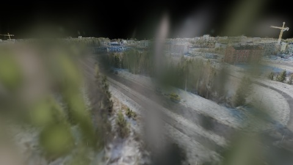

**kf-1**

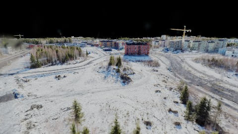

**kf-2**

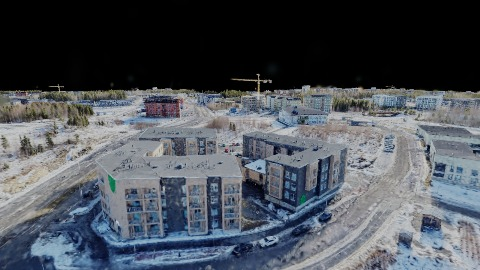

**kf-3**

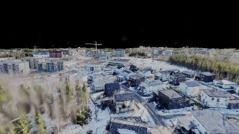

**kf-4**

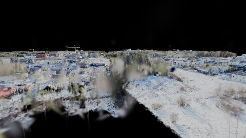

**kf-5**

**kf-6**

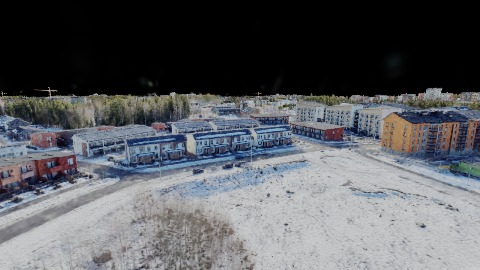

**kf-7**

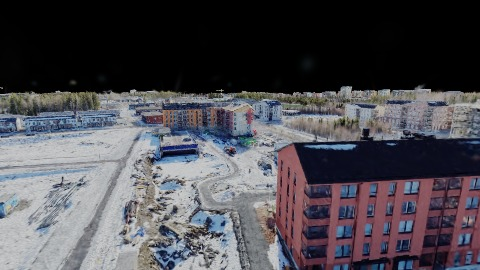

## 优化前 vs 优化后

### finland-native-scale（基线 `finland-2p-perf-native`）

| case | lodMode | lodRuntime | firstFrameMs | kf-1 blur | kf-2 blur | blur P90 | vramPeak | poolEvictions |
|------|---------|------------|--------------|-----------|-----------|----------|----------|---------------|
| finland-2p-perf-native | performance | native | 19858 (—) | 9801 (—) | 9401 | 25801 | 236 | - |
| finland-5p-perf-native | performance | native | 18369 (-7.5%) | - (-%) | 42874 | 42874 | 307 | - |

## 结论

- 见上方对比表；`bottleneckHint` 见 `results.json`（scheduler / asset-http / mixed）