# Scene Profile Benchmark — 2026-06-26

## 本轮维度: profile

Suite: `public/benchmark-suites/scene-finland-region-policy.json`

Renderer: `webgpu`

## 运行条件

- Cold start: yes
- Browser session: fresh-chromium-per-case
- Chromium HTTP cache: disabled-cdp-clearBrowserCache-zero-disk-cache
- Cold start (default): fresh Chromium per case, HTTP cache disabled
- OS 页缓存 / GPU 编译缓存：脚本不控制，跨次运行可能仍有差异

| label | presetId | budget | lodMode | lodRuntime | regionPolicy | firstFrameMs | jsHeap@1st | vram@1st | jsHeapPeak | vramPeak | fpsP50 | fpsP95 | gsplatsAvgM |
|-------|----------|--------|---------|------------|--------------|--------------|------------|----------|------------|----------|--------|--------|-------------|
| finland-perf-native-region-budget | desktop-mega-low | 4 | performance | native | region-budget | 17883.29999998212 | 599 | 81 | 1010 | 235 | 41.0 | 52.0 | 2.61 |
| finland-perf-native-billions | desktop-mega-low | 4 | performance | native | billions | 19203.79999998212 | 323 | 81 | 986 | 235 | 37.0 | 54.0 | 2.61 |

## 交互巡检（糊→清晰）

### finland-perf-native-region-budget

播放段 FPS: P50=41.0, P95=52.0, min=28.0, 总播放=10167ms

| waypoint | animTimeSec | moveMs | pendingPeak | blurToClearMs | fpsP50(refine) | fpsP95(refine) | fpsMin | gsplatsAtClearM | jsHeap@clear | vram@clear | jsHeapPeak | vramPeak | timeout |
|----------|-------------|--------|-------------|---------------|----------------|----------------|--------|-----------------|--------------|------------|------------|----------|---------|
| kf-0 | 0.00 | 0 | 28 | 26401 | 38.0 | 40.0 | 17.0 | 2.60 | 477 | 195 | 898 | 195 | N |
| kf-1 | 1.50 | 1466 | 4 | 8601 | 34.0 | 51.0 | 32.0 | 2.67 | 701 | 201 | 848 | 203 | N |
| kf-2 | 3.00 | 1466 | 3 | 9201 | 39.0 | 55.0 | 38.0 | 2.61 | 378 | 191 | 901 | 208 | N |
| kf-3 | 4.50 | 1402 | 3 | 9001 | 35.0 | 53.0 | 33.0 | 2.45 | 566 | 178 | 964 | 199 | N |
| kf-4 | 6.00 | 1467 | 6 | 8391 | 32.0 | 52.0 | 30.0 | 2.36 | 806 | 184 | 823 | 187 | N |
| kf-5 | 7.50 | 1450 | 5 | 15601 | 31.0 | 50.0 | 28.0 | 2.64 | 500 | 201 | 859 | 201 | N |
| kf-6 | 9.00 | 1450 | 6 | 16601 | 29.0 | 52.0 | 23.0 | 2.74 | 766 | 225 | 961 | 225 | N |
| kf-7 | 10.50 | 1466 | 4 | 10201 | 26.0 | 44.0 | 22.0 | 2.82 | 485 | 218 | 1010 | 235 | N |

变清晰截图（480×270 JPEG）：

**kf-0**

**kf-1**

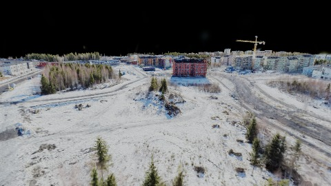

**kf-2**

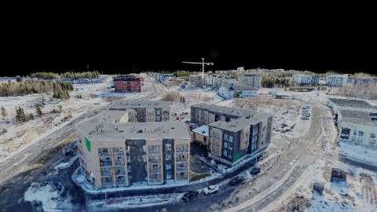

**kf-3**

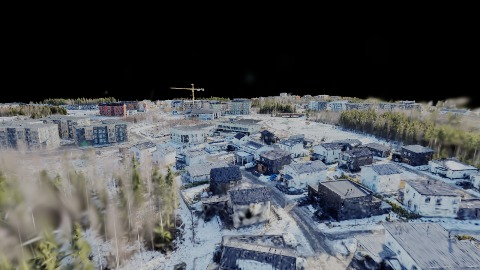

**kf-4**

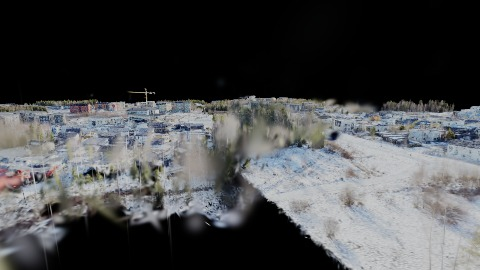

**kf-5**

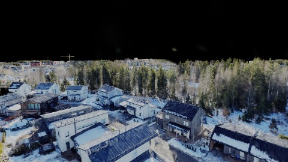

**kf-6**

**kf-7**

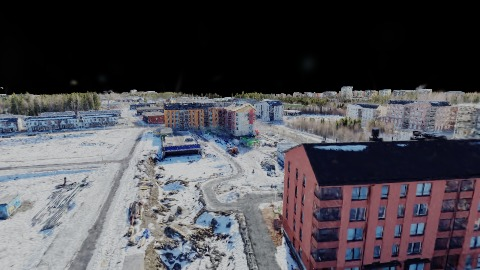

### finland-perf-native-billions

播放段 FPS: P50=37.0, P95=54.0, min=24.0, 总播放=10227ms

| waypoint | animTimeSec | moveMs | pendingPeak | blurToClearMs | fpsP50(refine) | fpsP95(refine) | fpsMin | gsplatsAtClearM | jsHeap@clear | vram@clear | jsHeapPeak | vramPeak | timeout |
|----------|-------------|--------|-------------|---------------|----------------|----------------|--------|-----------------|--------------|------------|------------|----------|---------|
| kf-0 | 0.00 | 0 | 28 | 28600 | 32.0 | 38.0 | 10.0 | 2.60 | 417 | 195 | 809 | 195 | N |
| kf-1 | 1.50 | 1450 | 4 | 10001 | 37.0 | 58.0 | 34.0 | 2.67 | 739 | 201 | 863 | 203 | N |
| kf-2 | 3.00 | 1466 | 3 | 13017 | 37.0 | 45.0 | 34.0 | 2.61 | 633 | 191 | 898 | 208 | N |
| kf-3 | 4.50 | 1466 | 3 | 10401 | 32.0 | 54.0 | 30.0 | 2.45 | 433 | 180 | 867 | 197 | N |
| kf-4 | 6.00 | 1450 | 5 | 7224 | 34.0 | 52.0 | 30.0 | 2.36 | 538 | 186 | 837 | 188 | N |
| kf-5 | 7.50 | 1480 | 6 | 16550 | 27.0 | 40.0 | 25.0 | 2.64 | 904 | 203 | 906 | 204 | N |
| kf-6 | 9.00 | 1450 | 6 | 18200 | 27.0 | 32.0 | 23.0 | 2.74 | 770 | 225 | 889 | 225 | N |
| kf-7 | 10.50 | 1466 | 4 | 9800 | 25.0 | 52.0 | 21.0 | 2.82 | 464 | 218 | 986 | 235 | N |

变清晰截图（480×270 JPEG）：

**kf-0**

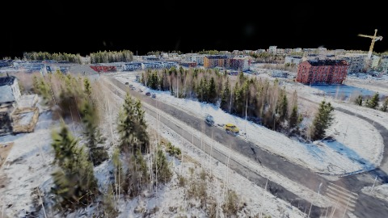

**kf-1**

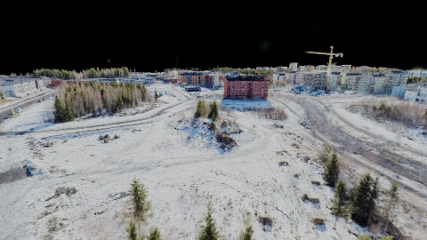

**kf-2**

**kf-3**

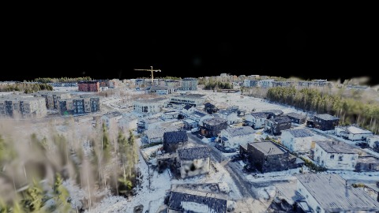

**kf-4**

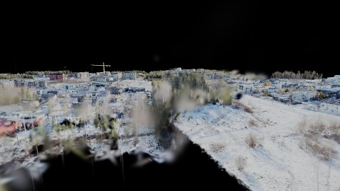

**kf-5**

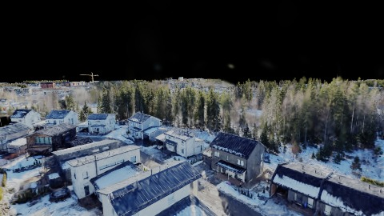

**kf-6**

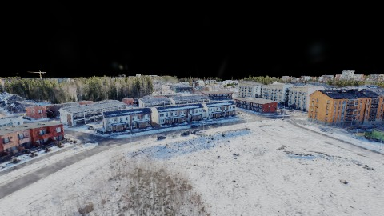

**kf-7**

## 优化前 vs 优化后

### default（基线 `finland-perf-native-region-budget`）

| case | lodMode | lodRuntime | firstFrameMs | kf-1 blur | kf-2 blur | blur P90 | vramPeak | poolEvictions |
|------|---------|------------|--------------|-----------|-----------|----------|----------|---------------|
| finland-perf-native-region-budget | performance | native | 17883 (—) | 8601 (—) | 9201 | 26401 | 235 | - |
| finland-perf-native-billions | performance | native | 19204 (7.4%) | 10001 (16.3%) | 13017 | 28600 | 235 | - |

## 结论

- 见上方对比表；`bottleneckHint` 见 `results.json`（scheduler / asset-http / mixed）