# Scene Profile Benchmark — 2026-06-26

## 本轮维度: profile

Suite: `public/benchmark-suites/scene-nanguangchang-native.json`

Renderer: `webgpu`

## 运行条件

- Cold start: yes
- Browser session: fresh-chromium-per-case
- Chromium HTTP cache: disabled-cdp-clearBrowserCache-zero-disk-cache
- Cold start (default): fresh Chromium per case, HTTP cache disabled
- OS 页缓存 / GPU 编译缓存：脚本不控制，跨次运行可能仍有差异

| label | presetId | budget | lodMode | lodRuntime | firstFrameMs | jsHeap@1st | vram@1st | jsHeapPeak | vramPeak | fpsP50 | fpsP95 | gsplatsAvgM |
|-------|----------|--------|---------|------------|--------------|------------|----------|------------|----------|--------|--------|-------------|
| v6-performance-refinement | desktop-standard | 4 | performance | refinement | 22980.5 | 229 | 235 | 540 | 412 | 59.0 | 60.0 | 3.03 |
| v6-performance-native | desktop-standard | 4 | performance | native | 1026.5999999940395 | 95 | 34 | 345 | 314 | 60.0 | 60.0 | 2.81 |

## 交互巡检（糊→清晰）

### v6-performance-refinement

播放段 FPS: P50=59.0, P95=60.0, min=54.0, 总播放=29387ms

| waypoint | animTimeSec | moveMs | pendingPeak | blurToClearMs | fpsP50(refine) | fpsP95(refine) | fpsMin | gsplatsAtClearM | jsHeap@clear | vram@clear | jsHeapPeak | vramPeak | timeout |
|----------|-------------|--------|-------------|---------------|----------------|----------------|--------|-----------------|--------------|------------|------------|----------|---------|
| kf-0 | 0.00 | 0 | 6 | 2597 | 59.0 | 60.0 | 58.0 | 2.62 | 270 | 258 | 326 | 258 | N |
| kf-1 | 2.13 | 2114 | 10 | 6602 | 59.0 | 60.0 | 57.0 | 3.16 | 453 | 295 | 453 | 295 | N |
| kf-2 | 4.30 | 2125 | 4 | 2210 | 58.0 | 59.0 | 54.0 | 3.35 | 311 | 283 | 429 | 302 | N |
| kf-3 | 6.43 | 2073 | 2 | 1017 | 59.0 | 60.0 | 59.0 | 3.01 | 304 | 278 | 446 | 283 | N |
| kf-4 | 8.57 | 2101 | 0 | 0 | 60.0 | 60.0 | 60.0 | 2.76 | 295 | 276 | 421 | 277 | N |
| kf-5 | 10.70 | 2091 | 0 | 0 | 60.0 | 60.0 | 60.0 | 3.04 | 454 | 273 | 454 | 273 | N |
| kf-6 | 12.87 | 2106 | 0 | 0 | 59.0 | 59.0 | 59.0 | 2.29 | 307 | 279 | 307 | 279 | N |
| kf-7 | 15.00 | 2094 | 5 | 2401 | 60.0 | 60.0 | 59.0 | 2.63 | 278 | 297 | 474 | 297 | N |
| kf-8 | 17.13 | 2092 | 1 | 801 | 59.0 | 60.0 | 59.0 | 2.55 | 379 | 305 | 389 | 313 | N |
| kf-9 | 19.30 | 2108 | 1 | 1000 | 59.0 | 60.0 | 59.0 | 2.90 | 486 | 319 | 486 | 319 | N |
| kf-10 | 21.43 | 2093 | 1 | 1201 | 60.0 | 60.0 | 60.0 | 3.17 | 471 | 335 | 471 | 335 | N |
| kf-11 | 23.57 | 2097 | 9 | 3603 | 57.0 | 59.0 | 50.0 | 3.38 | 415 | 363 | 436 | 363 | N |
| kf-12 | 25.70 | 2096 | 6 | 2401 | 60.0 | 60.0 | 60.0 | 3.45 | 427 | 385 | 479 | 385 | N |
| kf-13 | 27.87 | 2135 | 1 | 2202 | 60.0 | 60.0 | 60.0 | 3.57 | 457 | 406 | 489 | 406 | N |
| kf-14 | 29.97 | 2063 | 0 | 0 | 59.0 | 59.0 | 59.0 | 3.62 | 540 | 408 | 540 | 408 | N |

变清晰截图（480×270 JPEG）：

**kf-0**

**kf-1**

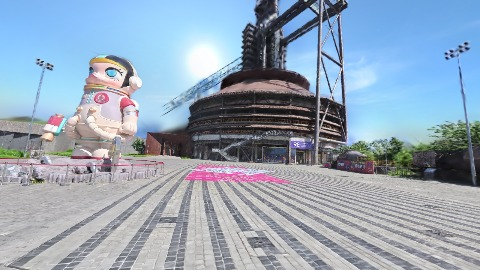

**kf-2**

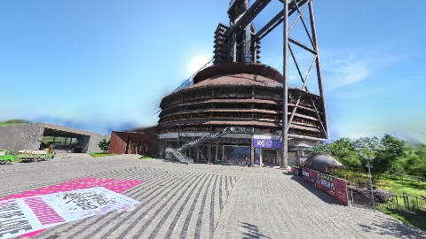

**kf-3**

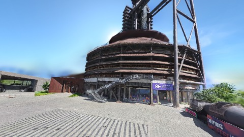

**kf-4**

**kf-5**

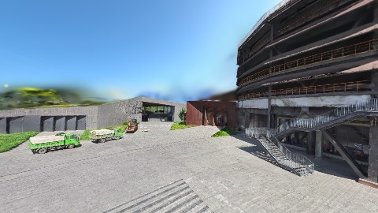

**kf-6**

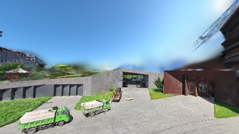

**kf-7**

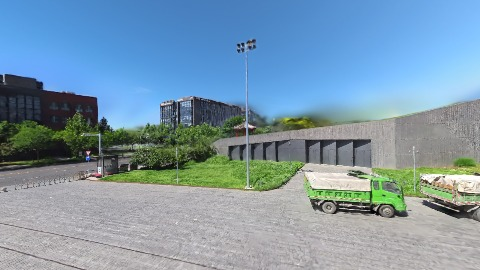

**kf-8**

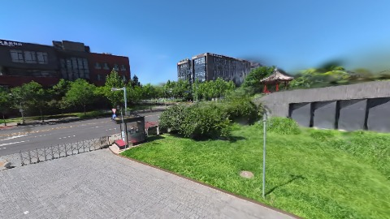

**kf-9**

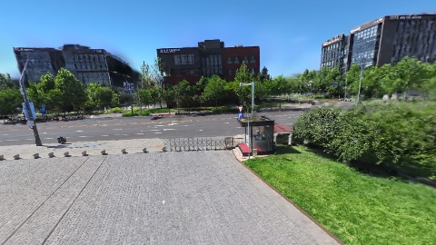

**kf-10**

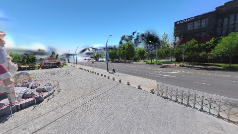

**kf-11**

**kf-12**

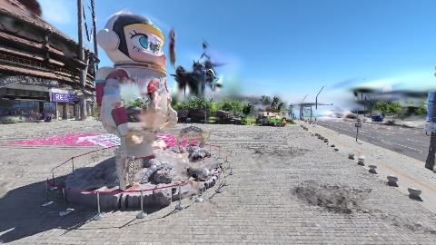

**kf-13**

**kf-14**

### v6-performance-native

播放段 FPS: P50=60.0, P95=60.0, min=59.0, 总播放=29396ms

| waypoint | animTimeSec | moveMs | pendingPeak | blurToClearMs | fpsP50(refine) | fpsP95(refine) | fpsMin | gsplatsAtClearM | jsHeap@clear | vram@clear | jsHeapPeak | vramPeak | timeout |
|----------|-------------|--------|-------------|---------------|----------------|----------------|--------|-----------------|--------------|------------|------------|----------|---------|
| kf-0 | 0.00 | 0 | 27 | 31200 | 60.0 | 60.0 | 55.0 | 3.78 | 311 | 299 | 311 | 299 | N |
| kf-1 | 2.13 | 2098 | 8 | - | 60.0 | 60.0 | 59.0 | - | - | - | 306 | 299 | Y |
| kf-2 | 4.30 | 2134 | 5 | - | 60.0 | 60.0 | 59.0 | - | - | - | 303 | 299 | Y |
| kf-3 | 6.43 | 2100 | 8 | - | 60.0 | 60.0 | 59.0 | - | - | - | 302 | 299 | Y |
| kf-4 | 8.57 | 2100 | 12 | 6401 | 60.0 | 60.0 | 59.0 | 2.43 | 178 | 215 | 345 | 314 | N |
| kf-5 | 10.70 | 2100 | 2 | 1201 | 60.0 | 60.0 | 59.0 | 2.71 | 218 | 238 | 225 | 238 | N |
| kf-6 | 12.87 | 2117 | 2 | 1400 | 60.0 | 60.0 | 60.0 | 2.08 | 243 | 222 | 256 | 251 | N |
| kf-7 | 15.00 | 2083 | 8 | - | 60.0 | 60.0 | 59.0 | - | - | - | 260 | 217 | Y |
| kf-8 | 17.13 | 2099 | 12 | - | 60.0 | 60.0 | 59.0 | - | - | - | 207 | 217 | Y |
| kf-9 | 19.30 | 2117 | 16 | 9201 | 60.0 | 60.0 | 57.0 | 2.53 | 225 | 235 | 231 | 235 | N |
| kf-10 | 21.43 | 2099 | 4 | - | 60.0 | 60.0 | 59.0 | - | - | - | 226 | 235 | Y |
| kf-11 | 23.57 | 2100 | 15 | 7401 | 60.0 | 60.0 | 59.0 | 3.32 | 274 | 276 | 282 | 276 | N |
| kf-12 | 25.70 | 2083 | 12 | - | 60.0 | 60.0 | 59.0 | - | - | - | 291 | 272 | Y |
| kf-13 | 27.87 | 2117 | 17 | - | 60.0 | 60.0 | 59.0 | - | - | - | 275 | 272 | Y |
| kf-14 | 29.97 | 2050 | 14 | - | 60.0 | 60.0 | 59.0 | - | - | - | 275 | 272 | Y |

变清晰截图（480×270 JPEG）：

**kf-0**

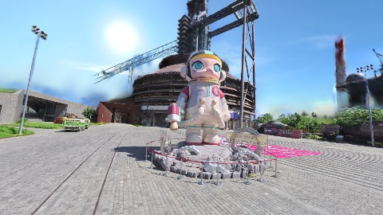

**kf-1**

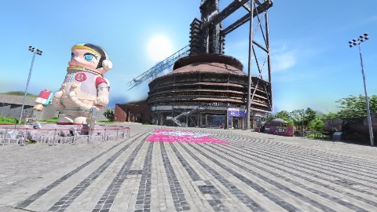

**kf-2**

**kf-3**

**kf-4**

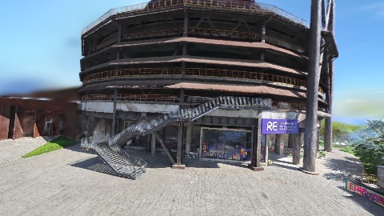

**kf-5**

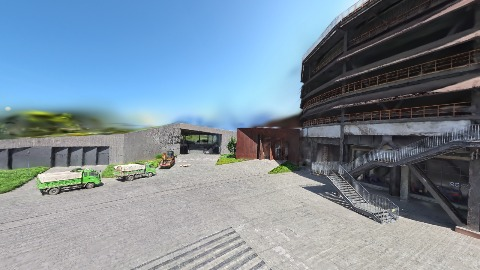

**kf-6**

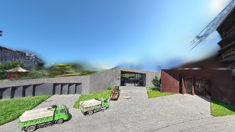

**kf-7**

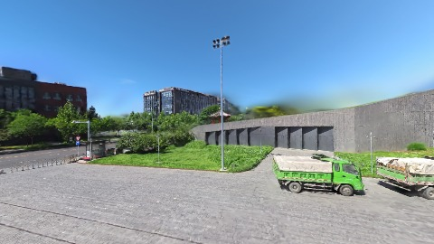

**kf-8**

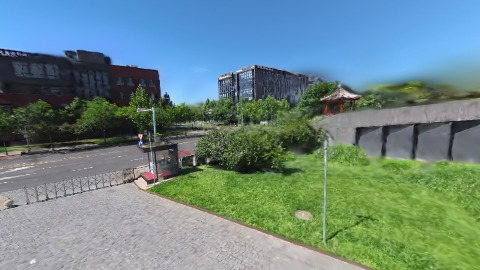

**kf-9**

**kf-10**

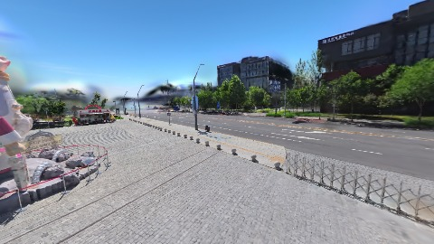

**kf-11**

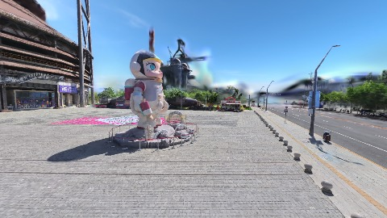

**kf-12**

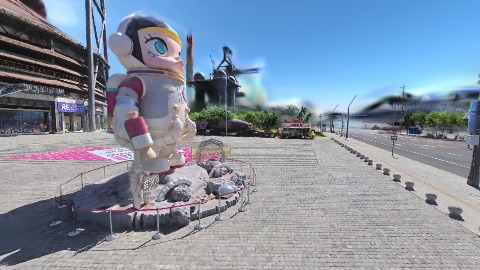

**kf-13**

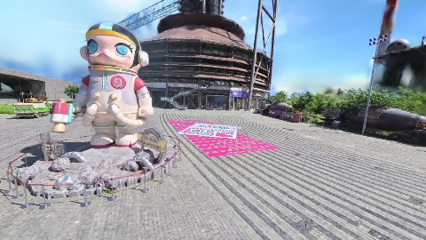

**kf-14**

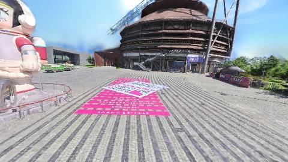

## 优化前 vs 优化后

### nanguangchang-v6（基线 `v6-performance-refinement`）

| case | lodMode | lodRuntime | firstFrameMs | kf-1 blur | kf-2 blur | blur P90 | vramPeak | poolEvictions |
|------|---------|------------|--------------|-----------|-----------|----------|----------|---------------|
| v6-performance-refinement | performance | refinement | 22981 (—) | 6602 (—) | 2210 | 3603 | 412 | 54 |
| v6-performance-native | performance | native | 1027 (-95.5%) | - (-%) | - | 31200 | 314 | - |

## 结论

- 见上方对比表；`bottleneckHint` 见 `results.json`（scheduler / asset-http / mixed）