# Scene Profile Benchmark — 2026-06-27

## 本轮维度: profile

Suite: `public/benchmark-suites/scene-nanguangchang.json`

Renderer: `webgpu`

## 运行条件

- Cold start: yes
- Browser session: fresh-chromium-per-case
- Chromium HTTP cache: disabled-cdp-clearBrowserCache-zero-disk-cache
- Cold start (default): fresh Chromium per case, HTTP cache disabled
- OS 页缓存 / GPU 编译缓存：脚本不控制，跨次运行可能仍有差异

| label | presetId | budget | lodMode | lodRuntime | firstFrameMs | jsHeap@1st | vram@1st | jsHeapPeak | vramPeak | fpsP50 | fpsP95 | gsplatsAvgM |
|-------|----------|--------|---------|------------|--------------|------------|----------|------------|----------|--------|--------|-------------|
| nanguangchang-current-profile | undefined | - | - | refinement | 13694 | 224 | 256 | 584 | 428 | 69.0 | 107.0 | 3.06 |

## 交互巡检（糊→清晰）

### nanguangchang-current-profile

播放段 FPS: P50=69.0, P95=107.0, min=47.0, 总播放=29287ms

| waypoint | animTimeSec | moveMs | pendingPeak | blurToClearMs | fpsP50(refine) | fpsP95(refine) | fpsMin | gsplatsAtClearM | jsHeap@clear | vram@clear | jsHeapPeak | vramPeak | timeout |
|----------|-------------|--------|-------------|---------------|----------------|----------------|--------|-----------------|--------------|------------|------------|----------|---------|
| kf-0 | 0.00 | 0 | 7 | 2007 | 54.0 | 64.0 | 53.0 | 2.68 | 306 | 275 | 327 | 275 | N |
| kf-1 | 2.13 | 2082 | 12 | 3803 | 56.0 | 61.0 | 54.0 | 3.18 | 400 | 311 | 405 | 313 | N |
| kf-2 | 4.30 | 2144 | 4 | 1804 | 61.0 | 61.0 | 56.0 | 3.40 | 305 | 299 | 429 | 317 | N |
| kf-3 | 6.43 | 2080 | 2 | 1006 | 59.0 | 74.0 | 59.0 | 3.04 | 279 | 292 | 490 | 303 | N |
| kf-4 | 8.57 | 2081 | 0 | 0 | 65.0 | 65.0 | 65.0 | 2.77 | 301 | 291 | 420 | 296 | N |
| kf-5 | 10.70 | 2083 | 1 | 805 | 82.0 | 82.0 | 82.0 | 3.05 | 271 | 292 | 370 | 294 | N |
| kf-6 | 12.87 | 2118 | 0 | 0 | 75.0 | 75.0 | 75.0 | 2.29 | 305 | 290 | 305 | 298 | N |
| kf-7 | 15.00 | 2101 | 7 | 2003 | 75.0 | 79.0 | 70.0 | 2.60 | 308 | 316 | 422 | 316 | N |
| kf-8 | 17.13 | 2083 | 1 | 803 | 69.0 | 69.0 | 68.0 | 2.57 | 325 | 328 | 325 | 334 | N |
| kf-9 | 19.30 | 2112 | 1 | 1000 | 74.0 | 80.0 | 74.0 | 2.97 | 377 | 342 | 384 | 342 | N |
| kf-10 | 21.43 | 2082 | 1 | 1028 | 61.0 | 68.0 | 61.0 | 3.21 | 371 | 358 | 458 | 359 | N |
| kf-11 | 23.57 | 2082 | 9 | 2001 | 50.0 | 55.0 | 49.0 | 3.40 | 457 | 385 | 468 | 388 | N |
| kf-12 | 25.70 | 2072 | 5 | 1201 | 48.0 | 53.0 | 48.0 | 3.48 | 472 | 410 | 492 | 410 | N |
| kf-13 | 27.87 | 2117 | 1 | 818 | 53.0 | 53.0 | 50.0 | 3.64 | 457 | 424 | 584 | 424 | N |
| kf-14 | 29.97 | 2051 | 0 | 0 | 48.0 | 48.0 | 48.0 | 3.64 | 488 | 427 | 488 | 427 | N |

变清晰截图（480×270 JPEG）：

**kf-0**

**kf-1**

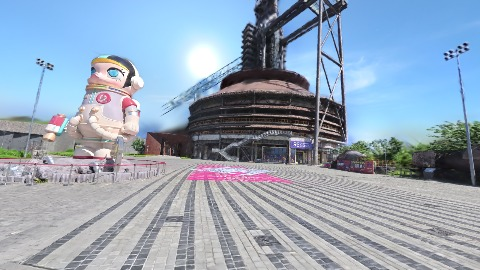

**kf-2**

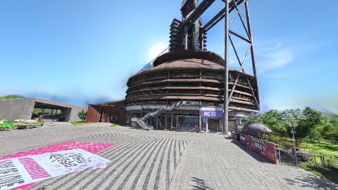

**kf-3**

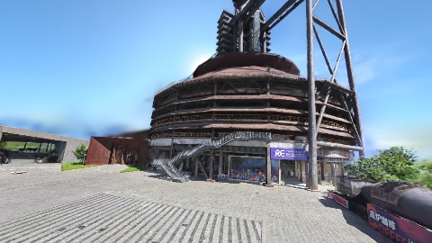

**kf-4**

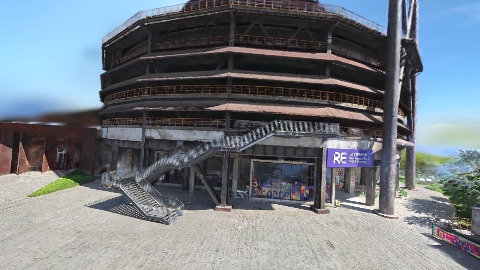

**kf-5**

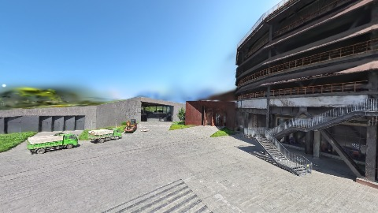

**kf-6**

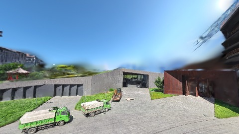

**kf-7**

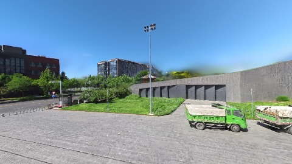

**kf-8**

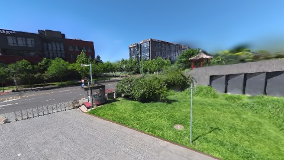

**kf-9**

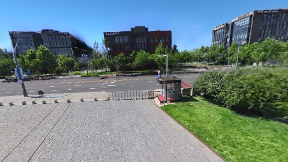

**kf-10**

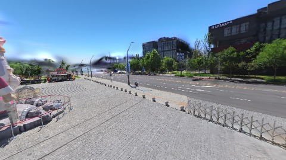

**kf-11**

**kf-12**

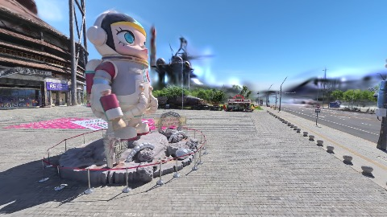

**kf-13**

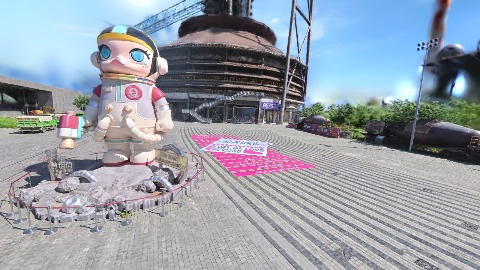

**kf-14**

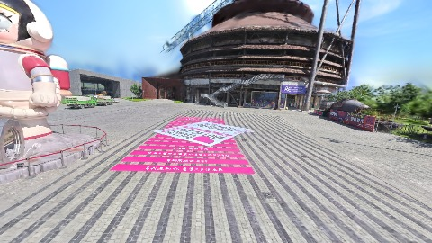

## 优化前 vs 优化后

### default（基线 `nanguangchang-current-profile`）

| case | lodMode | lodRuntime | firstFrameMs | kf-1 blur | kf-2 blur | blur P90 | vramPeak | poolEvictions |
|------|---------|------------|--------------|-----------|-----------|----------|----------|---------------|
| nanguangchang-current-profile | - | refinement | 13694 (—) | 3803 (—) | 1804 | 2007 | 428 | - |

## 结论

- 见上方对比表；`bottleneckHint` 见 `results.json`（scheduler / asset-http / mixed）