# Scene Profile Benchmark — 2026-06-28

## 本轮维度: profile

Suite: `public/benchmark-suites/scene-billions-finland.json`

Renderer: `webgpu`

## 运行条件

- Cold start: yes
- Browser session: fresh-chromium-per-case
- Chromium HTTP cache: disabled-cdp-clearBrowserCache-zero-disk-cache
- Cold start (default): fresh Chromium per case, HTTP cache disabled
- OS 页缓存 / GPU 编译缓存：脚本不控制，跨次运行可能仍有差异

| label | presetId | budget | lodMode | lodRuntime | firstFrameMs | jsHeap@1st | vram@1st | jsHeapPeak | vramPeak | fpsP50 | fpsP95 | gsplatsAvgM |
|-------|----------|--------|---------|------------|--------------|------------|----------|------------|----------|--------|--------|-------------|
| billions-finland-2p | undefined | - | - | native | 1365.9000000059605 | 261 | 66 | 699 | 250 | 86.0 | 115.0 | 2.79 |
| billions-finland-5p | undefined | - | - | native | 1613.5 | 454 | 137 | 1076 | 327 | 66.0 | 89.0 | 5.44 |
| billions-finland-10p | undefined | - | - | native | 2631.5999999940395 | 428 | 238 | 1439 | 432 | 30.0 | 83.0 | 9.69 |

## 交互巡检（糊→清晰）

### billions-finland-2p

播放段 FPS: P50=86.0, P95=115.0, min=71.0, 总播放=18615ms

| waypoint | animTimeSec | moveMs | pendingPeak | blurToClearMs | fpsP50(refine) | fpsP95(refine) | fpsMin | gsplatsAtClearM | jsHeap@clear | vram@clear | jsHeapPeak | vramPeak | timeout |
|----------|-------------|--------|-------------|---------------|----------------|----------------|--------|-----------------|--------------|------------|------------|----------|---------|
| kf-0 | 0.00 | 0 | 39 | 6178 | 79.0 | 80.0 | 77.0 | 2.36 | 510 | 143 | 510 | 143 | N |
| kf-1 | 2.10 | 2082 | 36 | 8000 | 85.0 | 89.0 | 71.0 | 2.98 | 466 | 215 | 646 | 215 | N |
| kf-2 | 4.20 | 2057 | 19 | 3800 | 83.0 | 84.0 | 76.0 | 2.95 | 391 | 203 | 658 | 207 | N |
| kf-3 | 6.30 | 2044 | 24 | 4401 | 79.0 | 86.0 | 79.0 | 2.87 | 419 | 199 | 662 | 201 | N |
| kf-4 | 8.40 | 2057 | 14 | 3200 | 77.0 | 79.0 | 76.0 | 2.76 | 652 | 191 | 654 | 206 | N |
| kf-5 | 10.50 | 2055 | 6 | 1600 | 77.0 | 86.0 | 74.0 | 2.55 | 615 | 161 | 626 | 195 | N |
| kf-6 | 12.60 | 2109 | 11 | 1801 | 77.0 | 78.0 | 77.0 | 2.51 | 290 | 174 | 612 | 183 | N |
| kf-7 | 14.70 | 2082 | 16 | 3202 | 78.0 | 81.0 | 76.0 | 2.81 | 443 | 197 | 697 | 197 | N |
| kf-8 | 16.80 | 2049 | 17 | 3601 | 75.0 | 86.0 | 71.0 | 2.99 | 399 | 220 | 653 | 220 | N |
| kf-9 | 18.90 | 2081 | 26 | 5002 | 77.0 | 83.0 | 74.0 | 3.14 | 486 | 250 | 699 | 250 | N |

变清晰截图（480×270 JPEG）：

**kf-0**

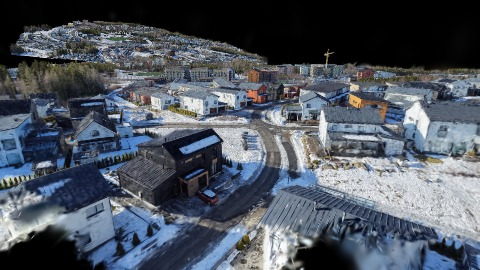

**kf-1**

**kf-2**

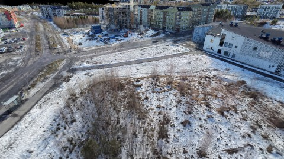

**kf-3**

**kf-4**

**kf-5**

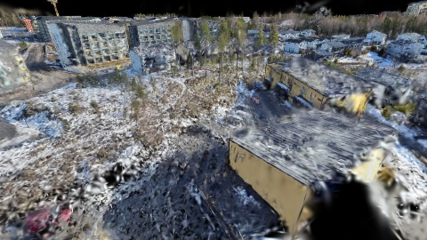

**kf-6**

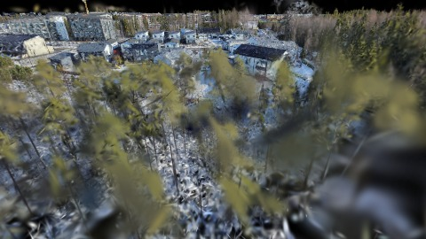

**kf-7**

**kf-8**

**kf-9**

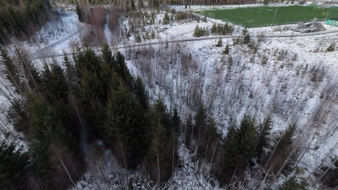

### billions-finland-5p

播放段 FPS: P50=66.0, P95=89.0, min=42.0, 总播放=22984ms

| waypoint | animTimeSec | moveMs | pendingPeak | blurToClearMs | fpsP50(refine) | fpsP95(refine) | fpsMin | gsplatsAtClearM | jsHeap@clear | vram@clear | jsHeapPeak | vramPeak | timeout |
|----------|-------------|--------|-------------|---------------|----------------|----------------|--------|-----------------|--------------|------------|------------|----------|---------|
| kf-0 | 0.00 | 0 | 69 | 12000 | 46.0 | 49.0 | 39.0 | 5.47 | 488 | 268 | 837 | 270 | N |
| kf-1 | 2.10 | 2482 | 36 | 9600 | 49.0 | 61.0 | 49.0 | 5.58 | 573 | 288 | 904 | 288 | N |
| kf-2 | 4.20 | 2403 | 17 | 3974 | 49.0 | 49.0 | 49.0 | 5.56 | 684 | 273 | 985 | 306 | N |
| kf-3 | 6.30 | 2433 | 20 | 4400 | 46.0 | 49.0 | 42.0 | 5.48 | 756 | 260 | 923 | 298 | N |
| kf-4 | 8.40 | 2587 | 12 | 2899 | 49.0 | 59.0 | 46.0 | 5.35 | 594 | 254 | 917 | 287 | N |
| kf-5 | 10.50 | 2605 | 7 | 1601 | 49.0 | 49.0 | 43.0 | 5.14 | 718 | 237 | 718 | 271 | N |
| kf-6 | 12.60 | 2729 | 9 | 1601 | 42.0 | 49.0 | 42.0 | 5.10 | 748 | 243 | 774 | 252 | N |
| kf-7 | 14.70 | 2560 | 12 | 2800 | 47.0 | 49.0 | 41.0 | 5.40 | 617 | 258 | 892 | 264 | N |
| kf-8 | 16.80 | 2612 | 18 | 3568 | 45.0 | 68.0 | 43.0 | 5.58 | 550 | 281 | 896 | 284 | N |
| kf-9 | 18.90 | 2573 | 26 | 5566 | 49.0 | 49.0 | 43.0 | 5.73 | 741 | 320 | 1076 | 327 | N |

变清晰截图（480×270 JPEG）：

**kf-0**

**kf-1**

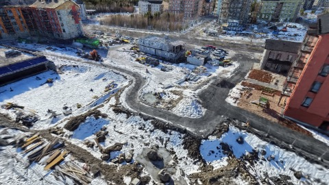

**kf-2**

**kf-3**

**kf-4**

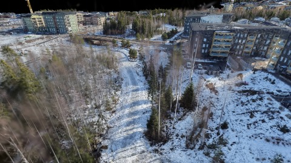

**kf-5**

**kf-6**

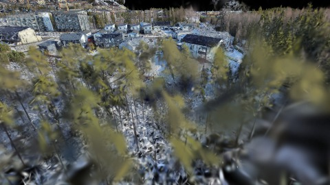

**kf-7**

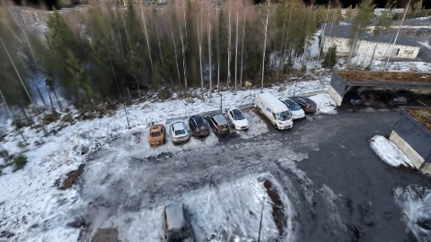

**kf-8**

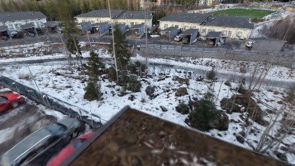

**kf-9**

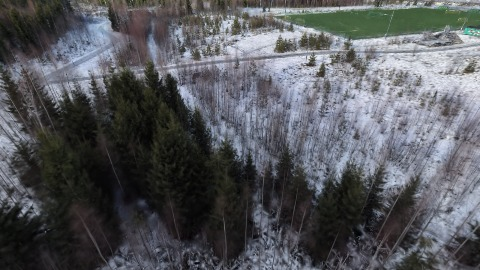

### billions-finland-10p

播放段 FPS: P50=30.0, P95=83.0, min=22.0, 总播放=33561ms

| waypoint | animTimeSec | moveMs | pendingPeak | blurToClearMs | fpsP50(refine) | fpsP95(refine) | fpsMin | gsplatsAtClearM | jsHeap@clear | vram@clear | jsHeapPeak | vramPeak | timeout |
|----------|-------------|--------|-------------|---------------|----------------|----------------|--------|-----------------|--------------|------------|------------|----------|---------|
| kf-0 | 0.00 | 0 | 69 | 14076 | 29.0 | 29.0 | 29.0 | 9.78 | 1144 | 378 | 1276 | 381 | N |
| kf-1 | 2.10 | 4231 | 29 | 10000 | 29.0 | 32.0 | 26.0 | 9.89 | 1279 | 395 | 1436 | 414 | N |
| kf-2 | 4.20 | 3677 | 14 | 3506 | 29.0 | 30.0 | 29.0 | 9.87 | 1258 | 383 | 1439 | 432 | N |
| kf-3 | 6.30 | 3720 | 17 | 4400 | 29.0 | 29.0 | 29.0 | 9.79 | 1379 | 368 | 1379 | 418 | N |
| kf-4 | 8.40 | 3880 | 13 | 4000 | 29.0 | 29.0 | 29.0 | 9.66 | 1106 | 358 | 1403 | 403 | N |
| kf-5 | 10.50 | 4185 | 0 | 0 | 29.0 | 29.0 | 29.0 | 9.45 | 1191 | 368 | 1211 | 390 | N |
| kf-6 | 12.60 | 4173 | 3 | 1201 | 29.0 | 29.0 | 29.0 | 9.41 | 486 | 354 | 1353 | 365 | N |
| kf-7 | 14.70 | 3676 | 16 | - | 79.0 | 80.0 | 30.0 | - | - | - | 1337 | 349 | Y |
| kf-8 | 16.80 | 3041 | 27 | - | 89.0 | 90.0 | 49.0 | - | - | - | 698 | 328 | Y |
| kf-9 | 18.90 | 2978 | 41 | - | 120.0 | 120.0 | 53.0 | - | - | - | 767 | 313 | Y |

变清晰截图（480×270 JPEG）：

**kf-0**

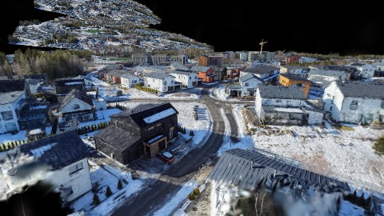

**kf-1**

**kf-2**

**kf-3**

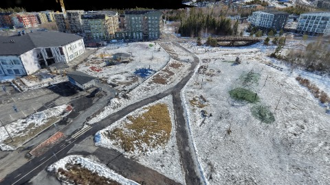

**kf-4**

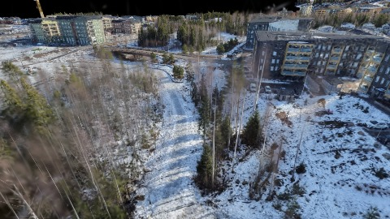

**kf-5**

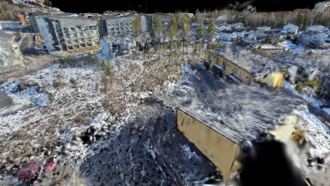

**kf-6**

**kf-7**

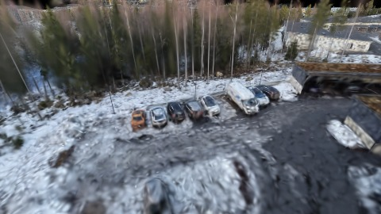

**kf-8**

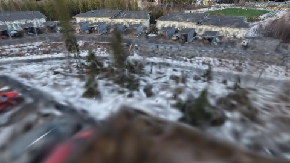

**kf-9**

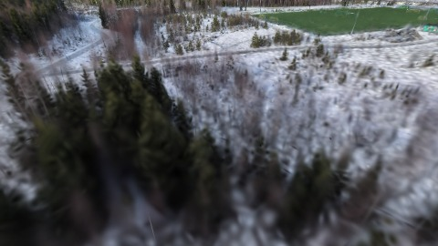

## 优化前 vs 优化后

### instances（基线 `billions-finland-2p`）

| case | lodMode | lodRuntime | firstFrameMs | kf-1 blur | kf-2 blur | blur P90 | vramPeak | poolEvictions |
|------|---------|------------|--------------|-----------|-----------|----------|----------|---------------|
| billions-finland-2p | - | native | 1366 (—) | 8000 (—) | 3800 | 8000 | 250 | - |
| billions-finland-5p | - | native | 1614 (18.1%) | 9600 (20.0%) | 3974 | 12000 | 327 | - |
| billions-finland-10p | - | native | 2632 (92.7%) | 10000 (25.0%) | 3506 | 14076 | 432 | - |

## 结论

- 见上方对比表；`bottleneckHint` 见 `results.json`（scheduler / asset-http / mixed）