# Scene Profile Benchmark — 2026-06-28

## 本轮维度: profile

Suite: `public/benchmark-suites/scene-billions-poland.json`

Renderer: `webgpu`

## 运行条件

- Cold start: yes
- Browser session: fresh-chromium-per-case
- Chromium HTTP cache: disabled-cdp-clearBrowserCache-zero-disk-cache
- Cold start (default): fresh Chromium per case, HTTP cache disabled
- OS 页缓存 / GPU 编译缓存：脚本不控制，跨次运行可能仍有差异

| label | presetId | budget | lodMode | lodRuntime | firstFrameMs | jsHeap@1st | vram@1st | jsHeapPeak | vramPeak | fpsP50 | fpsP95 | gsplatsAvgM |
|-------|----------|--------|---------|------------|--------------|------------|----------|------------|----------|--------|--------|-------------|
| billions-poland-2p | undefined | - | - | native | 4515.299999982119 | 18 | 4 | 231 | 323 | 120.0 | 120.0 | 2.58 |
| billions-poland-5p | undefined | - | - | native | 5020.299999982119 | 20 | 8 | 224 | 342 | 119.0 | 120.0 | 3.22 |
| billions-poland-10p | undefined | - | - | native | 10350.699999988079 | 18 | 15 | 229 | 346 | 119.0 | 120.0 | 3.77 |

## 交互巡检（糊→清晰）

### billions-poland-2p

播放段 FPS: P50=120.0, P95=120.0, min=119.0, 总播放=12311ms

| waypoint | animTimeSec | moveMs | pendingPeak | blurToClearMs | fpsP50(refine) | fpsP95(refine) | fpsMin | gsplatsAtClearM | jsHeap@clear | vram@clear | jsHeapPeak | vramPeak | timeout |
|----------|-------------|--------|-------------|---------------|----------------|----------------|--------|-----------------|--------------|------------|------------|----------|---------|
| kf-0 | 0.00 | 0 | 8 | 23400 | 120.0 | 120.0 | 118.0 | 2.01 | 102 | 193 | 115 | 193 | N |
| kf-1 | 2.10 | 2053 | 6 | 26199 | 120.0 | 120.0 | 119.0 | 2.97 | 173 | 302 | 196 | 302 | N |
| kf-2 | 4.20 | 2055 | 11 | 24201 | 120.0 | 120.0 | 119.0 | 3.23 | 187 | 323 | 202 | 323 | N |
| kf-3 | 6.30 | 2045 | 4 | 8400 | 120.0 | 120.0 | 119.0 | 2.74 | 201 | 308 | 231 | 308 | N |
| kf-4 | 8.40 | 2054 | 9 | 10001 | 120.0 | 120.0 | 119.0 | 2.05 | 204 | 294 | 204 | 294 | N |
| kf-5 | 10.50 | 2049 | 10 | 33601 | 120.0 | 120.0 | 119.0 | 2.62 | 132 | 274 | 179 | 284 | N |
| kf-6 | 12.60 | 2055 | 8 | 40201 | 120.0 | 120.0 | 119.0 | 2.47 | 196 | 297 | 196 | 306 | N |

变清晰截图（480×270 JPEG）：

**kf-0**

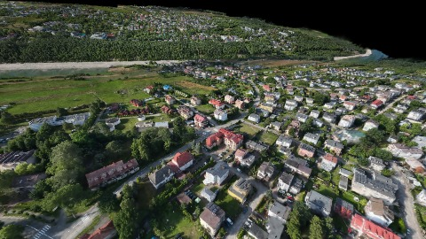

**kf-1**

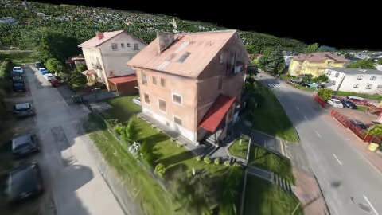

**kf-2**

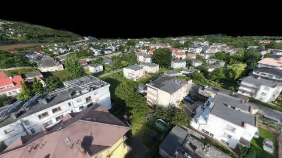

**kf-3**

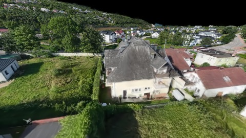

**kf-4**

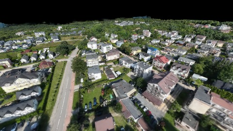

**kf-5**

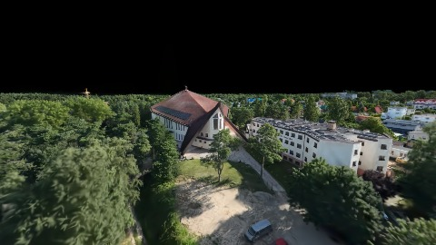

**kf-6**

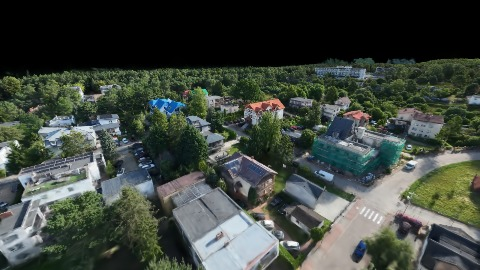

### billions-poland-5p

播放段 FPS: P50=119.0, P95=120.0, min=95.0, 总播放=12308ms

| waypoint | animTimeSec | moveMs | pendingPeak | blurToClearMs | fpsP50(refine) | fpsP95(refine) | fpsMin | gsplatsAtClearM | jsHeap@clear | vram@clear | jsHeapPeak | vramPeak | timeout |
|----------|-------------|--------|-------------|---------------|----------------|----------------|--------|-----------------|--------------|------------|------------|----------|---------|
| kf-0 | 0.00 | 0 | 11 | 36600 | 120.0 | 120.0 | 119.0 | 2.48 | 111 | 202 | 129 | 202 | N |
| kf-1 | 2.10 | 2054 | 6 | 29800 | 120.0 | 120.0 | 112.0 | 3.42 | 202 | 317 | 205 | 317 | N |
| kf-2 | 4.20 | 2044 | 7 | 16602 | 120.0 | 120.0 | 119.0 | 3.89 | 173 | 342 | 211 | 342 | N |
| kf-3 | 6.30 | 2056 | 3 | 14201 | 120.0 | 120.0 | 119.0 | 3.25 | 192 | 327 | 205 | 327 | N |
| kf-4 | 8.40 | 2053 | 7 | 12601 | 119.0 | 120.0 | 119.0 | 2.73 | 216 | 312 | 216 | 312 | N |
| kf-5 | 10.50 | 2048 | 10 | 28801 | 113.0 | 120.0 | 100.0 | 3.42 | 198 | 293 | 198 | 302 | N |
| kf-6 | 12.60 | 2053 | 9 | 19600 | 120.0 | 120.0 | 106.0 | 3.35 | 224 | 326 | 224 | 335 | N |

变清晰截图（480×270 JPEG）：

**kf-0**

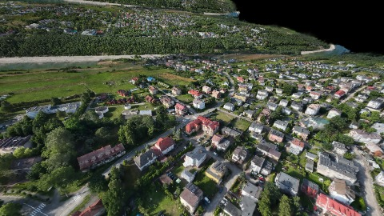

**kf-1**

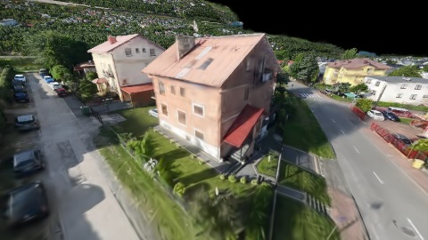

**kf-2**

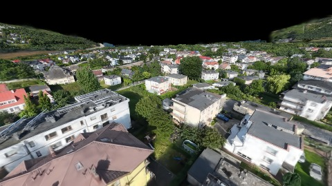

**kf-3**

**kf-4**

**kf-5**

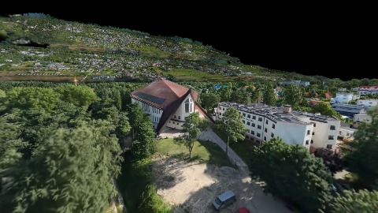

**kf-6**

### billions-poland-10p

播放段 FPS: P50=119.0, P95=120.0, min=92.0, 总播放=12309ms

| waypoint | animTimeSec | moveMs | pendingPeak | blurToClearMs | fpsP50(refine) | fpsP95(refine) | fpsMin | gsplatsAtClearM | jsHeap@clear | vram@clear | jsHeapPeak | vramPeak | timeout |
|----------|-------------|--------|-------------|---------------|----------------|----------------|--------|-----------------|--------------|------------|------------|----------|---------|
| kf-0 | 0.00 | 0 | 14 | - | 120.0 | 120.0 | 119.0 | - | - | - | 103 | 205 | Y |
| kf-1 | 2.10 | 2047 | 6 | 40001 | 120.0 | 120.0 | 114.0 | 3.90 | 219 | 320 | 219 | 322 | N |
| kf-2 | 4.20 | 2055 | 6 | 9000 | 120.0 | 120.0 | 117.0 | 4.30 | 171 | 346 | 229 | 346 | N |
| kf-3 | 6.30 | 2051 | 5 | 9000 | 120.0 | 120.0 | 119.0 | 3.73 | 178 | 331 | 207 | 331 | N |
| kf-4 | 8.40 | 2055 | 7 | 11200 | 120.0 | 120.0 | 119.0 | 3.12 | 148 | 315 | 185 | 315 | N |
| kf-5 | 10.50 | 2051 | 10 | 22203 | 108.0 | 116.0 | 93.0 | 3.83 | 158 | 296 | 200 | 306 | N |
| kf-6 | 12.60 | 2050 | 9 | 22001 | 120.0 | 120.0 | 108.0 | 3.76 | 210 | 330 | 229 | 339 | N |

变清晰截图（480×270 JPEG）：

**kf-0**

**kf-1**

**kf-2**

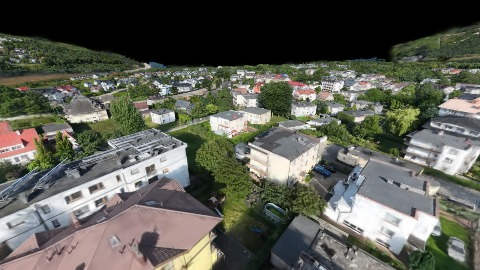

**kf-3**

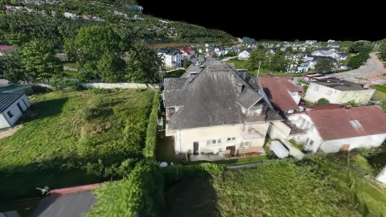

**kf-4**

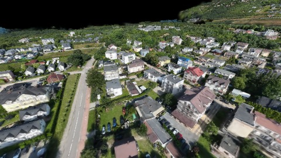

**kf-5**

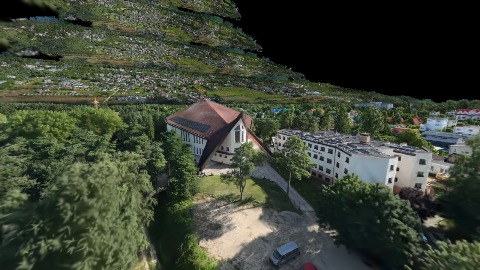

**kf-6**

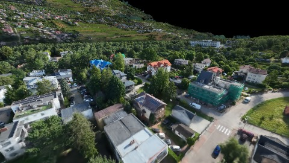

## 优化前 vs 优化后

### instances（基线 `billions-poland-2p`）

| case | lodMode | lodRuntime | firstFrameMs | kf-1 blur | kf-2 blur | blur P90 | vramPeak | poolEvictions |
|------|---------|------------|--------------|-----------|-----------|----------|----------|---------------|
| billions-poland-2p | - | native | 4515 (—) | 26199 (—) | 24201 | 40201 | 323 | - |
| billions-poland-5p | - | native | 5020 (11.2%) | 29800 (13.7%) | 16602 | 36600 | 342 | - |
| billions-poland-10p | - | native | 10351 (129.2%) | 40001 (52.7%) | 9000 | 40001 | 346 | - |

## 结论

- 见上方对比表；`bottleneckHint` 见 `results.json`（scheduler / asset-http / mixed）