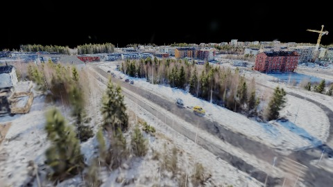
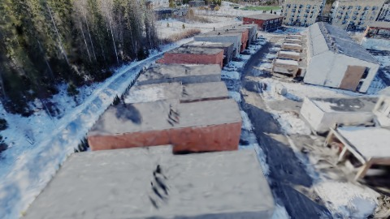
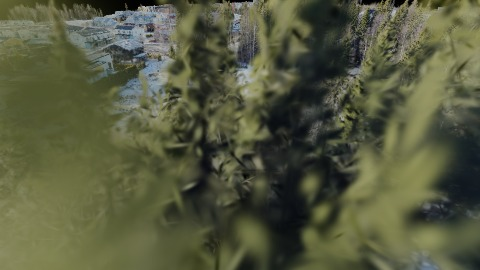
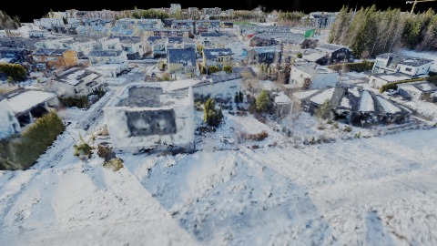
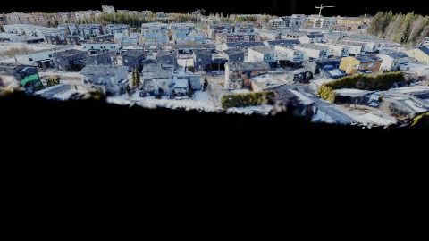
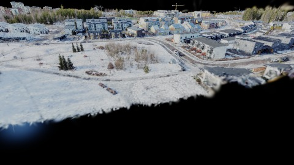
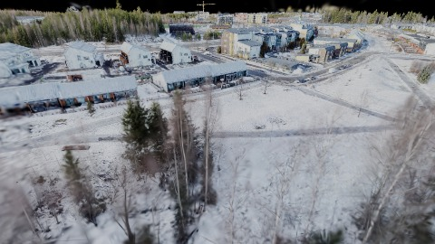
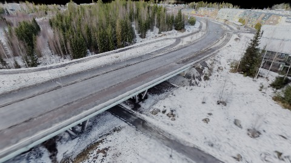
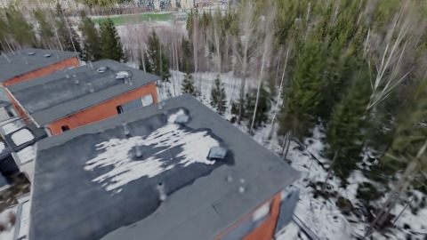
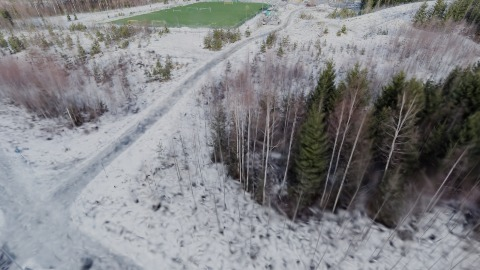

# Scene Profile Benchmark — 2026-06-28

## 本轮维度: profile

Suite: `public/benchmark-suites/scene-finland-single.json`

Renderer: `webgpu`

## 运行条件

- Cold start: yes
- Browser session: fresh-chromium-per-case
- Chromium HTTP cache: disabled-cdp-clearBrowserCache-zero-disk-cache
- Cold start (default): fresh Chromium per case, HTTP cache disabled
- OS 页缓存 / GPU 编译缓存：脚本不控制，跨次运行可能仍有差异

| label | presetId | budget | lodMode | lodRuntime | firstFrameMs | jsHeap@1st | vram@1st | jsHeapPeak | vramPeak | fpsP50 | fpsP95 | gsplatsAvgM |
|-------|----------|--------|---------|------------|--------------|------------|----------|------------|----------|--------|--------|-------------|
| finland-single-current-profile | undefined | - | - | refinement | 11603.300000011921 | 457 | 189 | 1004 | 355 | 10.0 | 19.0 | 2.11 |

## 交互巡检（糊→清晰）

### finland-single-current-profile

播放段 FPS: P50=10.0, P95=19.0, min=7.0, 总播放=22261ms

| waypoint | animTimeSec | moveMs | pendingPeak | blurToClearMs | fpsP50(refine) | fpsP95(refine) | fpsMin | gsplatsAtClearM | jsHeap@clear | vram@clear | jsHeapPeak | vramPeak | timeout |
|----------|-------------|--------|-------------|---------------|----------------|----------------|--------|-----------------|--------------|------------|------------|----------|---------|
| kf-0 | 0.00 | 0 | 3 | 1097 | 6.0 | 10.0 | 6.0 | 1.66 | 592 | 188 | 592 | 188 | N |
| kf-1 | 2.10 | 2532 | 5 | 3125 | 11.0 | 11.0 | 8.0 | 2.15 | 522 | 235 | 795 | 237 | N |
| kf-2 | 4.20 | 2373 | 4 | 2385 | 9.0 | 13.0 | 8.0 | 2.28 | 494 | 248 | 867 | 250 | N |
| kf-3 | 6.30 | 2364 | 2 | 1500 | 8.0 | 12.0 | 8.0 | 2.42 | 804 | 256 | 817 | 256 | N |
| kf-4 | 8.40 | 2531 | 1 | 1497 | 9.0 | 9.0 | 7.0 | 2.18 | 664 | 263 | 664 | 263 | N |
| kf-5 | 10.50 | 2634 | 3 | 1552 | 8.0 | 10.0 | 7.0 | 2.01 | 535 | 267 | 889 | 269 | N |
| kf-6 | 12.60 | 2639 | 3 | 3061 | 9.0 | 13.0 | 7.0 | 1.90 | 519 | 284 | 919 | 284 | N |
| kf-7 | 14.70 | 2599 | 4 | 2298 | 9.0 | 10.0 | 7.0 | 2.08 | 498 | 303 | 931 | 308 | N |
| kf-8 | 16.80 | 2486 | 2 | 3052 | 10.0 | 15.0 | 8.0 | 2.17 | 573 | 328 | 936 | 329 | N |
| kf-9 | 18.90 | 2101 | 3 | 3064 | 13.0 | 15.0 | 10.0 | 2.24 | 701 | 355 | 1004 | 355 | N |

变清晰截图（480×270 JPEG）：

**kf-0**

**kf-1**

**kf-2**

**kf-3**

**kf-4**

**kf-5**

**kf-6**

**kf-7**

**kf-8**

**kf-9**

## 优化前 vs 优化后

### default（基线 `finland-single-current-profile`）

| case | lodMode | lodRuntime | firstFrameMs | kf-1 blur | kf-2 blur | blur P90 | vramPeak | poolEvictions |
|------|---------|------------|--------------|-----------|-----------|----------|----------|---------------|
| finland-single-current-profile | - | refinement | 11603 (—) | 3125 (—) | 2385 | 3125 | 355 | - |

## 结论

- 见上方对比表；`bottleneckHint` 见 `results.json`（scheduler / asset-http / mixed）