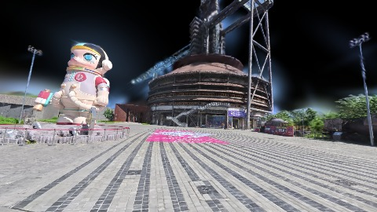
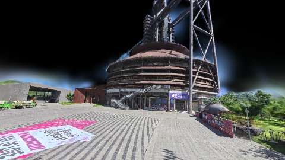
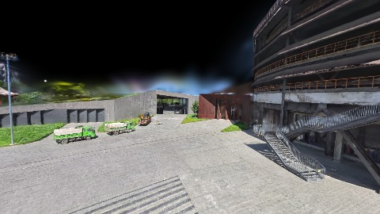
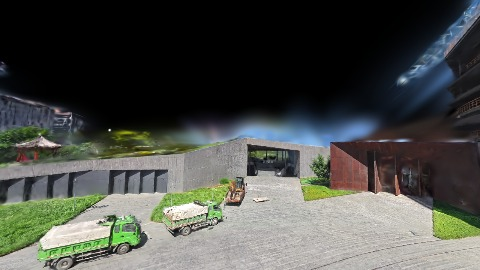
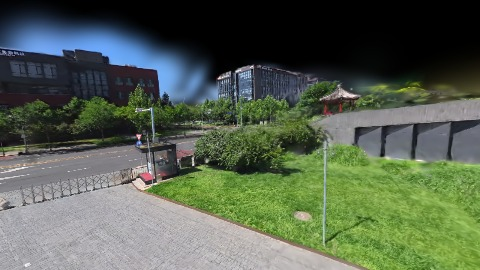
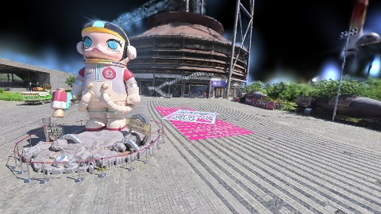
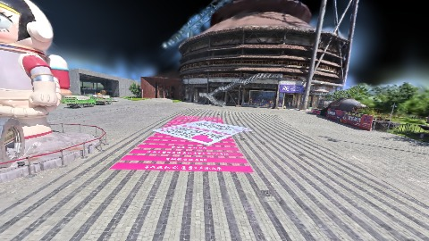

# Scene Profile Benchmark — 2026-06-28

## 本轮维度: profile

Suite: `public/benchmark-suites/scene-nanguangchang.json`

Renderer: `webgpu`

## 运行条件

- Cold start: yes
- Browser session: fresh-chromium-per-case
- Chromium HTTP cache: disabled-cdp-clearBrowserCache-zero-disk-cache
- Cold start (default): fresh Chromium per case, HTTP cache disabled
- OS 页缓存 / GPU 编译缓存：脚本不控制，跨次运行可能仍有差异

| label | presetId | budget | lodMode | lodRuntime | firstFrameMs | jsHeap@1st | vram@1st | jsHeapPeak | vramPeak | fpsP50 | fpsP95 | gsplatsAvgM |
|-------|----------|--------|---------|------------|--------------|------------|----------|------------|----------|--------|--------|-------------|
| nanguangchang-current-profile | undefined | - | - | refinement | 5256.600000023842 | 323 | 253 | 730 | 501 | 69.0 | 100.0 | 3.13 |

## 交互巡检（糊→清晰）

### nanguangchang-current-profile

播放段 FPS: P50=69.0, P95=100.0, min=46.0, 总播放=29588ms

| waypoint | animTimeSec | moveMs | pendingPeak | blurToClearMs | fpsP50(refine) | fpsP95(refine) | fpsMin | gsplatsAtClearM | jsHeap@clear | vram@clear | jsHeapPeak | vramPeak | timeout |
|----------|-------------|--------|-------------|---------------|----------------|----------------|--------|-----------------|--------------|------------|------------|----------|---------|
| kf-0 | 0.00 | 0 | 4 | 1208 | 44.0 | 57.0 | 44.0 | 2.67 | 413 | 257 | 413 | 257 | N |
| kf-1 | 2.13 | 2103 | 8 | 1401 | 54.0 | 54.0 | 52.0 | 3.27 | 376 | 315 | 383 | 315 | N |
| kf-2 | 4.30 | 2129 | 1 | 812 | 52.0 | 57.0 | 52.0 | 3.40 | 335 | 316 | 470 | 329 | N |
| kf-3 | 5.57 | 1216 | 12 | 1401 | 70.0 | 70.0 | 57.0 | 2.99 | 394 | 327 | 484 | 343 | N |
| kf-4 | 6.87 | 1256 | 6 | 1605 | 62.0 | 79.0 | 62.0 | 3.35 | 413 | 384 | 489 | 386 | N |
| kf-5 | 8.57 | 1644 | 5 | 1001 | 56.0 | 86.0 | 56.0 | 3.23 | 451 | 417 | 568 | 421 | N |
| kf-6 | 12.87 | 4258 | 0 | 0 | 88.0 | 88.0 | 74.0 | 2.44 | 541 | 413 | 541 | 415 | N |
| kf-7 | 17.13 | 4233 | 1 | 803 | 69.0 | 92.0 | 69.0 | 2.53 | 546 | 442 | 546 | 444 | N |
| kf-8 | 27.87 | 10697 | 1 | 1213 | 51.0 | 53.0 | 50.0 | 3.63 | 560 | 491 | 657 | 493 | N |
| kf-9 | 29.97 | 2052 | 0 | 0 | 46.0 | 46.0 | 46.0 | 3.79 | 563 | 499 | 713 | 499 | N |

变清晰截图（480×270 JPEG）：

**kf-0**

**kf-1**

**kf-2**

**kf-3**

**kf-4**

**kf-5**

**kf-6**

**kf-7**

**kf-8**

**kf-9**

## 优化前 vs 优化后

### default（基线 `nanguangchang-current-profile`）

| case | lodMode | lodRuntime | firstFrameMs | kf-1 blur | kf-2 blur | blur P90 | vramPeak | poolEvictions |
|------|---------|------------|--------------|-----------|-----------|----------|----------|---------------|
| nanguangchang-current-profile | - | refinement | 5257 (—) | 1401 (—) | 812 | 1605 | 501 | - |

## 结论

- 见上方对比表；`bottleneckHint` 见 `results.json`（scheduler / asset-http / mixed）