# Scene Profile Benchmark — 2026-06-29

## 本轮维度: profile

Suite: `public/benchmark-suites/scene-billions-poland-1p5p10p.json`

Renderer: `webgpu`

## 运行条件

- Cold start: yes
- Browser session: fresh-chromium-per-case
- Chromium HTTP cache: disabled-cdp-clearBrowserCache-zero-disk-cache
- Cold start (default): fresh Chromium per case, HTTP cache disabled
- OS 页缓存 / GPU 编译缓存：脚本不控制，跨次运行可能仍有差异

| label | presetId | budget | lodMode | lodRuntime | firstFrameMs | jsHeap@1st | vram@1st | jsHeapPeak | vramPeak | fpsP50 | fpsP95 | gsplatsAvgM |
|-------|----------|--------|---------|------------|--------------|------------|----------|------------|----------|--------|--------|-------------|
| billions-poland-1p | undefined | - | - | native | 358.3999999985099 | 16 | 2 | 356 | 301 | 60.0 | 60.0 | 2.16 |
| billions-poland-5p | undefined | - | - | native | 361.30000000074506 | 20 | 8 | 296 | 250 | 60.0 | 60.0 | 2.27 |
| billions-poland-10p | undefined | - | - | native | 189.89999999850988 | 20 | 15 | 381 | 335 | 60.0 | 60.0 | 3.18 |

## 交互巡检（糊→清晰）

### billions-poland-1p

播放段 FPS: P50=60.0, P95=60.0, min=59.0, 总播放=12299ms

| waypoint | animTimeSec | moveMs | pendingPeak | blurToClearMs | fpsP50(refine) | fpsP95(refine) | fpsMin | gsplatsAtClearM | jsHeap@clear | vram@clear | jsHeapPeak | vramPeak | timeout |
|----------|-------------|--------|-------------|---------------|----------------|----------------|--------|-----------------|--------------|------------|------------|----------|---------|
| kf-0 | 0.00 | 0 | 7 | 27001 | 60.0 | 60.0 | 59.0 | 1.48 | 182 | 178 | 211 | 178 | N |
| kf-1 | 2.10 | 2034 | 6 | 34001 | 60.0 | 60.0 | 59.0 | 2.33 | 342 | 271 | 352 | 271 | N |
| kf-2 | 4.20 | 2063 | 8 | 14201 | 60.0 | 60.0 | 59.0 | 2.78 | 304 | 301 | 340 | 301 | N |
| kf-3 | 6.30 | 2034 | 4 | 11800 | 60.0 | 60.0 | 59.0 | 2.10 | 295 | 270 | 356 | 289 | N |
| kf-4 | 8.40 | 2053 | 8 | 18201 | 60.0 | 60.0 | 59.0 | 1.72 | 279 | 281 | 314 | 281 | N |
| kf-5 | 10.50 | 2050 | 9 | 27401 | 60.0 | 60.0 | 59.0 | 2.43 | 289 | 260 | 344 | 281 | N |
| kf-6 | 12.60 | 2065 | 7 | 26000 | 60.0 | 60.0 | 59.0 | 2.26 | 272 | 283 | 335 | 293 | N |

变清晰截图（480×270 JPEG）：

**kf-0**

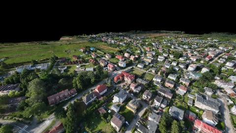

**kf-1**

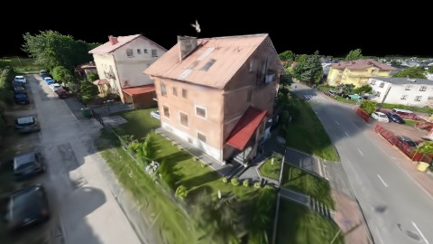

**kf-2**

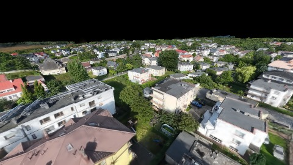

**kf-3**

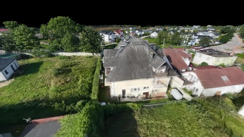

**kf-4**

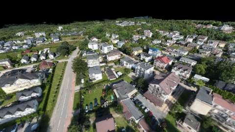

**kf-5**

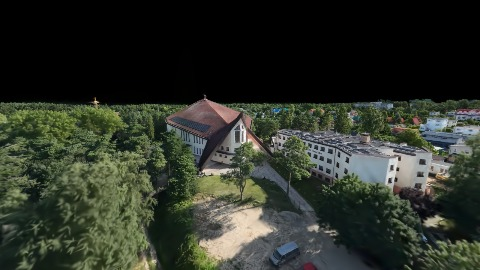

**kf-6**

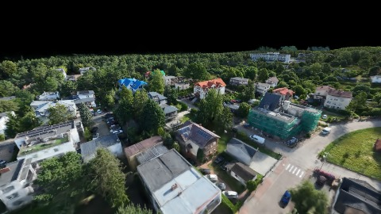

### billions-poland-5p

播放段 FPS: P50=60.0, P95=60.0, min=59.0, 总播放=12285ms

| waypoint | animTimeSec | moveMs | pendingPeak | blurToClearMs | fpsP50(refine) | fpsP95(refine) | fpsMin | gsplatsAtClearM | jsHeap@clear | vram@clear | jsHeapPeak | vramPeak | timeout |
|----------|-------------|--------|-------------|---------------|----------------|----------------|--------|-----------------|--------------|------------|------------|----------|---------|
| kf-0 | 0.00 | 0 | 11 | 27201 | 60.0 | 60.0 | 59.0 | 2.48 | 207 | 202 | 215 | 202 | N |
| kf-1 | 2.10 | 2037 | 4 | 4201 | 60.0 | 60.0 | 60.0 | 2.29 | 231 | 223 | 249 | 223 | N |
| kf-2 | 4.20 | 2048 | 4 | 3801 | 60.0 | 60.0 | 59.0 | 2.30 | 248 | 244 | 274 | 244 | N |
| kf-3 | 6.30 | 2035 | 2 | 4601 | 59.0 | 60.0 | 59.0 | 2.45 | 235 | 239 | 296 | 239 | N |
| kf-4 | 8.40 | 2053 | 3 | 2601 | 60.0 | 60.0 | 60.0 | 1.93 | 208 | 208 | 264 | 208 | N |
| kf-5 | 10.50 | 2057 | 5 | 5400 | 60.0 | 60.0 | 59.0 | 2.10 | 257 | 241 | 287 | 250 | N |
| kf-6 | 12.60 | 2056 | 6 | 10200 | 60.0 | 60.0 | 59.0 | 2.32 | 247 | 240 | 271 | 240 | N |

变清晰截图（480×270 JPEG）：

**kf-0**

**kf-1**

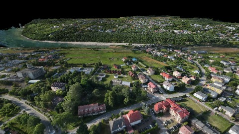

**kf-2**

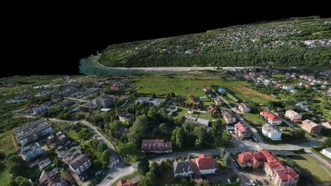

**kf-3**

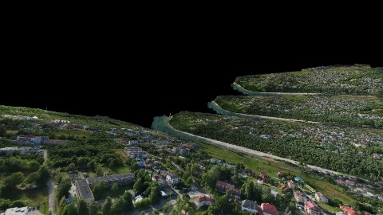

**kf-4**

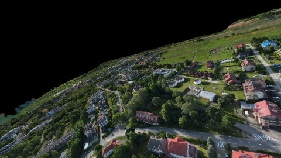

**kf-5**

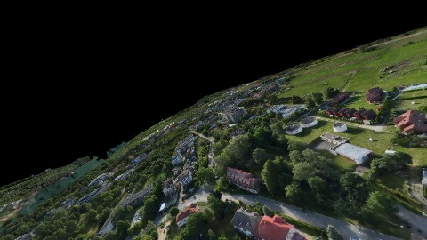

**kf-6**

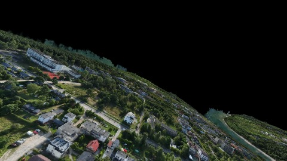

### billions-poland-10p

播放段 FPS: P50=60.0, P95=60.0, min=59.0, 总播放=12309ms

| waypoint | animTimeSec | moveMs | pendingPeak | blurToClearMs | fpsP50(refine) | fpsP95(refine) | fpsMin | gsplatsAtClearM | jsHeap@clear | vram@clear | jsHeapPeak | vramPeak | timeout |
|----------|-------------|--------|-------------|---------------|----------------|----------------|--------|-----------------|--------------|------------|------------|----------|---------|
| kf-0 | 0.00 | 0 | 14 | 27200 | 60.0 | 60.0 | 59.0 | 2.95 | 193 | 215 | 208 | 215 | N |
| kf-1 | 2.10 | 2045 | 7 | 8401 | 60.0 | 60.0 | 59.0 | 2.80 | 260 | 246 | 281 | 257 | N |
| kf-2 | 4.20 | 2035 | 5 | 2601 | 60.0 | 60.0 | 59.0 | 2.93 | 278 | 235 | 284 | 235 | N |
| kf-3 | 6.30 | 2048 | 11 | 17801 | 60.0 | 60.0 | 59.0 | 2.98 | 310 | 273 | 330 | 293 | N |
| kf-4 | 8.40 | 2051 | 5 | 35800 | 60.0 | 60.0 | 59.0 | 3.62 | 304 | 326 | 357 | 335 | N |
| kf-5 | 10.50 | 2066 | 15 | 31601 | 60.0 | 60.0 | 59.0 | 3.75 | 376 | 330 | 376 | 330 | N |
| kf-6 | 12.60 | 2064 | 10 | 33001 | 60.0 | 60.0 | 59.0 | 3.22 | 300 | 298 | 381 | 298 | N |

变清晰截图（480×270 JPEG）：

**kf-0**

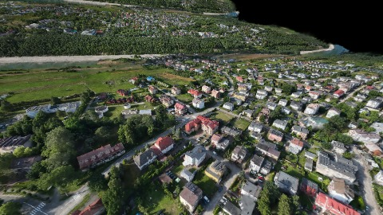

**kf-1**

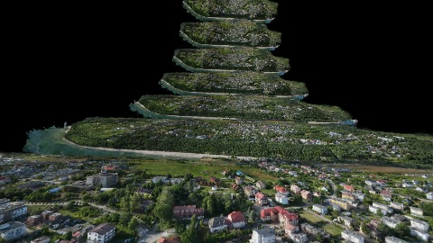

**kf-2**

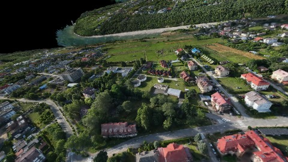

**kf-3**

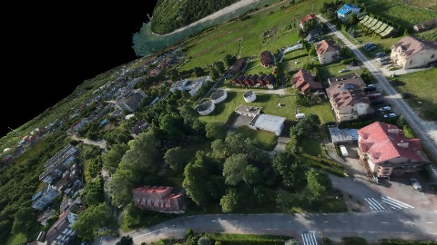

**kf-4**

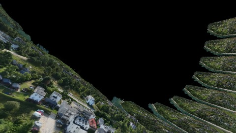

**kf-5**

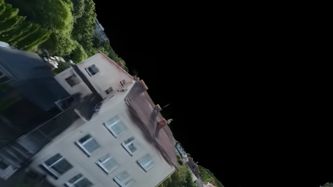

**kf-6**

## 优化前 vs 优化后

### instances（基线 `billions-poland-1p`）

| case | lodMode | lodRuntime | firstFrameMs | kf-1 blur | kf-2 blur | blur P90 | vramPeak | poolEvictions |
|------|---------|------------|--------------|-----------|-----------|----------|----------|---------------|
| billions-poland-1p | - | native | 358 (—) | 34001 (—) | 14201 | 34001 | 301 | - |
| billions-poland-5p | - | native | 361 (0.8%) | 4201 (-87.6%) | 3801 | 27201 | 250 | - |
| billions-poland-10p | - | native | 190 (-47.0%) | 8401 (-75.3%) | 2601 | 35800 | 335 | - |

## 结论

- 见上方对比表；`bottleneckHint` 见 `results.json`（scheduler / asset-http / mixed）