# Scene Profile Benchmark — 2026-06-29

## 本轮维度: profile

Suite: `public/benchmark-suites/scene-nanguangchang-native-refine-compare.json`

Renderer: `webgpu`

## 运行条件

- Cold start: yes
- Browser session: fresh-chromium-per-case
- Chromium HTTP cache: disabled-cdp-clearBrowserCache-zero-disk-cache
- Cold start (default): fresh Chromium per case, HTTP cache disabled
- OS 页缓存 / GPU 编译缓存：脚本不控制，跨次运行可能仍有差异

| label | presetId | budget | lodMode | lodRuntime | firstFrameMs | jsHeap@1st | vram@1st | jsHeapPeak | vramPeak | fpsP50 | fpsP95 | gsplatsAvgM |
|-------|----------|--------|---------|------------|--------------|------------|----------|------------|----------|--------|--------|-------------|
| v6-performance-native | undefined | - | - | native | 1045.2000000029802 | 95 | 125 | 343 | 318 | 60.0 | 60.0 | 3.24 |
| v6-performance-refinement | undefined | - | - | refinement | 26352.19999999553 | 273 | 250 | 645 | 462 | 59.0 | 60.0 | 3.09 |

## 交互巡检（糊→清晰）

### v6-performance-native

播放段 FPS: P50=60.0, P95=60.0, min=59.0, 总播放=29593ms

| waypoint | animTimeSec | moveMs | pendingPeak | blurToClearMs | fpsP50(refine) | fpsP95(refine) | fpsMin | gsplatsAtClearM | jsHeap@clear | vram@clear | jsHeapPeak | vramPeak | timeout |
|----------|-------------|--------|-------------|---------------|----------------|----------------|--------|-----------------|--------------|------------|------------|----------|---------|
| kf-0 | 0.00 | 0 | 186 | 35801 | 60.0 | 60.0 | 53.0 | 3.78 | 301 | 306 | 316 | 306 | N |
| kf-1 | 2.13 | 2082 | 0 | 0 | 60.0 | 60.0 | 60.0 | 3.78 | 286 | 304 | 286 | 304 | N |
| kf-2 | 4.30 | 2117 | 0 | 0 | 60.0 | 60.0 | 60.0 | 3.78 | 301 | 304 | 301 | 304 | N |
| kf-3 | 5.57 | 1217 | 79 | 15600 | 60.0 | 60.0 | 59.0 | 2.44 | 281 | 276 | 343 | 318 | N |
| kf-4 | 6.87 | 1266 | 0 | 0 | 60.0 | 60.0 | 60.0 | 2.44 | 243 | 274 | 243 | 274 | N |
| kf-5 | 8.57 | 1649 | 44 | 8000 | 60.0 | 60.0 | 59.0 | 2.91 | 237 | 256 | 313 | 289 | N |
| kf-6 | 12.87 | 4266 | 0 | 0 | 60.0 | 60.0 | 60.0 | 2.91 | 228 | 256 | 228 | 256 | N |
| kf-7 | 17.13 | 4232 | 0 | 0 | 60.0 | 60.0 | 60.0 | 2.91 | 214 | 256 | 215 | 256 | N |
| kf-8 | 27.87 | 10699 | 95 | 19200 | 60.0 | 60.0 | 59.0 | 3.74 | 306 | 300 | 312 | 303 | N |
| kf-9 | 29.97 | 2066 | 0 | 0 | 60.0 | 60.0 | 60.0 | 3.74 | 268 | 298 | 268 | 298 | N |

变清晰截图（480×270 JPEG）：

**kf-0**

**kf-1**

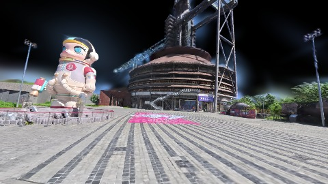

**kf-2**

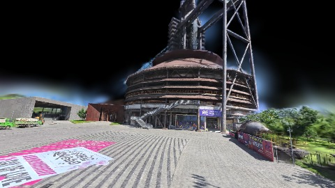

**kf-3**

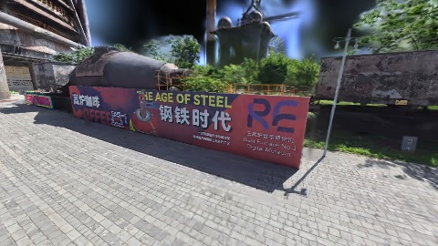

**kf-4**

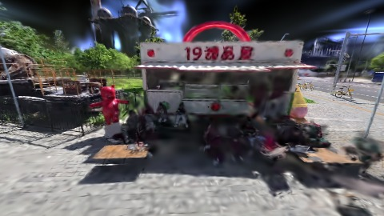

**kf-5**

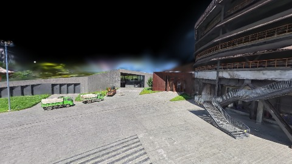

**kf-6**

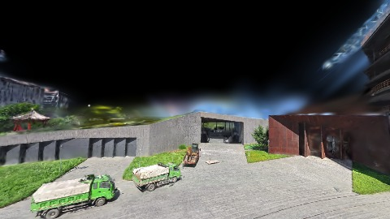

**kf-7**

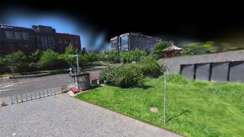

**kf-8**

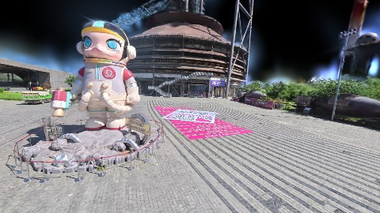

**kf-9**

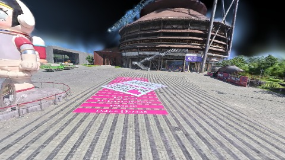

### v6-performance-refinement

播放段 FPS: P50=59.0, P95=60.0, min=46.0, 总播放=29600ms

| waypoint | animTimeSec | moveMs | pendingPeak | blurToClearMs | fpsP50(refine) | fpsP95(refine) | fpsMin | gsplatsAtClearM | jsHeap@clear | vram@clear | jsHeapPeak | vramPeak | timeout |
|----------|-------------|--------|-------------|---------------|----------------|----------------|--------|-----------------|--------------|------------|------------|----------|---------|
| kf-0 | 0.00 | 0 | 6 | 1403 | 48.0 | 60.0 | 48.0 | 2.68 | 255 | 261 | 341 | 262 | N |
| kf-1 | 2.13 | 2102 | 13 | 7399 | 58.0 | 60.0 | 54.0 | 3.21 | 333 | 304 | 460 | 306 | N |
| kf-2 | 4.30 | 2139 | 4 | 2811 | 58.0 | 58.0 | 54.0 | 3.44 | 313 | 289 | 495 | 307 | N |
| kf-3 | 5.57 | 1220 | 17 | 9201 | 60.0 | 60.0 | 59.0 | 3.04 | 393 | 310 | 444 | 312 | N |
| kf-4 | 6.87 | 1258 | 8 | 5801 | 60.0 | 60.0 | 59.0 | 3.14 | 457 | 355 | 502 | 355 | N |
| kf-5 | 8.57 | 1644 | 10 | 5202 | 60.0 | 60.0 | 58.0 | 3.23 | 475 | 375 | 556 | 375 | N |
| kf-6 | 12.87 | 4258 | 0 | 0 | 60.0 | 60.0 | 60.0 | 2.39 | 498 | 373 | 498 | 375 | N |
| kf-7 | 17.13 | 4227 | 3 | 1801 | 60.0 | 60.0 | 60.0 | 2.57 | 560 | 403 | 560 | 403 | N |
| kf-8 | 27.87 | 10706 | 7 | 3606 | 55.0 | 57.0 | 53.0 | 3.45 | 525 | 452 | 611 | 452 | N |
| kf-9 | 29.97 | 2046 | 0 | 0 | 46.0 | 46.0 | 46.0 | 3.70 | 544 | 460 | 544 | 460 | N |

变清晰截图（480×270 JPEG）：

**kf-0**

**kf-1**

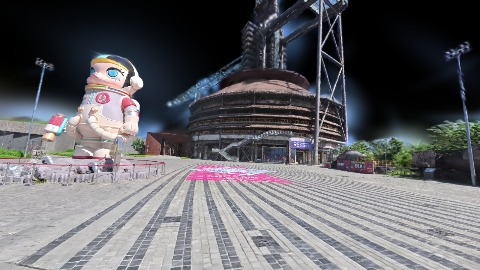

**kf-2**

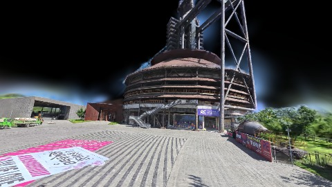

**kf-3**

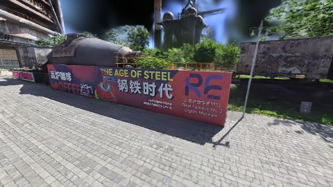

**kf-4**

**kf-5**

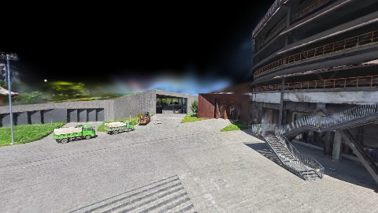

**kf-6**

**kf-7**

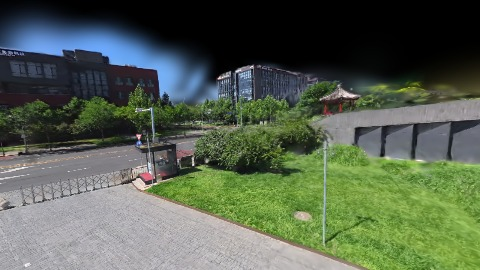

**kf-8**

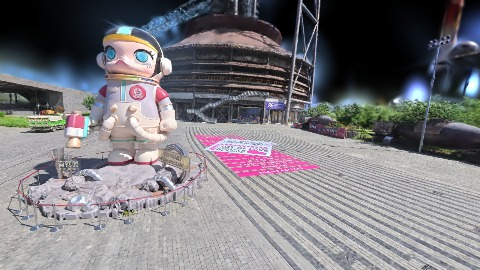

**kf-9**

## 优化前 vs 优化后

### nanguangchang-v6（基线 `v6-performance-native`）

| case | lodMode | lodRuntime | firstFrameMs | kf-1 blur | kf-2 blur | blur P90 | vramPeak | poolEvictions |
|------|---------|------------|--------------|-----------|-----------|----------|----------|---------------|
| v6-performance-native | - | native | 1045 (—) | 0 (—) | 0 | 35801 | 318 | - |
| v6-performance-refinement | - | refinement | 26352 (2421.3%) | 7399 (-%) | 2811 | 9201 | 462 | - |

## 结论

- 见上方对比表；`bottleneckHint` 见 `results.json`（scheduler / asset-http / mixed）