# Scene Profile Benchmark — 2026-06-29

## 本轮维度: profile

Suite: `public/benchmark-suites/scene-poland-mainline.json`

Renderer: `webgpu`

## 运行条件

- Cold start: yes
- Browser session: fresh-chromium-per-case
- Chromium HTTP cache: disabled-cdp-clearBrowserCache-zero-disk-cache
- Cold start (default): fresh Chromium per case, HTTP cache disabled
- OS 页缓存 / GPU 编译缓存：脚本不控制，跨次运行可能仍有差异

| label | presetId | budget | lodMode | lodRuntime | firstFrameMs | jsHeap@1st | vram@1st | jsHeapPeak | vramPeak | fpsP50 | fpsP95 | gsplatsAvgM |
|-------|----------|--------|---------|------------|--------------|------------|----------|------------|----------|--------|--------|-------------|
| poland-v1 | undefined | - | - | refinement | 31422.39999999851 | 1737 | 177 | 2785 | 325 | 2.0 | 4.0 | 1.54 |
| poland-v2 | undefined | - | - | refinement | 28905.5 | 258 | 269 | 517 | 473 | 60.0 | 60.0 | 2.72 |

## 交互巡检（糊→清晰）

### poland-v1

播放段 FPS: P50=2.0, P95=4.0, min=2.0, 总播放=34383ms

| waypoint | animTimeSec | moveMs | pendingPeak | blurToClearMs | fpsP50(refine) | fpsP95(refine) | fpsMin | gsplatsAtClearM | jsHeap@clear | vram@clear | jsHeapPeak | vramPeak | timeout |
|----------|-------------|--------|-------------|---------------|----------------|----------------|--------|-----------------|--------------|------------|------------|----------|---------|
| kf-0 | 0.00 | 0 | 3 | 8397 | 4.0 | 4.0 | 3.0 | 1.14 | 1043 | 192 | 2245 | 193 | N |
| kf-1 | 2.10 | 5932 | 6 | 3670 | 4.0 | 4.0 | 3.0 | 1.30 | 2120 | 214 | 2120 | 214 | N |
| kf-2 | 4.20 | 7165 | 6 | 3626 | 3.0 | 3.0 | 2.0 | 1.39 | 1239 | 256 | 1239 | 256 | N |
| kf-3 | 6.30 | 7372 | 8 | 5061 | 3.0 | 4.0 | 2.0 | 1.54 | 2425 | 292 | 2425 | 295 | N |
| kf-4 | 8.40 | 7243 | 5 | 3421 | 3.0 | 4.0 | 2.0 | 1.63 | 1793 | 318 | 1793 | 320 | N |
| kf-5 | 10.50 | 6672 | 0 | 0 | 3.0 | 3.0 | 3.0 | 2.27 | 2625 | 324 | 2625 | 324 | N |

变清晰截图（480×270 JPEG）：

**kf-0**

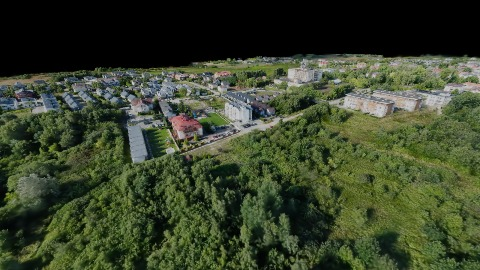

**kf-1**

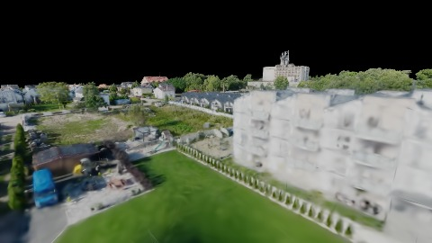

**kf-2**

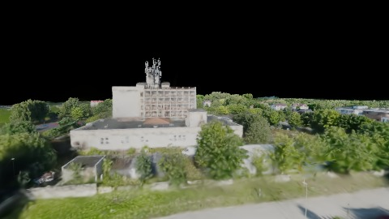

**kf-3**

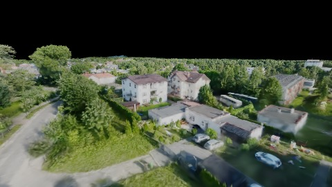

**kf-4**

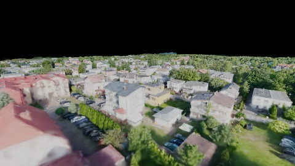

**kf-5**

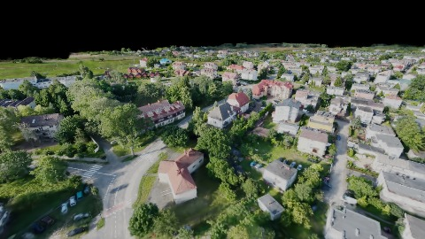

### poland-v2

播放段 FPS: P50=60.0, P95=60.0, min=59.0, 总播放=10293ms

| waypoint | animTimeSec | moveMs | pendingPeak | blurToClearMs | fpsP50(refine) | fpsP95(refine) | fpsMin | gsplatsAtClearM | jsHeap@clear | vram@clear | jsHeapPeak | vramPeak | timeout |
|----------|-------------|--------|-------------|---------------|----------------|----------------|--------|-----------------|--------------|------------|------------|----------|---------|
| kf-0 | 0.00 | 0 | 0 | 0 | 60.0 | 60.0 | 60.0 | 1.68 | 225 | 269 | 258 | 269 | N |
| kf-1 | 2.10 | 2066 | 4 | 9800 | 60.0 | 60.0 | 59.0 | 2.66 | 325 | 336 | 340 | 336 | N |
| kf-2 | 4.20 | 2065 | 1 | 9401 | 60.0 | 60.0 | 59.0 | 3.18 | 364 | 375 | 379 | 375 | N |
| kf-3 | 6.30 | 2049 | 5 | 17801 | 60.0 | 60.0 | 59.0 | 3.01 | 499 | 473 | 500 | 473 | N |
| kf-4 | 8.40 | 2048 | 1 | 2201 | 60.0 | 60.0 | 60.0 | 3.02 | 477 | 465 | 517 | 473 | N |
| kf-5 | 10.50 | 2065 | 0 | 0 | 60.0 | 60.0 | 60.0 | 2.75 | 460 | 465 | 478 | 465 | N |

变清晰截图（480×270 JPEG）：

**kf-0**

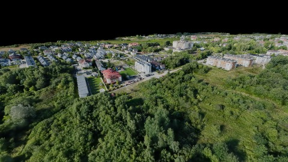

**kf-1**

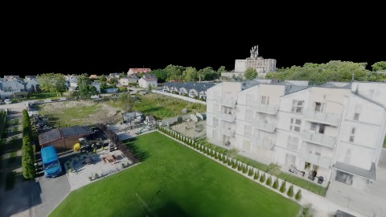

**kf-2**

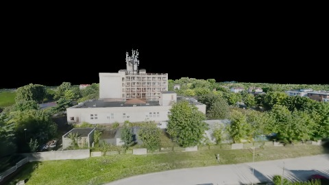

**kf-3**

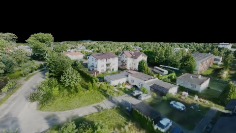

**kf-4**

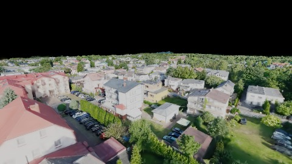

**kf-5**

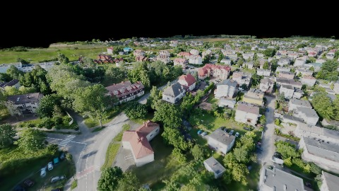

## 优化前 vs 优化后

### poland-mainline（基线 `poland-v1`）

| case | lodMode | lodRuntime | firstFrameMs | kf-1 blur | kf-2 blur | blur P90 | vramPeak | poolEvictions |
|------|---------|------------|--------------|-----------|-----------|----------|----------|---------------|
| poland-v1 | - | refinement | 31422 (—) | 3670 (—) | 3626 | 8397 | 325 | - |
| poland-v2 | - | refinement | 28906 (-8.0%) | 9800 (167.0%) | 9401 | 17801 | 473 | - |

## 结论

- 见上方对比表；`bottleneckHint` 见 `results.json`（scheduler / asset-http / mixed）