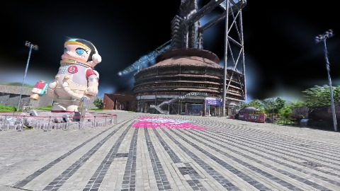
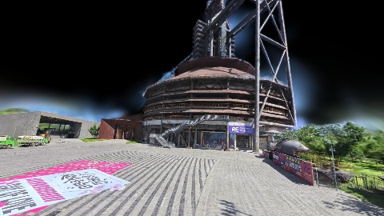
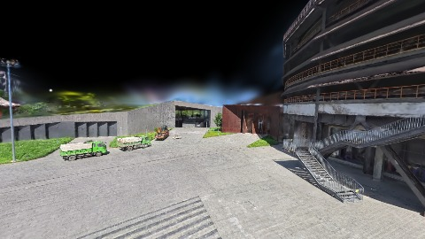
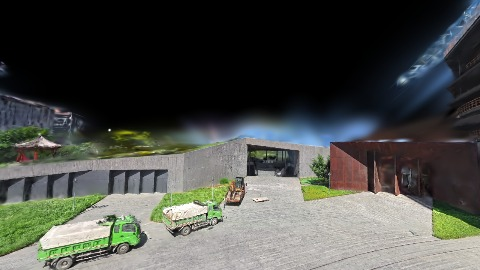
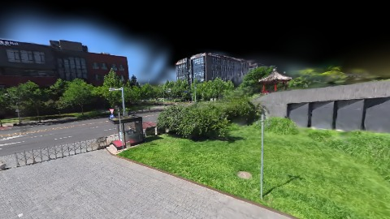
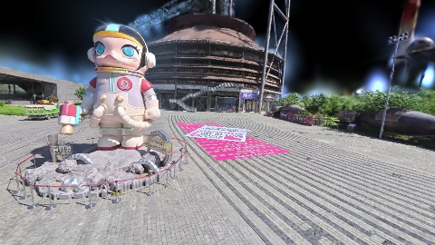
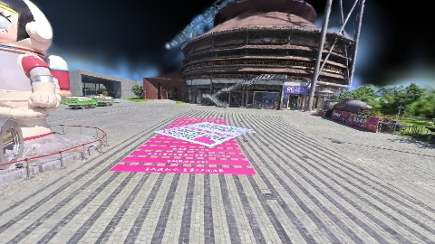

# Scene Profile Benchmark — 2026-07-01

## 本轮维度: profile

Suite: `public/benchmark-suites/scene-nanguangchang.json`

Renderer: `webgpu`

## 运行条件

- Cold start: yes
- Browser session: fresh-chromium-per-case
- Chromium HTTP cache: disabled-cdp-clearBrowserCache-zero-disk-cache
- Cold start (default): fresh Chromium per case, HTTP cache disabled
- OS 页缓存 / GPU 编译缓存：脚本不控制，跨次运行可能仍有差异

| label | presetId | budget | lodMode | lodRuntime | firstFrameMs | jsHeap@1st | vram@1st | jsHeapPeak | vramPeak | fpsP50 | fpsP95 | gsplatsAvgM |
|-------|----------|--------|---------|------------|--------------|------------|----------|------------|----------|--------|--------|-------------|
| nanguangchang-current-profile | undefined | - | - | refinement | 25513.20000000298 | 198 | 247 | 440 | 458 | 51.0 | 58.0 | 3.07 |

## 交互巡检（糊→清晰）

### nanguangchang-current-profile

播放段 FPS: P50=51.0, P95=58.0, min=26.0, 总播放=29594ms

| waypoint | animTimeSec | moveMs | pendingPeak | blurToClearMs | fpsP50(refine) | fpsP95(refine) | fpsMin | gsplatsAtClearM | jsHeap@clear | vram@clear | jsHeapPeak | vramPeak | timeout |
|----------|-------------|--------|-------------|---------------|----------------|----------------|--------|-----------------|--------------|------------|------------|----------|---------|
| kf-0 | 0.00 | 0 | 5 | 2433 | 55.0 | 56.0 | 47.0 | 2.68 | 219 | 261 | 251 | 261 | N |
| kf-1 | 2.13 | 2111 | 12 | 7392 | 32.0 | 54.0 | 29.0 | 3.21 | 208 | 301 | 277 | 301 | N |
| kf-2 | 4.30 | 2117 | 4 | 2803 | 47.0 | 60.0 | 42.0 | 3.43 | 227 | 287 | 328 | 311 | N |
| kf-3 | 5.57 | 1206 | 17 | 8800 | 59.0 | 60.0 | 50.0 | 3.04 | 241 | 307 | 363 | 308 | N |
| kf-4 | 6.87 | 1267 | 10 | 6998 | 60.0 | 60.0 | 54.0 | 3.13 | 389 | 353 | 389 | 353 | N |
| kf-5 | 8.57 | 1651 | 12 | 5200 | 48.0 | 51.0 | 37.0 | 3.17 | 253 | 369 | 358 | 370 | N |
| kf-6 | 12.87 | 4246 | 0 | 0 | 50.0 | 56.0 | 50.0 | 2.39 | 281 | 367 | 300 | 369 | N |
| kf-7 | 17.13 | 4210 | 4 | 1607 | 58.0 | 58.0 | 54.0 | 2.51 | 295 | 395 | 346 | 397 | N |
| kf-8 | 27.87 | 10702 | 8 | 3399 | 31.0 | 31.0 | 28.0 | 3.41 | 274 | 446 | 364 | 447 | N |
| kf-9 | 29.97 | 2084 | 0 | 0 | 26.0 | 26.0 | 26.0 | 3.69 | 309 | 456 | 309 | 456 | N |

变清晰截图（480×270 JPEG）：

**kf-0**

**kf-1**

**kf-2**

**kf-3**

**kf-4**

**kf-5**

**kf-6**

**kf-7**

**kf-8**

**kf-9**

## 优化前 vs 优化后

### default（基线 `nanguangchang-current-profile`）

| case | lodMode | lodRuntime | firstFrameMs | kf-1 blur | kf-2 blur | blur P90 | vramPeak | poolEvictions |
|------|---------|------------|--------------|-----------|-----------|----------|----------|---------------|
| nanguangchang-current-profile | - | refinement | 25513 (—) | 7392 (—) | 2803 | 8800 | 458 | - |

## 结论

- 见上方对比表；`bottleneckHint` 见 `results.json`（scheduler / asset-http / mixed）