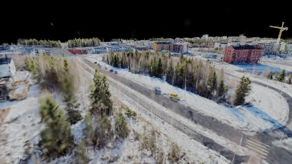
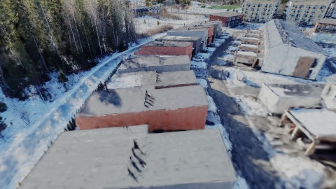
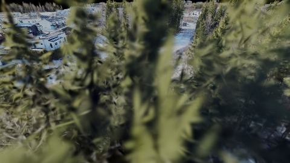
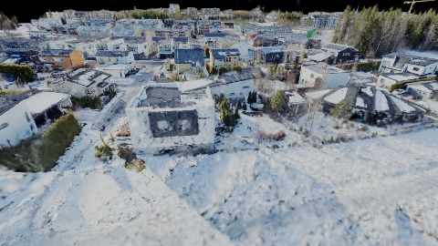
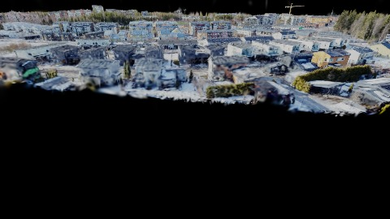
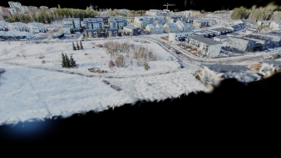
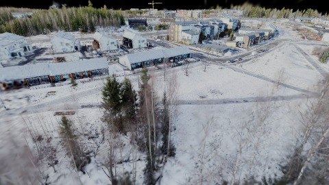
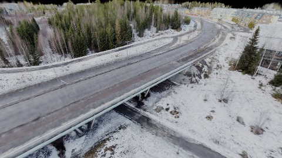
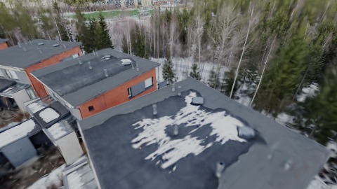
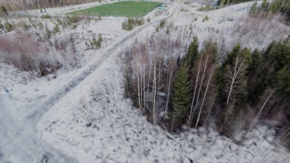

# Scene Profile Benchmark — 2026-07-02

## 本轮维度: profile

Suite: `/Users/leqiwan/Desktop/shuyuan_wlq/大场景渲染/supersplat-viewer/public/benchmark-suites/scene-finland-v3-refine-after.json`

Renderer: `webgpu`

## 运行条件

- Cold start: yes
- Browser session: fresh-chromium-per-case
- Chromium HTTP cache: disabled-cdp-clearBrowserCache-zero-disk-cache
- Cold start (default): fresh Chromium per case, HTTP cache disabled
- OS 页缓存 / GPU 编译缓存：脚本不控制，跨次运行可能仍有差异

| label | presetId | budget | lodMode | lodRuntime | firstFrameMs | jsHeap@1st | vram@1st | jsHeapPeak | vramPeak | fpsP50 | fpsP95 | gsplatsAvgM |
|-------|----------|--------|---------|------------|--------------|------------|----------|------------|----------|--------|--------|-------------|
| finland-v3-refine-after | undefined | - | - | refinement | 14163.5 | 348 | 175 | 847 | 405 | 19.0 | 30.0 | 1.55 |

## 交互巡检（糊→清晰）

### finland-v3-refine-after

播放段 FPS: P50=19.0, P95=30.0, min=11.0, 总播放=18762ms

| waypoint | animTimeSec | moveMs | pendingPeak | blurToClearMs | fpsP50(refine) | fpsP95(refine) | fpsMin | gsplatsAtClearM | jsHeap@clear | vram@clear | jsHeapPeak | vramPeak | timeout |
|----------|-------------|--------|-------------|---------------|----------------|----------------|--------|-----------------|--------------|------------|------------|----------|---------|
| kf-0 | 0.00 | 0 | 1 | 1471 | 12.0 | 15.0 | 10.0 | 1.19 | 499 | 180 | 499 | 180 | N |
| kf-1 | 2.10 | 2074 | 2 | 8236 | 16.0 | 17.0 | 11.0 | 1.32 | 500 | 230 | 620 | 230 | N |
| kf-2 | 4.20 | 2095 | 1 | 2268 | 15.0 | 22.0 | 12.0 | 1.86 | 444 | 249 | 677 | 253 | N |
| kf-3 | 6.30 | 2100 | 1 | 1264 | 13.0 | 14.0 | 13.0 | 1.87 | 661 | 254 | 661 | 254 | N |
| kf-4 | 8.40 | 2069 | 1 | 1472 | 11.0 | 14.0 | 11.0 | 1.51 | 537 | 259 | 537 | 263 | N |
| kf-5 | 10.50 | 2152 | 0 | 0 | 12.0 | 12.0 | 11.0 | 1.03 | 323 | 259 | 696 | 259 | N |
| kf-6 | 12.60 | 2055 | 3 | 3536 | 14.0 | 16.0 | 11.0 | 1.45 | 477 | 289 | 703 | 293 | N |
| kf-7 | 14.70 | 2088 | 2 | 3438 | 14.0 | 20.0 | 11.0 | 1.76 | 571 | 319 | 737 | 323 | N |
| kf-8 | 16.80 | 2094 | 1 | 3655 | 15.0 | 25.0 | 11.0 | 1.67 | 650 | 344 | 769 | 348 | N |
| kf-9 | 18.90 | 2036 | 6 | 9433 | 19.0 | 20.0 | 14.0 | 1.79 | 591 | 405 | 847 | 405 | N |

变清晰截图（480×270 JPEG）：

**kf-0**

**kf-1**

**kf-2**

**kf-3**

**kf-4**

**kf-5**

**kf-6**

**kf-7**

**kf-8**

**kf-9**

## 优化前 vs 优化后

### default（基线 `finland-v3-refine-after`）

| case | lodMode | lodRuntime | firstFrameMs | kf-1 blur | kf-2 blur | blur P90 | vramPeak | poolEvictions |
|------|---------|------------|--------------|-----------|-----------|----------|----------|---------------|
| finland-v3-refine-after | - | refinement | 14164 (—) | 8236 (—) | 2268 | 9433 | 405 | - |

## 结论

- 见上方对比表；`bottleneckHint` 见 `results.json`（scheduler / asset-http / mixed）