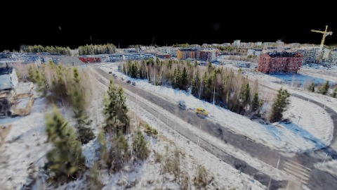
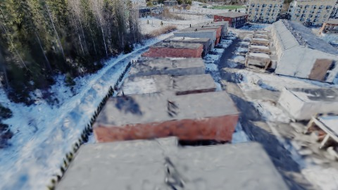
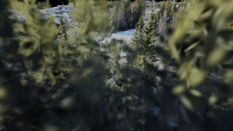
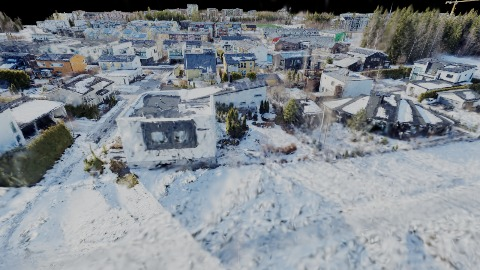
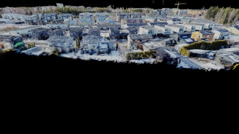
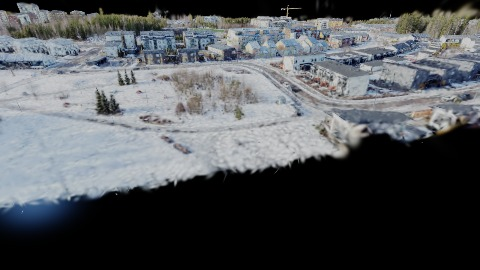
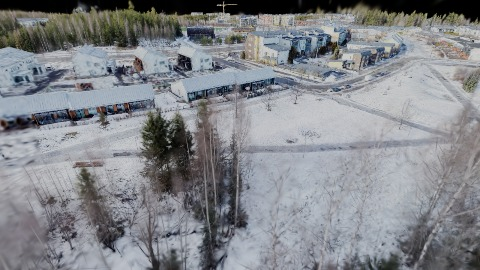
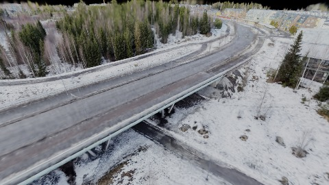
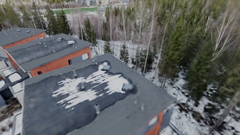
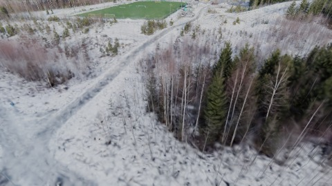

# Scene Profile Benchmark — 2026-07-02

## 本轮维度: profile

Suite: `/Users/leqiwan/Desktop/shuyuan_wlq/大场景渲染/supersplat-viewer/public/benchmark-suites/scene-finland-v3-refine-before.json`

Renderer: `webgpu`

## 运行条件

- Cold start: yes
- Browser session: fresh-chromium-per-case
- Chromium HTTP cache: disabled-cdp-clearBrowserCache-zero-disk-cache
- Cold start (default): fresh Chromium per case, HTTP cache disabled
- OS 页缓存 / GPU 编译缓存：脚本不控制，跨次运行可能仍有差异

| label | presetId | budget | lodMode | lodRuntime | firstFrameMs | jsHeap@1st | vram@1st | jsHeapPeak | vramPeak | fpsP50 | fpsP95 | gsplatsAvgM |
|-------|----------|--------|---------|------------|--------------|------------|----------|------------|----------|--------|--------|-------------|
| finland-v3-refine-before | undefined | - | - | refinement | 13929.400000002235 | 402 | 175 | 834 | 405 | 18.0 | 31.0 | 1.53 |

## 交互巡检（糊→清晰）

### finland-v3-refine-before

播放段 FPS: P50=18.0, P95=31.0, min=10.0, 总播放=18546ms

| waypoint | animTimeSec | moveMs | pendingPeak | blurToClearMs | fpsP50(refine) | fpsP95(refine) | fpsMin | gsplatsAtClearM | jsHeap@clear | vram@clear | jsHeapPeak | vramPeak | timeout |
|----------|-------------|--------|-------------|---------------|----------------|----------------|--------|-----------------|--------------|------------|------------|----------|---------|
| kf-0 | 0.00 | 0 | 1 | 1076 | 10.0 | 14.0 | 10.0 | 1.11 | 503 | 180 | 503 | 180 | N |
| kf-1 | 2.10 | 2112 | 2 | 7466 | 17.0 | 17.0 | 11.0 | 1.16 | 424 | 225 | 611 | 229 | N |
| kf-2 | 4.20 | 2026 | 1 | 2664 | 14.0 | 16.0 | 13.0 | 1.86 | 456 | 249 | 657 | 253 | N |
| kf-3 | 6.30 | 2034 | 1 | 1246 | 13.0 | 14.0 | 13.0 | 1.87 | 659 | 254 | 659 | 254 | N |
| kf-4 | 8.40 | 2082 | 1 | 1472 | 12.0 | 16.0 | 11.0 | 1.51 | 519 | 259 | 547 | 259 | N |
| kf-5 | 10.50 | 2067 | 0 | 0 | 12.0 | 12.0 | 10.0 | 1.04 | 324 | 259 | 676 | 259 | N |
| kf-6 | 12.60 | 2042 | 3 | 3566 | 14.0 | 18.0 | 11.0 | 1.46 | 484 | 289 | 708 | 293 | N |
| kf-7 | 14.70 | 2100 | 2 | 3444 | 14.0 | 15.0 | 11.0 | 1.76 | 613 | 319 | 711 | 319 | N |
| kf-8 | 16.80 | 2030 | 1 | 2845 | 16.0 | 16.0 | 12.0 | 1.78 | 599 | 344 | 777 | 344 | N |
| kf-9 | 18.90 | 2054 | 6 | 9632 | 19.0 | 20.0 | 15.0 | 1.77 | 574 | 405 | 834 | 405 | N |

变清晰截图（480×270 JPEG）：

**kf-0**

**kf-1**

**kf-2**

**kf-3**

**kf-4**

**kf-5**

**kf-6**

**kf-7**

**kf-8**

**kf-9**

## 优化前 vs 优化后

### default（基线 `finland-v3-refine-before`）

| case | lodMode | lodRuntime | firstFrameMs | kf-1 blur | kf-2 blur | blur P90 | vramPeak | poolEvictions |
|------|---------|------------|--------------|-----------|-----------|----------|----------|---------------|
| finland-v3-refine-before | - | refinement | 13929 (—) | 7466 (—) | 2664 | 9632 | 405 | - |

## 结论

- 见上方对比表；`bottleneckHint` 见 `results.json`（scheduler / asset-http / mixed）