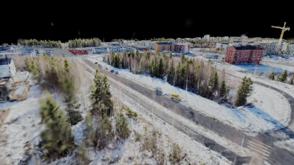
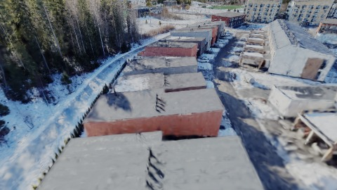
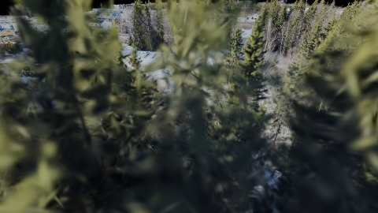
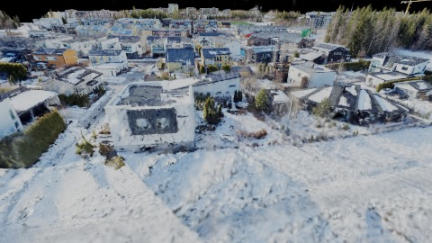
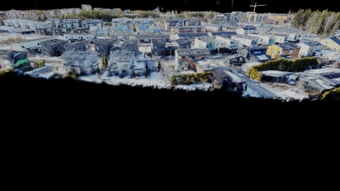
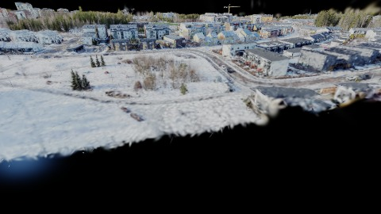
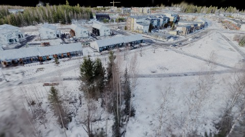
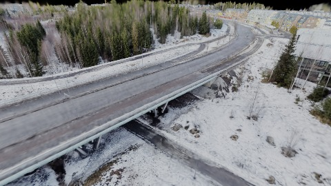
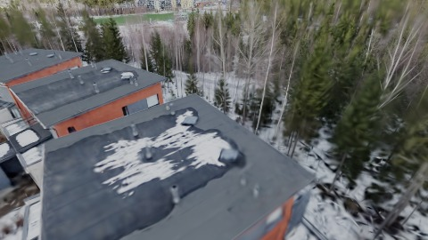
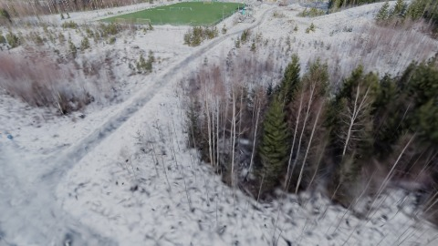

# Scene Profile Benchmark — 2026-07-03

## 本轮维度: profile

Suite: `/Users/leqiwan/Desktop/shuyuan_wlq/大场景渲染/supersplat-viewer/public/benchmark-suites/scene-finland-v3-traverse-after.json`

Renderer: `webgpu`

## 运行条件

- Cold start: yes
- Browser session: fresh-chromium-per-case
- Chromium HTTP cache: disabled-cdp-clearBrowserCache-zero-disk-cache
- Cold start (default): fresh Chromium per case, HTTP cache disabled
- OS 页缓存 / GPU 编译缓存：脚本不控制，跨次运行可能仍有差异

| label | presetId | budget | lodMode | lodRuntime | firstFrameMs | jsHeap@1st | vram@1st | jsHeapPeak | vramPeak | fpsP50 | fpsP95 | gsplatsAvgM |
|-------|----------|--------|---------|------------|--------------|------------|----------|------------|----------|--------|--------|-------------|
| finland-v3-traverse-after | undefined | - | - | refinement | 14221.90000000596 | 356 | 180 | 849 | 405 | 19.0 | 36.0 | 1.57 |

## 交互巡检（糊→清晰）

### finland-v3-traverse-after

播放段 FPS: P50=19.0, P95=36.0, min=11.0, 总播放=18466ms

| waypoint | animTimeSec | moveMs | pendingPeak | blurToClearMs | fpsP50(refine) | fpsP95(refine) | fpsMin | gsplatsAtClearM | jsHeap@clear | vram@clear | jsHeapPeak | vramPeak | timeout |
|----------|-------------|--------|-------------|---------------|----------------|----------------|--------|-----------------|--------------|------------|------------|----------|---------|
| kf-0 | 0.00 | 0 | 0 | 0 | 14.0 | 15.0 | 14.0 | 1.19 | 410 | 180 | 410 | 180 | N |
| kf-1 | 2.10 | 2109 | 2 | 8053 | 25.0 | 26.0 | 11.0 | 1.32 | 421 | 230 | 609 | 230 | N |
| kf-2 | 4.20 | 2038 | 1 | 1862 | 19.0 | 19.0 | 14.0 | 1.86 | 333 | 249 | 680 | 253 | N |
| kf-3 | 6.30 | 2051 | 1 | 1245 | 12.0 | 19.0 | 12.0 | 1.87 | 529 | 254 | 540 | 254 | N |
| kf-4 | 8.40 | 2030 | 1 | 1472 | 13.0 | 13.0 | 12.0 | 1.52 | 416 | 259 | 656 | 263 | N |
| kf-5 | 10.50 | 2046 | 0 | 0 | 11.0 | 11.0 | 11.0 | 1.04 | 611 | 259 | 611 | 259 | N |
| kf-6 | 12.60 | 2078 | 3 | 3330 | 21.0 | 23.0 | 11.0 | 1.46 | 372 | 289 | 721 | 289 | N |
| kf-7 | 14.70 | 2060 | 2 | 3050 | 16.0 | 27.0 | 12.0 | 1.83 | 449 | 319 | 730 | 319 | N |
| kf-8 | 16.80 | 2032 | 1 | 2605 | 17.0 | 22.0 | 12.0 | 1.78 | 468 | 344 | 769 | 344 | N |
| kf-9 | 18.90 | 2021 | 6 | 9231 | 25.0 | 27.0 | 16.0 | 1.79 | 823 | 405 | 849 | 405 | N |

变清晰截图（480×270 JPEG）：

**kf-0**

**kf-1**

**kf-2**

**kf-3**

**kf-4**

**kf-5**

**kf-6**

**kf-7**

**kf-8**

**kf-9**

## 优化前 vs 优化后

### default（基线 `finland-v3-traverse-after`）

| case | lodMode | lodRuntime | firstFrameMs | kf-1 blur | kf-2 blur | blur P90 | vramPeak | poolEvictions |
|------|---------|------------|--------------|-----------|-----------|----------|----------|---------------|
| finland-v3-traverse-after | - | refinement | 14222 (—) | 8053 (—) | 1862 | 9231 | 405 | - |

## 结论

- 见上方对比表；`bottleneckHint` 见 `results.json`（scheduler / asset-http / mixed）