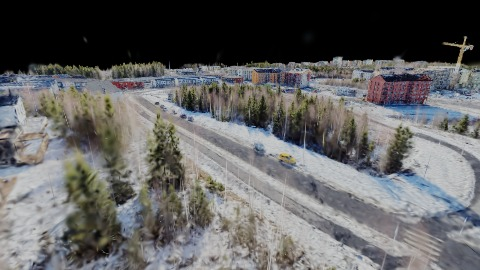
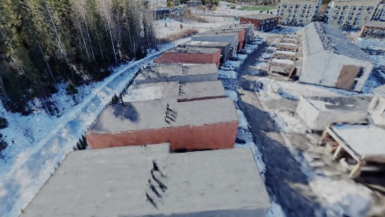
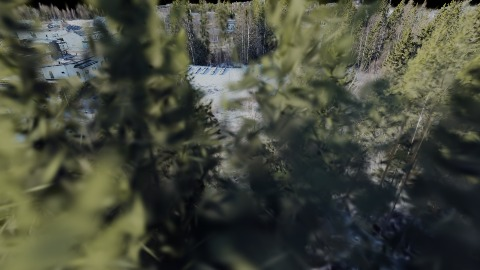
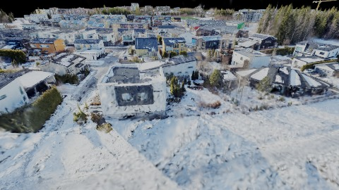
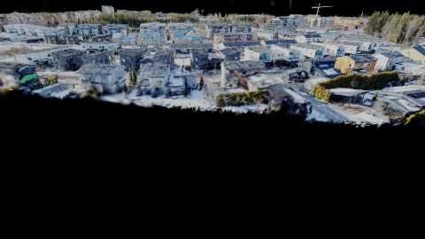
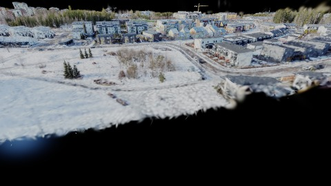
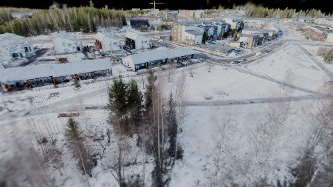
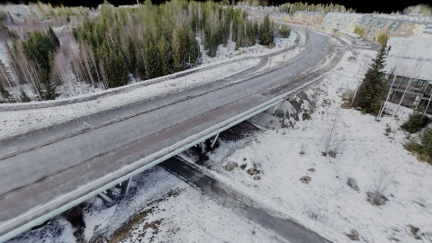
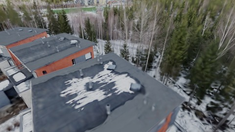
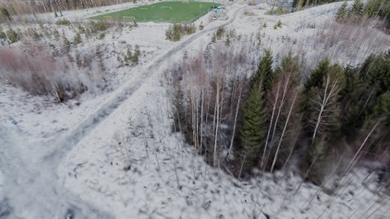

# Scene Profile Benchmark — 2026-07-03

## 本轮维度: profile

Suite: `/Users/leqiwan/Desktop/shuyuan_wlq/大场景渲染/supersplat-viewer/public/benchmark-suites/scene-finland-v3-traverse-before.json`

Renderer: `webgpu`

## 运行条件

- Cold start: yes
- Browser session: fresh-chromium-per-case
- Chromium HTTP cache: disabled-cdp-clearBrowserCache-zero-disk-cache
- Cold start (default): fresh Chromium per case, HTTP cache disabled
- OS 页缓存 / GPU 编译缓存：脚本不控制，跨次运行可能仍有差异

| label | presetId | budget | lodMode | lodRuntime | firstFrameMs | jsHeap@1st | vram@1st | jsHeapPeak | vramPeak | fpsP50 | fpsP95 | gsplatsAvgM |
|-------|----------|--------|---------|------------|--------------|------------|----------|------------|----------|--------|--------|-------------|
| finland-v3-traverse-before | undefined | - | - | refinement | 14674 | 566 | 180 | 875 | 410 | 17.0 | 27.0 | 1.58 |

## 交互巡检（糊→清晰）

### finland-v3-traverse-before

播放段 FPS: P50=17.0, P95=27.0, min=9.0, 总播放=18710ms

| waypoint | animTimeSec | moveMs | pendingPeak | blurToClearMs | fpsP50(refine) | fpsP95(refine) | fpsMin | gsplatsAtClearM | jsHeap@clear | vram@clear | jsHeapPeak | vramPeak | timeout |
|----------|-------------|--------|-------------|---------------|----------------|----------------|--------|-----------------|--------------|------------|------------|----------|---------|
| kf-0 | 0.00 | 0 | 0 | 0 | 10.0 | 10.0 | 10.0 | 1.19 | 256 | 180 | 564 | 180 | N |
| kf-1 | 2.10 | 2118 | 2 | 10260 | 18.0 | 22.0 | 10.0 | 1.32 | 557 | 235 | 608 | 235 | N |
| kf-2 | 4.20 | 2069 | 2 | 2241 | 15.0 | 15.0 | 11.0 | 1.86 | 494 | 254 | 500 | 254 | N |
| kf-3 | 6.30 | 2084 | 1 | 1278 | 12.0 | 12.0 | 12.0 | 1.87 | 677 | 259 | 677 | 259 | N |
| kf-4 | 8.40 | 2047 | 1 | 1443 | 10.0 | 12.0 | 9.0 | 1.52 | 524 | 264 | 529 | 268 | N |
| kf-5 | 10.50 | 2082 | 0 | 0 | 10.0 | 10.0 | 9.0 | 1.04 | 695 | 264 | 695 | 264 | N |
| kf-6 | 12.60 | 2096 | 3 | 7348 | 20.0 | 21.0 | 10.0 | 1.46 | 647 | 294 | 751 | 294 | N |
| kf-7 | 14.70 | 2070 | 2 | 3466 | 15.0 | 19.0 | 10.0 | 1.78 | 644 | 324 | 669 | 324 | N |
| kf-8 | 16.80 | 2098 | 1 | 2656 | 14.0 | 18.0 | 11.0 | 1.77 | 619 | 349 | 619 | 349 | N |
| kf-9 | 18.90 | 2047 | 6 | 10678 | 20.0 | 21.0 | 13.0 | 2.00 | 848 | 410 | 875 | 410 | N |

变清晰截图（480×270 JPEG）：

**kf-0**

**kf-1**

**kf-2**

**kf-3**

**kf-4**

**kf-5**

**kf-6**

**kf-7**

**kf-8**

**kf-9**

## 优化前 vs 优化后

### default（基线 `finland-v3-traverse-before`）

| case | lodMode | lodRuntime | firstFrameMs | kf-1 blur | kf-2 blur | blur P90 | vramPeak | poolEvictions |
|------|---------|------------|--------------|-----------|-----------|----------|----------|---------------|
| finland-v3-traverse-before | - | refinement | 14674 (—) | 10260 (—) | 2241 | 10678 | 410 | - |

## 结论

- 见上方对比表；`bottleneckHint` 见 `results.json`（scheduler / asset-http / mixed）