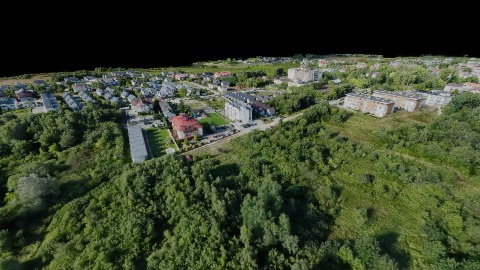
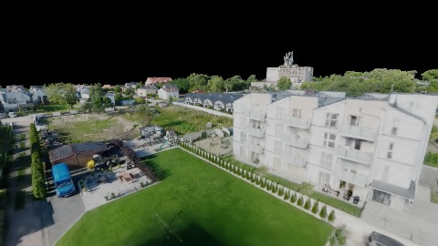
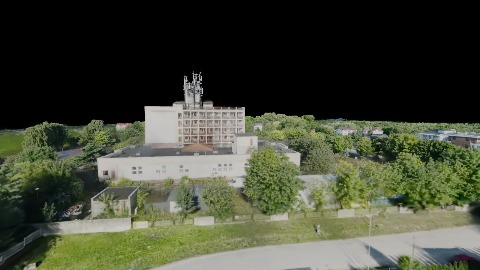
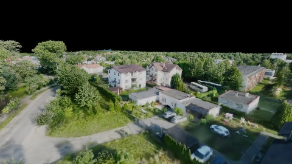
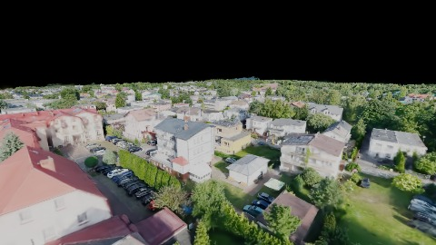
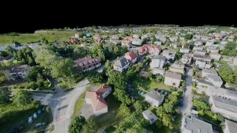

# Scene Profile Benchmark — 2026-07-03

## 本轮维度: profile

Suite: `/Users/leqiwan/Desktop/shuyuan_wlq/大场景渲染/supersplat-viewer/public/benchmark-suites/scene-poland-v2-traverse-after.json`

Renderer: `webgpu`

## 运行条件

- Cold start: yes
- Browser session: fresh-chromium-per-case
- Chromium HTTP cache: disabled-cdp-clearBrowserCache-zero-disk-cache
- Cold start (default): fresh Chromium per case, HTTP cache disabled
- OS 页缓存 / GPU 编译缓存：脚本不控制，跨次运行可能仍有差异

| label | presetId | budget | lodMode | lodRuntime | firstFrameMs | jsHeap@1st | vram@1st | jsHeapPeak | vramPeak | fpsP50 | fpsP95 | gsplatsAvgM |
|-------|----------|--------|---------|------------|--------------|------------|----------|------------|----------|--------|--------|-------------|
| poland-v2-traverse-after | undefined | - | - | refinement | 7072.19999999553 | 254 | 269 | 510 | 485 | 60.0 | 60.0 | 2.70 |

## 交互巡检（糊→清晰）

### poland-v2-traverse-after

播放段 FPS: P50=60.0, P95=60.0, min=59.0, 总播放=10289ms

| waypoint | animTimeSec | moveMs | pendingPeak | blurToClearMs | fpsP50(refine) | fpsP95(refine) | fpsMin | gsplatsAtClearM | jsHeap@clear | vram@clear | jsHeapPeak | vramPeak | timeout |
|----------|-------------|--------|-------------|---------------|----------------|----------------|--------|-----------------|--------------|------------|------------|----------|---------|
| kf-0 | 0.00 | 0 | 0 | 0 | 59.0 | 59.0 | 59.0 | 1.68 | 225 | 269 | 257 | 269 | N |
| kf-1 | 2.10 | 2048 | 2 | 2201 | 60.0 | 60.0 | 59.0 | 2.56 | 302 | 326 | 306 | 326 | N |
| kf-2 | 4.20 | 2063 | 1 | 2201 | 60.0 | 60.0 | 59.0 | 3.18 | 393 | 385 | 394 | 385 | N |
| kf-3 | 6.30 | 2048 | 3 | 3400 | 60.0 | 60.0 | 59.0 | 3.01 | 486 | 473 | 508 | 473 | N |
| kf-4 | 8.40 | 2064 | 1 | 1201 | 60.0 | 60.0 | 60.0 | 3.02 | 494 | 465 | 494 | 485 | N |
| kf-5 | 10.50 | 2065 | 0 | 0 | 60.0 | 60.0 | 59.0 | 2.75 | 492 | 455 | 510 | 455 | N |

变清晰截图（480×270 JPEG）：

**kf-0**

**kf-1**

**kf-2**

**kf-3**

**kf-4**

**kf-5**

## 优化前 vs 优化后

### default（基线 `poland-v2-traverse-after`）

| case | lodMode | lodRuntime | firstFrameMs | kf-1 blur | kf-2 blur | blur P90 | vramPeak | poolEvictions |
|------|---------|------------|--------------|-----------|-----------|----------|----------|---------------|
| poland-v2-traverse-after | - | refinement | 7072 (—) | 2201 (—) | 2201 | 3400 | 485 | - |

## 结论

- 见上方对比表；`bottleneckHint` 见 `results.json`（scheduler / asset-http / mixed）