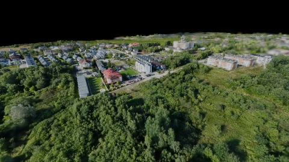
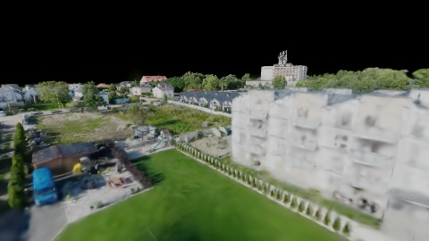
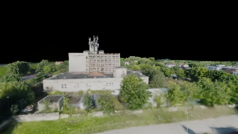
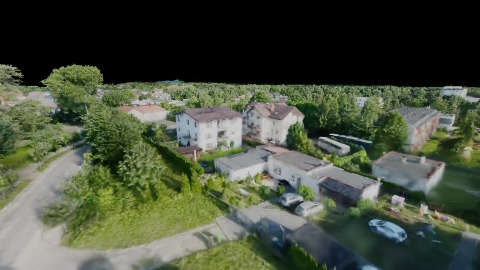
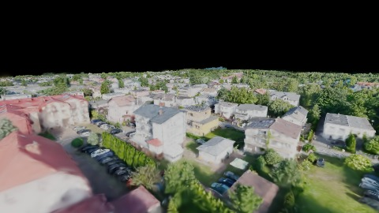
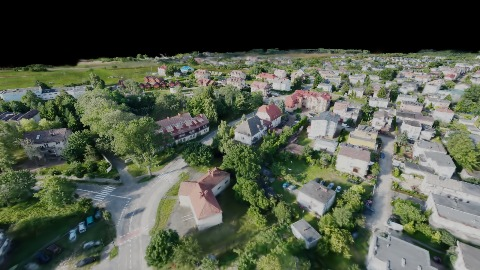

# Scene Profile Benchmark — 2026-07-15

## 本轮维度: profile

Suite: `public/benchmark-suites/scene-poland-b1-dirty-sync.json`

Renderer: `webgpu`

## 运行条件

- Cold start: yes
- Browser session: fresh-chromium-per-case
- Chromium HTTP cache: disabled-cdp-clearBrowserCache-zero-disk-cache
- Cold start (default): fresh Chromium per case, HTTP cache disabled
- OS 页缓存 / GPU 编译缓存：脚本不控制，跨次运行可能仍有差异

| label | presetId | budget | lodMode | lodRuntime | firstFrameMs | jsHeap@1st | vram@1st | jsHeapPeak | vramPeak | fpsP50 | fpsP95 | gsplatsAvgM |
|-------|----------|--------|---------|------------|--------------|------------|----------|------------|----------|--------|--------|-------------|
| poland-v1-bake-acceptance | undefined | - | - | refinement | 23793.799999952316 | 1166 | 138 | 2679 | 268 | 5.0 | 5.0 | 1.48 |

## 交互巡检（糊→清晰）

### poland-v1-bake-acceptance

播放段 FPS: P50=5.0, P95=5.0, min=4.0, 总播放=19569ms

| waypoint | animTimeSec | moveMs | pendingPeak | blurToClearMs | fpsP50(refine) | fpsP95(refine) | fpsMin | gsplatsAtClearM | jsHeap@clear | vram@clear | jsHeapPeak | vramPeak | timeout |
|----------|-------------|--------|-------------|---------------|----------------|----------------|--------|-----------------|--------------|------------|------------|----------|---------|
| kf-0 | 0.00 | 0 | 1 | 8014 | 6.0 | 7.0 | 4.0 | 0.76 | 2048 | 147 | 2048 | 147 | N |
| kf-1 | 2.10 | 3606 | 6 | 3954 | 7.0 | 8.0 | 5.0 | 1.18 | 1622 | 183 | 1622 | 183 | N |
| kf-2 | 4.20 | 3702 | 6 | 4719 | 6.0 | 6.0 | 5.0 | 1.44 | 1152 | 220 | 2679 | 223 | N |
| kf-3 | 6.30 | 4019 | 5 | 4193 | 5.0 | 6.0 | 4.0 | 1.65 | 1081 | 251 | 2613 | 252 | N |
| kf-4 | 8.40 | 3968 | 5 | 2592 | 5.0 | 6.0 | 5.0 | 1.49 | 2448 | 268 | 2448 | 268 | N |
| kf-5 | 10.50 | 4274 | 1 | 1416 | 5.0 | 5.0 | 4.0 | 2.35 | 1672 | 256 | 1672 | 258 | N |

变清晰截图（480×270 JPEG）：

**kf-0**

**kf-1**

**kf-2**

**kf-3**

**kf-4**

**kf-5**

## 优化前 vs 优化后

### bake-acceptance（基线 `poland-v1-bake-acceptance`）

| case | lodMode | lodRuntime | firstFrameMs | kf-1 blur | kf-2 blur | blur P90 | vramPeak | poolEvictions |
|------|---------|------------|--------------|-----------|-----------|----------|----------|---------------|
| poland-v1-bake-acceptance | - | refinement | 23794 (—) | 3954 (—) | 4719 | 8014 | 268 | - |

## Bake / WorldState 验收

### poland-v1-bake-acceptance

| 指标 | 值 |
|------|----|
| 采样帧数 | 1313 |
| copyPct ≥ 95% 帧占比 | 2 / 1313 (0.2%) |
| uploaded/total P50 / P90 | 0.000 / 0.044 |
| uploadMbEst | P50=0.1 · P90=2.6 · max=29.0 (n=280) |
| bakePassesEst | P50=1 · P90=1 · max=1 (n=280) |
| worldState.fullRebuild 帧占比 | 1 (0.1%) |
| dirtyForcedWorkBufferRebuild 帧占比 | 1 (0.1%) |
| sync 后 5 帧内推进 | 121/121 (100.0%)；ver=121 lod=110 |
| staleLoadedNodes 最长连续帧 | 2（有 stale 帧 17） |

## 结论

- 见上方对比表；`bottleneckHint` / `bakeAcceptance` 见 `results.json`