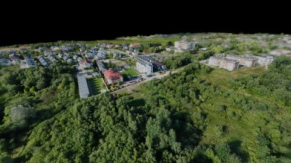
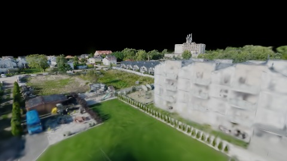
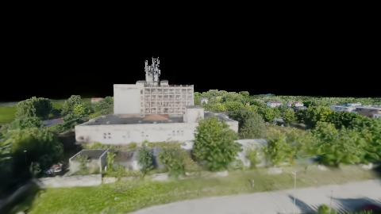
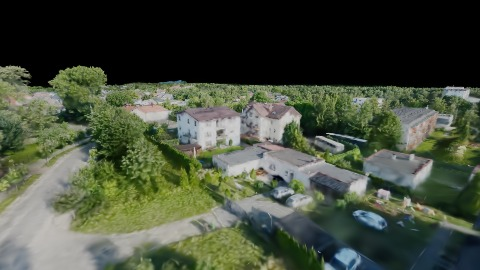
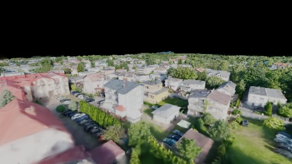
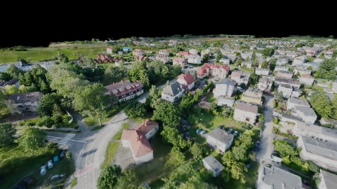

# Scene Profile Benchmark — 2026-07-15

## 本轮维度: profile

Suite: `public/benchmark-suites/scene-poland-p0-poll-fix.json`

Renderer: `webgpu`

## 运行条件

- Cold start: yes
- Browser session: fresh-chromium-per-case
- Chromium HTTP cache: disabled-cdp-clearBrowserCache-zero-disk-cache
- Cold start (default): fresh Chromium per case, HTTP cache disabled
- OS 页缓存 / GPU 编译缓存：脚本不控制，跨次运行可能仍有差异

| label | presetId | budget | lodMode | lodRuntime | firstFrameMs | jsHeap@1st | vram@1st | jsHeapPeak | vramPeak | fpsP50 | fpsP95 | gsplatsAvgM |
|-------|----------|--------|---------|------------|--------------|------------|----------|------------|----------|--------|--------|-------------|
| poland-v1-p0-poll-fix | undefined | - | - | refinement | 22540.100000023842 | 1024 | 137 | 2189 | 259 | 15.0 | 20.0 | 1.25 |

## 交互巡检（糊→清晰）

### poland-v1-p0-poll-fix

播放段 FPS: P50=15.0, P95=20.0, min=10.0, 总播放=11057ms

| waypoint | animTimeSec | moveMs | pendingPeak | blurToClearMs | fpsP50(refine) | fpsP95(refine) | fpsMin | gsplatsAtClearM | jsHeap@clear | vram@clear | jsHeapPeak | vramPeak | timeout |
|----------|-------------|--------|-------------|---------------|----------------|----------------|--------|-----------------|--------------|------------|------------|----------|---------|
| kf-0 | 0.00 | 0 | 1 | 1057 | 8.0 | 17.0 | 8.0 | 0.61 | 1044 | 139 | 1051 | 140 | N |
| kf-1 | 2.10 | 2170 | 2 | 1275 | 14.0 | 15.0 | 14.0 | 0.88 | 1343 | 158 | 1349 | 158 | N |
| kf-2 | 4.20 | 2154 | 9 | 4942 | 15.0 | 18.0 | 13.0 | 1.14 | 1832 | 188 | 1832 | 197 | N |
| kf-3 | 6.30 | 2126 | 5 | 6263 | 16.0 | 20.0 | 14.0 | 1.16 | 802 | 205 | 2189 | 224 | N |
| kf-4 | 8.40 | 2184 | 4 | 2623 | 13.0 | 18.0 | 12.0 | 1.58 | 1204 | 233 | 1209 | 233 | N |
| kf-5 | 10.50 | 2424 | 1 | 4278 | 16.0 | 20.0 | 10.0 | 2.13 | 1726 | 255 | 1747 | 259 | N |

变清晰截图（480×270 JPEG）：

**kf-0**

**kf-1**

**kf-2**

**kf-3**

**kf-4**

**kf-5**

## 优化前 vs 优化后

### p0-poll-fix（基线 `poland-v1-p0-poll-fix`）

| case | lodMode | lodRuntime | firstFrameMs | kf-1 blur | kf-2 blur | blur P90 | vramPeak | poolEvictions |
|------|---------|------------|--------------|-----------|-----------|----------|----------|---------------|
| poland-v1-p0-poll-fix | - | refinement | 22540 (—) | 1275 (—) | 4942 | 6263 | 259 | - |

## Bake / WorldState 验收

### poland-v1-p0-poll-fix

| 指标 | 值 |
|------|----|
| 采样帧数 | 2579 |
| copyPct ≥ 95% 帧占比 | 1 / 2579 (0.0%) |
| uploaded/total P50 / P90 | 0.000 / 0.159 |
| uploadMbEst | P50=0.0 · P90=3.1 · max=15.9 (n=93) |
| bakePassesEst | P50=1 · P90=1 · max=1 (n=93) |
| worldState.fullRebuild 帧占比 | 1 (0.0%) |
| dirtyForcedWorkBufferRebuild 帧占比 | 1 (0.0%) |
| sync 后 5 帧内推进 | 102/150 (68.0%)；ver=97 lod=74 |
| staleLoadedNodes 最长连续帧 | 23（有 stale 帧 97） |

## 结论

- 见上方对比表；`bottleneckHint` / `bakeAcceptance` 见 `results.json`