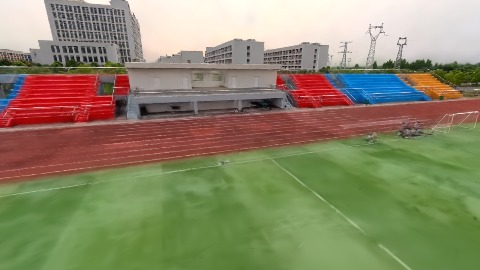
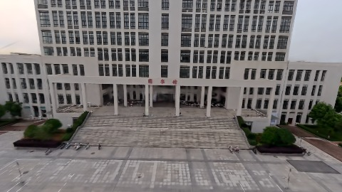
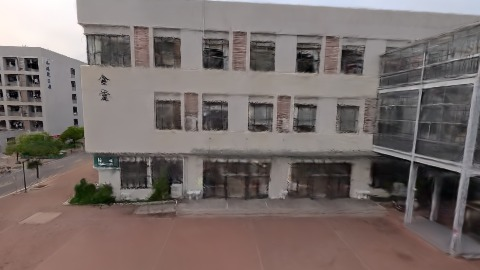

# Scene Profile Benchmark — 2026-07-22

## 本轮维度: profile

Suite: `public/benchmark-suites/scene-wuhan-waypoints.json`

Renderer: `webgpu`

## 运行条件

- Cold start: yes
- Browser session: fresh-chromium-per-case
- Chromium HTTP cache: disabled-cdp-clearBrowserCache-zero-disk-cache
- Cold start (default): fresh Chromium per case, HTTP cache disabled
- OS 页缓存 / GPU 编译缓存：脚本不控制，跨次运行可能仍有差异

| label | presetId | budget | lodMode | lodRuntime | firstFrameMs | jsHeap@1st | vram@1st | jsHeapPeak | vramPeak | fpsP50 | fpsP95 | gsplatsAvgM |
|-------|----------|--------|---------|------------|--------------|------------|----------|------------|----------|--------|--------|-------------|
| wuhan-user-waypoints | undefined | 2.5 | - | refinement | 38371.199999928474 | 290 | 254 | 384 | 283 | 44.0 | 57.0 | 2.42 |

## 交互巡检（糊→清晰）

### wuhan-user-waypoints

播放段 FPS: P50=44.0, P95=57.0, min=42.0, 总播放=2887ms

| waypoint | animTimeSec | moveMs | pendingPeak | blurToClearMs | fpsP50(refine) | fpsP95(refine) | fpsMin | gsplatsAtClearM | jsHeap@clear | vram@clear | jsHeapPeak | vramPeak | timeout |
|----------|-------------|--------|-------------|---------------|----------------|----------------|--------|-----------------|--------------|------------|------------|----------|---------|
| kf-0 | 0.00 | 0 | 1 | 802 | 42.0 | 43.0 | 42.0 | 2.38 | 272 | 261 | 290 | 261 | N |
| kf-1 | 1.00 | 972 | 16 | 3599 | 43.0 | 43.0 | 42.0 | 2.44 | 268 | 262 | 363 | 270 | N |
| kf-2 | 2.00 | 950 | 27 | 18800 | 60.0 | 60.0 | 44.0 | 2.44 | 306 | 269 | 361 | 283 | N |
| kf-3 | 3.00 | 965 | 26 | 13601 | 55.0 | 60.0 | 53.0 | 2.43 | 315 | 264 | 384 | 272 | N |

变清晰截图（480×270 JPEG）：

**kf-0**

**kf-1**

**kf-2**

**kf-3**

## 优化前 vs 优化后

### default（基线 `wuhan-user-waypoints`）

| case | lodMode | lodRuntime | firstFrameMs | kf-1 blur | kf-2 blur | blur P90 | vramPeak | poolEvictions |
|------|---------|------------|--------------|-----------|-----------|----------|----------|---------------|
| wuhan-user-waypoints | - | refinement | 38371 (—) | 3599 (—) | 18800 | 18800 | 283 | - |

## 结论

- 见上方对比表；`bottleneckHint` 见 `results.json`（scheduler / asset-http / mixed）