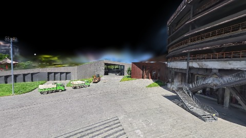
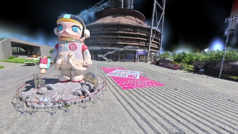
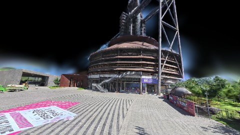
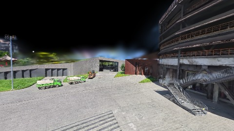
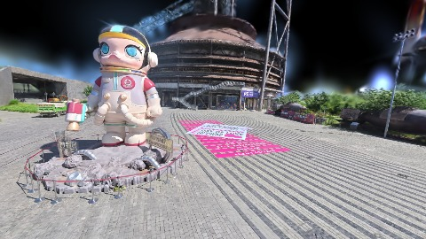

# Scene Profile Benchmark — 2026-07-23

## 本轮维度: profile

Suite: `public/benchmark-suites/scene-nanguangchang-d0-ab-short.json`

Renderer: `webgpu`

## 运行条件

- Cold start: yes
- Browser session: fresh-chromium-per-case
- Chromium HTTP cache: disabled-cdp-clearBrowserCache-zero-disk-cache
- Cold start (default): fresh Chromium per case, HTTP cache disabled
- OS 页缓存 / GPU 编译缓存：脚本不控制，跨次运行可能仍有差异

| label | presetId | budget | lodMode | lodRuntime | firstFrameMs | jsHeap@1st | vram@1st | jsHeapPeak | vramPeak | fpsP50 | fpsP95 | gsplatsAvgM |
|-------|----------|--------|---------|------------|--------------|------------|----------|------------|----------|--------|--------|-------------|
| nanguangchang-d0-5-short | undefined | - | - | refinement | 26027.299999952316 | 290 | 244 | 473 | 349 | 59.0 | 60.0 | 3.45 |
| nanguangchang-d0-2.25-short | undefined | - | - | refinement | 15554.600000023842 | 229 | 196 | 466 | 362 | 59.0 | 60.0 | 3.89 |

## 交互巡检（糊→清晰）

### nanguangchang-d0-5-short

播放段 FPS: P50=59.0, P95=60.0, min=59.0, 总播放=2854ms

| waypoint | animTimeSec | moveMs | pendingPeak | blurToClearMs | fpsP50(refine) | fpsP95(refine) | fpsMin | gsplatsAtClearM | jsHeap@clear | vram@clear | jsHeapPeak | vramPeak | timeout |
|----------|-------------|--------|-------------|---------------|----------------|----------------|--------|-----------------|--------------|------------|------------|----------|---------|
| kf-0 | 0.00 | 0 | 5 | 12201 | 60.0 | 60.0 | 59.0 | 3.30 | 327 | 301 | 327 | 301 | N |
| kf-1 | 1.00 | 954 | 5 | - | 60.0 | 60.0 | 59.0 | - | - | - | 440 | 345 | Y |
| kf-2 | 2.00 | 950 | 1 | - | 60.0 | 60.0 | 59.0 | - | - | - | 392 | 347 | Y |
| kf-3 | 3.00 | 950 | 18 | 21201 | 60.0 | 60.0 | 58.0 | 3.59 | 343 | 332 | 473 | 337 | N |

变清晰截图（480×270 JPEG）：

**kf-0**

**kf-1**

**kf-2**

**kf-3**

### nanguangchang-d0-2.25-short

播放段 FPS: P50=59.0, P95=60.0, min=47.0, 总播放=2856ms

| waypoint | animTimeSec | moveMs | pendingPeak | blurToClearMs | fpsP50(refine) | fpsP95(refine) | fpsMin | gsplatsAtClearM | jsHeap@clear | vram@clear | jsHeapPeak | vramPeak | timeout |
|----------|-------------|--------|-------------|---------------|----------------|----------------|--------|-----------------|--------------|------------|------------|----------|---------|
| kf-0 | 0.00 | 0 | 3 | - | 60.0 | 60.0 | 59.0 | - | - | - | 408 | 337 | Y |
| kf-1 | 1.00 | 959 | 1 | 44801 | 60.0 | 60.0 | 47.0 | 3.89 | 383 | 346 | 451 | 355 | N |
| kf-2 | 2.00 | 940 | 0 | - | 60.0 | 60.0 | 52.0 | - | - | - | 466 | 359 | Y |
| kf-3 | 3.00 | 957 | 6 | - | 60.0 | 60.0 | 37.0 | - | - | - | 432 | 362 | Y |

变清晰截图（480×270 JPEG）：

**kf-0**

**kf-1**

**kf-2**

**kf-3**

## 优化前 vs 优化后

### nanguangchang-d0-ab-short（基线 `nanguangchang-d0-5-short`）

| case | lodMode | lodRuntime | firstFrameMs | kf-1 blur | kf-2 blur | blur P90 | vramPeak | poolEvictions |
|------|---------|------------|--------------|-----------|-----------|----------|----------|---------------|
| nanguangchang-d0-5-short | - | refinement | 26027 (—) | - (—) | - | 21201 | 349 | - |
| nanguangchang-d0-2.25-short | - | refinement | 15555 (-40.2%) | 44801 (-%) | - | 44801 | 362 | - |

## 结论

- 见上方对比表；`bottleneckHint` 见 `results.json`（scheduler / asset-http / mixed）