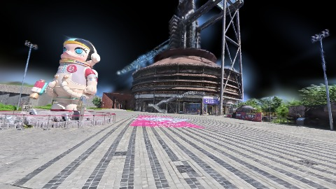
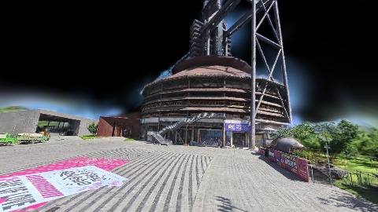
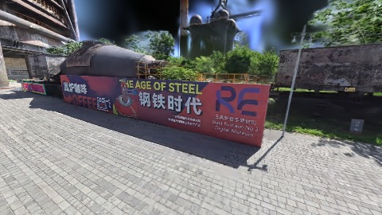
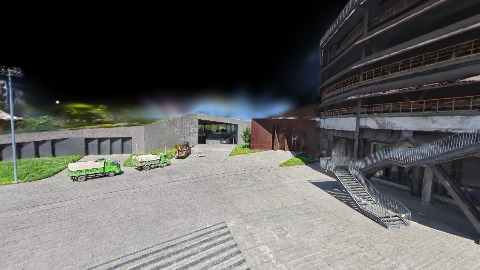
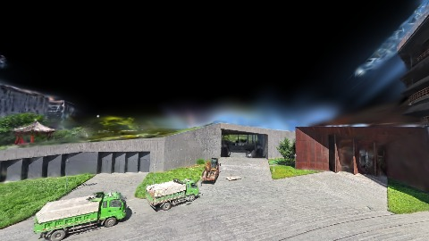
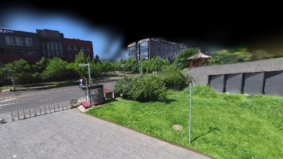
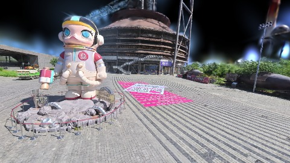
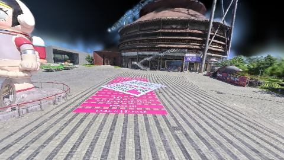

# Scene Profile Benchmark — 2026-07-23

## 本轮维度: profile

Suite: `public/benchmark-suites/scene-nanguangchang.json`

Renderer: `webgpu`

## 运行条件

- Cold start: yes
- Browser session: fresh-chromium-per-case
- Chromium HTTP cache: disabled-cdp-clearBrowserCache-zero-disk-cache
- Cold start (default): fresh Chromium per case, HTTP cache disabled
- OS 页缓存 / GPU 编译缓存：脚本不控制，跨次运行可能仍有差异

| label | presetId | budget | lodMode | lodRuntime | firstFrameMs | jsHeap@1st | vram@1st | jsHeapPeak | vramPeak | fpsP50 | fpsP95 | gsplatsAvgM |
|-------|----------|--------|---------|------------|--------------|------------|----------|------------|----------|--------|--------|-------------|
| nanguangchang-current-profile | undefined | - | - | refinement | 5309.799999952316 | 252 | 250 | 549 | 407 | 60.0 | 60.0 | 3.83 |

## 交互巡检（糊→清晰）

### nanguangchang-current-profile

播放段 FPS: P50=60.0, P95=60.0, min=56.0, 总播放=29574ms

| waypoint | animTimeSec | moveMs | pendingPeak | blurToClearMs | fpsP50(refine) | fpsP95(refine) | fpsMin | gsplatsAtClearM | jsHeap@clear | vram@clear | jsHeapPeak | vramPeak | timeout |
|----------|-------------|--------|-------------|---------------|----------------|----------------|--------|-----------------|--------------|------------|------------|----------|---------|
| kf-0 | 0.00 | 0 | 4 | 3591 | 60.0 | 60.0 | 53.0 | 3.90 | 421 | 349 | 429 | 357 | N |
| kf-1 | 2.13 | 2103 | 8 | 5401 | 59.0 | 60.0 | 56.0 | 3.90 | 496 | 348 | 541 | 389 | N |
| kf-2 | 4.30 | 2114 | 0 | 0 | 58.0 | 59.0 | 56.0 | 3.91 | 542 | 329 | 542 | 381 | N |
| kf-3 | 5.57 | 1212 | 6 | - | 60.0 | 60.0 | 57.0 | - | - | - | 451 | 380 | Y |
| kf-4 | 6.87 | 1242 | 7 | 1403 | 60.0 | 60.0 | 59.0 | 3.50 | 420 | 308 | 420 | 375 | N |
| kf-5 | 8.57 | 1652 | 5 | - | 60.0 | 60.0 | 59.0 | - | - | - | 509 | 364 | Y |
| kf-6 | 12.87 | 4263 | 0 | - | 60.0 | 60.0 | 59.0 | - | - | - | 410 | 357 | Y |
| kf-7 | 17.13 | 4217 | 0 | - | 60.0 | 60.0 | 59.0 | - | - | - | 489 | 376 | Y |
| kf-8 | 27.87 | 10699 | 4 | 799 | 59.0 | 60.0 | 59.0 | 3.90 | 444 | 353 | 445 | 376 | N |
| kf-9 | 29.97 | 2072 | 4 | 1601 | 60.0 | 60.0 | 59.0 | 3.89 | 501 | 361 | 503 | 400 | N |

变清晰截图（480×270 JPEG）：

**kf-0**

**kf-1**

**kf-2**

**kf-3**

**kf-4**

**kf-5**

**kf-6**

**kf-7**

**kf-8**

**kf-9**

## 优化前 vs 优化后

### default（基线 `nanguangchang-current-profile`）

| case | lodMode | lodRuntime | firstFrameMs | kf-1 blur | kf-2 blur | blur P90 | vramPeak | poolEvictions |
|------|---------|------------|--------------|-----------|-----------|----------|----------|---------------|
| nanguangchang-current-profile | - | refinement | 5310 (—) | 5401 (—) | 0 | 5401 | 407 | - |

## 结论

- 见上方对比表；`bottleneckHint` 见 `results.json`（scheduler / asset-http / mixed）