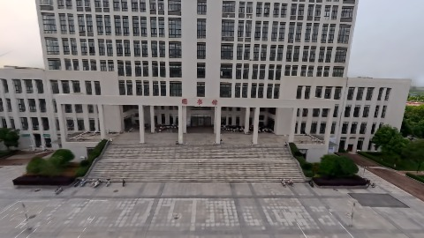
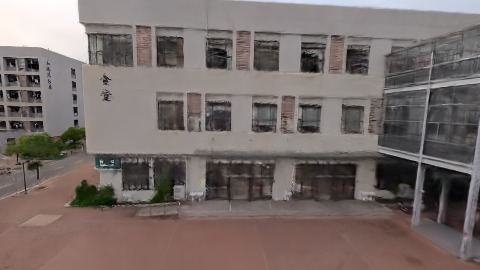
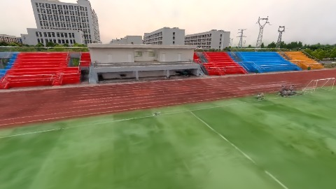
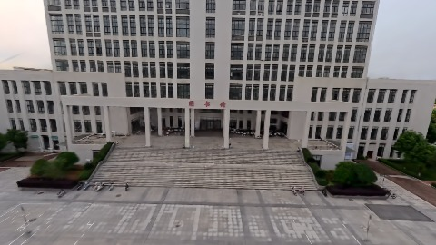
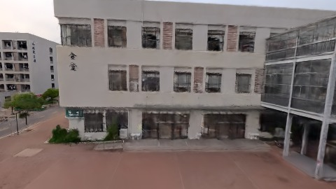

# Scene Profile Benchmark — 2026-07-23

## 本轮维度: profile

Suite: `public/benchmark-suites/scene-wuhan-budget-obey-ab.json`

Renderer: `webgpu`

## 运行条件

- Cold start: yes
- Browser session: fresh-chromium-per-case
- Chromium HTTP cache: disabled-cdp-clearBrowserCache-zero-disk-cache
- Cold start (default): fresh Chromium per case, HTTP cache disabled
- OS 页缓存 / GPU 编译缓存：脚本不控制，跨次运行可能仍有差异

| label | presetId | budget | lodMode | lodRuntime | firstFrameMs | jsHeap@1st | vram@1st | jsHeapPeak | vramPeak | fpsP50 | fpsP95 | gsplatsAvgM |
|-------|----------|--------|---------|------------|--------------|------------|----------|------------|----------|--------|--------|-------------|
| wuhan-before-no-budget-obey | undefined | - | - | refinement | 9390.799999952316 | 268 | 293 | 383 | 372 | 20.0 | 21.0 | 3.60 |
| wuhan-after-budget-obey | undefined | - | - | refinement | 6267.699999928474 | 308 | 294 | 315 | 321 | 35.0 | 45.0 | 3.61 |

## 交互巡检（糊→清晰）

### wuhan-before-no-budget-obey

播放段 FPS: P50=20.0, P95=21.0, min=19.0, 总播放=2960ms

| waypoint | animTimeSec | moveMs | pendingPeak | blurToClearMs | fpsP50(refine) | fpsP95(refine) | fpsMin | gsplatsAtClearM | jsHeap@clear | vram@clear | jsHeapPeak | vramPeak | timeout |
|----------|-------------|--------|-------------|---------------|----------------|----------------|--------|-----------------|--------------|------------|------------|----------|---------|
| kf-0 | 0.00 | 0 | 4 | 1601 | 21.0 | 22.0 | 21.0 | 3.55 | 264 | 298 | 284 | 299 | N |
| kf-1 | 1.00 | 970 | 1 | 3601 | 21.0 | 22.0 | 19.0 | 3.55 | 256 | 294 | 277 | 299 | N |
| kf-2 | 2.00 | 985 | 24 | 6802 | 27.0 | 33.0 | 21.0 | 3.61 | 263 | 310 | 303 | 316 | N |
| kf-3 | 3.00 | 1004 | 26 | 4001 | 26.0 | 26.0 | 18.0 | 3.69 | 364 | 365 | 383 | 372 | N |

变清晰截图（480×270 JPEG）：

**kf-0**

**kf-1**

**kf-2**

**kf-3**

### wuhan-after-budget-obey

播放段 FPS: P50=35.0, P95=45.0, min=33.0, 总播放=2873ms

| waypoint | animTimeSec | moveMs | pendingPeak | blurToClearMs | fpsP50(refine) | fpsP95(refine) | fpsMin | gsplatsAtClearM | jsHeap@clear | vram@clear | jsHeapPeak | vramPeak | timeout |
|----------|-------------|--------|-------------|---------------|----------------|----------------|--------|-----------------|--------------|------------|------------|----------|---------|
| kf-0 | 0.00 | 0 | 1 | 802 | 38.0 | 38.0 | 33.0 | 3.62 | 253 | 290 | 284 | 294 | N |
| kf-1 | 1.00 | 959 | 0 | 0 | 34.0 | 34.0 | 34.0 | 3.62 | 257 | 288 | 257 | 288 | N |
| kf-2 | 2.00 | 949 | 23 | 3401 | 57.0 | 60.0 | 35.0 | 3.56 | 251 | 290 | 300 | 309 | N |
| kf-3 | 3.00 | 966 | 26 | 3399 | 54.0 | 57.0 | 44.0 | 3.65 | 293 | 315 | 315 | 321 | N |

变清晰截图（480×270 JPEG）：

**kf-0**

**kf-1**

**kf-2**

**kf-3**

## 优化前 vs 优化后

### wuhan-budget-obey-ab（基线 `wuhan-before-no-budget-obey`）

| case | lodMode | lodRuntime | firstFrameMs | kf-1 blur | kf-2 blur | blur P90 | vramPeak | poolEvictions |
|------|---------|------------|--------------|-----------|-----------|----------|----------|---------------|
| wuhan-before-no-budget-obey | - | refinement | 9391 (—) | 3601 (—) | 6802 | 6802 | 372 | - |
| wuhan-after-budget-obey | - | refinement | 6268 (-33.3%) | 0 (-100.0%) | 3401 | 3401 | 321 | - |

## 结论

- 见上方对比表；`bottleneckHint` 见 `results.json`（scheduler / asset-http / mixed）