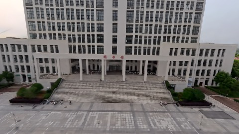
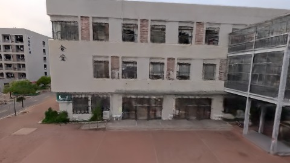
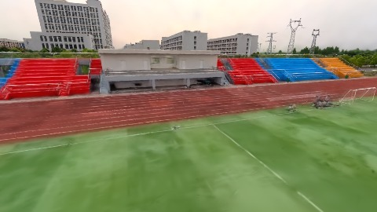
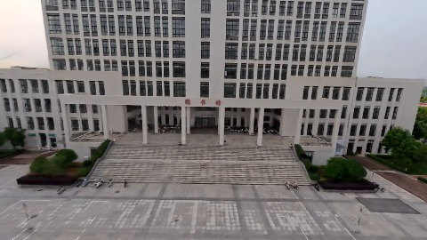
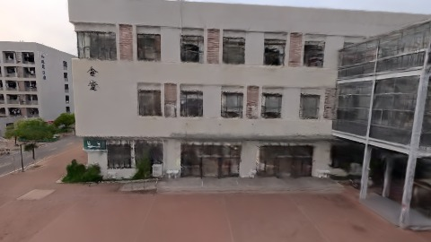

# Scene Profile Benchmark — 2026-07-23

## 本轮维度: profile

Suite: `public/benchmark-suites/scene-wuhan-d0-ab.json`

Renderer: `webgpu`

## 运行条件

- Cold start: yes
- Browser session: fresh-chromium-per-case
- Chromium HTTP cache: disabled-cdp-clearBrowserCache-zero-disk-cache
- Cold start (default): fresh Chromium per case, HTTP cache disabled
- OS 页缓存 / GPU 编译缓存：脚本不控制，跨次运行可能仍有差异

| label | presetId | budget | lodMode | lodRuntime | firstFrameMs | jsHeap@1st | vram@1st | jsHeapPeak | vramPeak | fpsP50 | fpsP95 | gsplatsAvgM |
|-------|----------|--------|---------|------------|--------------|------------|----------|------------|----------|--------|--------|-------------|
| wuhan-d0-5 | undefined | - | - | refinement | 33575.299999952316 | 250 | 283 | 319 | 310 | 39.0 | 42.0 | 3.64 |
| wuhan-d0-2.25 | undefined | - | - | refinement | 11677.899999976158 | 122 | 182 | 286 | 287 | 42.0 | 48.0 | 2.97 |

## 交互巡检（糊→清晰）

### wuhan-d0-5

播放段 FPS: P50=39.0, P95=42.0, min=31.0, 总播放=2888ms

| waypoint | animTimeSec | moveMs | pendingPeak | blurToClearMs | fpsP50(refine) | fpsP95(refine) | fpsMin | gsplatsAtClearM | jsHeap@clear | vram@clear | jsHeapPeak | vramPeak | timeout |
|----------|-------------|--------|-------------|---------------|----------------|----------------|--------|-----------------|--------------|------------|------------|----------|---------|
| kf-0 | 0.00 | 0 | 5 | 3001 | 34.0 | 34.0 | 32.0 | 3.62 | 265 | 292 | 273 | 297 | N |
| kf-1 | 1.00 | 958 | 1 | 801 | 32.0 | 32.0 | 31.0 | 3.62 | 288 | 294 | 298 | 297 | N |
| kf-2 | 2.00 | 966 | 22 | 15601 | 52.0 | 59.0 | 39.0 | 3.62 | 279 | 304 | 309 | 310 | N |
| kf-3 | 3.00 | 964 | 28 | 11602 | 49.0 | 58.0 | 39.0 | 3.71 | 264 | 305 | 319 | 310 | N |

变清晰截图（480×270 JPEG）：

**kf-0**

**kf-1**

**kf-2**

**kf-3**

### wuhan-d0-2.25

播放段 FPS: P50=42.0, P95=48.0, min=42.0, 总播放=2876ms

| waypoint | animTimeSec | moveMs | pendingPeak | blurToClearMs | fpsP50(refine) | fpsP95(refine) | fpsMin | gsplatsAtClearM | jsHeap@clear | vram@clear | jsHeapPeak | vramPeak | timeout |
|----------|-------------|--------|-------------|---------------|----------------|----------------|--------|-----------------|--------------|------------|------------|----------|---------|
| kf-0 | 0.00 | 0 | 15 | 7400 | 68.0 | 99.0 | 42.0 | 2.79 | 207 | 242 | 221 | 246 | N |
| kf-1 | 1.00 | 949 | 1 | 3001 | 42.0 | 42.0 | 41.0 | 2.79 | 175 | 242 | 210 | 246 | N |
| kf-2 | 2.00 | 966 | 17 | 13601 | 51.0 | 67.0 | 42.0 | 3.08 | 234 | 274 | 272 | 278 | N |
| kf-3 | 3.00 | 961 | 12 | 12001 | 57.0 | 81.0 | 43.0 | 3.21 | 212 | 261 | 286 | 287 | N |

变清晰截图（480×270 JPEG）：

**kf-0**

**kf-1**

**kf-2**

**kf-3**

## 优化前 vs 优化后

### wuhan-d0-ab（基线 `wuhan-d0-5`）

| case | lodMode | lodRuntime | firstFrameMs | kf-1 blur | kf-2 blur | blur P90 | vramPeak | poolEvictions |
|------|---------|------------|--------------|-----------|-----------|----------|----------|---------------|
| wuhan-d0-5 | - | refinement | 33575 (—) | 801 (—) | 15601 | 15601 | 310 | - |
| wuhan-d0-2.25 | - | refinement | 11678 (-65.2%) | 3001 (274.8%) | 13601 | 13601 | 287 | - |

## 结论

- 见上方对比表；`bottleneckHint` 见 `results.json`（scheduler / asset-http / mixed）