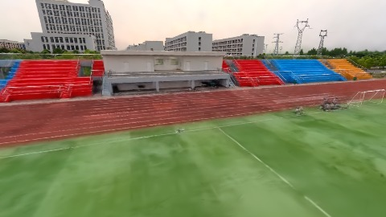
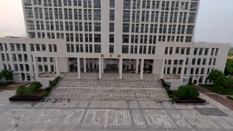
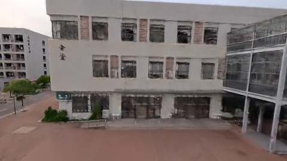

# Scene Profile Benchmark — 2026-07-23

## 本轮维度: profile

Suite: `public/benchmark-suites/scene-wuhan-v2-waypoints.json`

Renderer: `webgpu`

## 运行条件

- Cold start: yes
- Browser session: fresh-chromium-per-case
- Chromium HTTP cache: disabled-cdp-clearBrowserCache-zero-disk-cache
- Cold start (default): fresh Chromium per case, HTTP cache disabled
- OS 页缓存 / GPU 编译缓存：脚本不控制，跨次运行可能仍有差异

| label | presetId | budget | lodMode | lodRuntime | firstFrameMs | jsHeap@1st | vram@1st | jsHeapPeak | vramPeak | fpsP50 | fpsP95 | gsplatsAvgM |
|-------|----------|--------|---------|------------|--------------|------------|----------|------------|----------|--------|--------|-------------|
| wuhan-v2-user-waypoints | undefined | 2.5 | - | refinement | 1659.1000000238419 | 72 | 97 | 423 | 324 | 41.0 | 53.0 | 2.40 |

## 交互巡检（糊→清晰）

### wuhan-v2-user-waypoints

播放段 FPS: P50=41.0, P95=53.0, min=38.0, 总播放=2899ms

| waypoint | animTimeSec | moveMs | pendingPeak | blurToClearMs | fpsP50(refine) | fpsP95(refine) | fpsMin | gsplatsAtClearM | jsHeap@clear | vram@clear | jsHeapPeak | vramPeak | timeout |
|----------|-------------|--------|-------------|---------------|----------------|----------------|--------|-----------------|--------------|------------|------------|----------|---------|
| kf-0 | 0.00 | 0 | 33 | 7599 | 59.0 | 60.0 | 41.0 | 2.37 | 267 | 245 | 298 | 257 | N |
| kf-1 | 1.00 | 951 | 2 | 799 | 39.0 | 40.0 | 38.0 | 2.42 | 321 | 252 | 321 | 272 | N |
| kf-2 | 2.00 | 980 | 21 | 4200 | 54.0 | 57.0 | 39.0 | 2.40 | 294 | 276 | 423 | 324 | N |
| kf-3 | 3.00 | 968 | 26 | 10801 | 48.0 | 59.0 | 46.0 | 2.41 | 305 | 268 | 368 | 294 | N |

变清晰截图（480×270 JPEG）：

**kf-0**

**kf-1**

**kf-2**

**kf-3**

## 优化前 vs 优化后

### default（基线 `wuhan-v2-user-waypoints`）

| case | lodMode | lodRuntime | firstFrameMs | kf-1 blur | kf-2 blur | blur P90 | vramPeak | poolEvictions |
|------|---------|------------|--------------|-----------|-----------|----------|----------|---------------|
| wuhan-v2-user-waypoints | - | refinement | 1659 (—) | 799 (—) | 4200 | 10801 | 324 | - |

## 结论

- 见上方对比表；`bottleneckHint` 见 `results.json`（scheduler / asset-http / mixed）