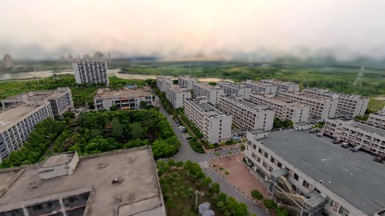
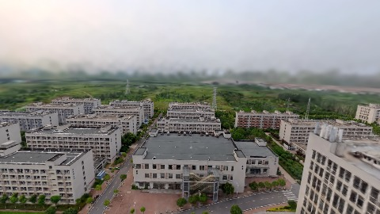
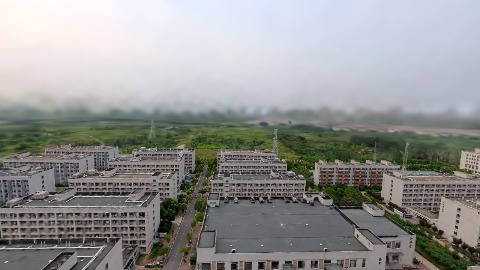

# Scene Profile Benchmark — 2026-07-24

## 本轮维度: profile

Suite: `public/benchmark-suites/scene-wuhan-v5-waypoints.json`

Renderer: `webgpu`

## 运行条件

- Cold start: yes
- Browser session: fresh-chromium-per-case
- Chromium HTTP cache: disabled-cdp-clearBrowserCache-zero-disk-cache
- Cold start (default): fresh Chromium per case, HTTP cache disabled
- OS 页缓存 / GPU 编译缓存：脚本不控制，跨次运行可能仍有差异

| label | presetId | budget | lodMode | lodRuntime | firstFrameMs | jsHeap@1st | vram@1st | jsHeapPeak | vramPeak | fpsP50 | fpsP95 | gsplatsAvgM |
|-------|----------|--------|---------|------------|--------------|------------|----------|------------|----------|--------|--------|-------------|
| wuhan-v5-user-waypoints | undefined | 2.5 | - | refinement | 3253 | 93 | 110 | 163 | 159 | 60.0 | 60.0 | 1.20 |

## 交互巡检（糊→清晰）

### wuhan-v5-user-waypoints

播放段 FPS: P50=60.0, P95=60.0, min=59.0, 总播放=2847ms

| waypoint | animTimeSec | moveMs | pendingPeak | blurToClearMs | fpsP50(refine) | fpsP95(refine) | fpsMin | gsplatsAtClearM | jsHeap@clear | vram@clear | jsHeapPeak | vramPeak | timeout |
|----------|-------------|--------|-------------|---------------|----------------|----------------|--------|-----------------|--------------|------------|------------|----------|---------|
| kf-0 | 0.00 | 0 | 11 | 5201 | 60.0 | 60.0 | 59.0 | 0.92 | 119 | 135 | 146 | 135 | N |
| kf-1 | 1.00 | 949 | 0 | 0 | 60.0 | 60.0 | 60.0 | 0.92 | 99 | 135 | 121 | 135 | N |
| kf-2 | 2.00 | 950 | 5 | 2200 | 60.0 | 60.0 | 59.0 | 1.45 | 134 | 155 | 152 | 155 | N |
| kf-3 | 3.00 | 949 | 1 | 1000 | 60.0 | 60.0 | 59.0 | 1.51 | 139 | 159 | 163 | 159 | N |

变清晰截图（480×270 JPEG）：

**kf-0**

**kf-1**

**kf-2**

**kf-3**

## 优化前 vs 优化后

### default（基线 `wuhan-v5-user-waypoints`）

| case | lodMode | lodRuntime | firstFrameMs | kf-1 blur | kf-2 blur | blur P90 | vramPeak | poolEvictions |
|------|---------|------------|--------------|-----------|-----------|----------|----------|---------------|
| wuhan-v5-user-waypoints | - | refinement | 3253 (—) | 0 (—) | 2200 | 5201 | 159 | - |

## 结论

- 见上方对比表；`bottleneckHint` 见 `results.json`（scheduler / asset-http / mixed）