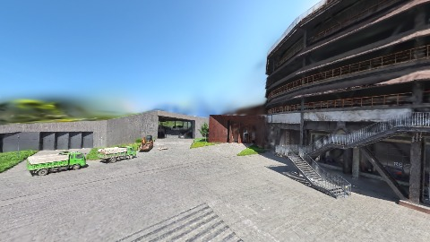
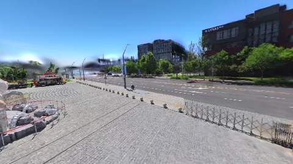
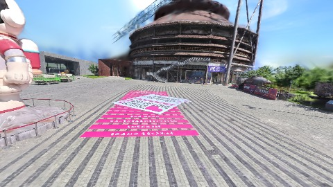

# Scene Profile Benchmark — 2026-07-29

## 本轮维度: profile

Suite: `/Users/leqiwan/Desktop/shuyuan_wlq/大场景渲染/supersplat-viewer/public/benchmark-suites/scene-nanguangchang-scale-align-after.json`

Renderer: `webgpu`

## 运行条件

- Cold start: yes
- Browser session: fresh-chromium-per-case
- Chromium HTTP cache: disabled-cdp-clearBrowserCache-zero-disk-cache
- Cold start (default): fresh Chromium per case, HTTP cache disabled
- OS 页缓存 / GPU 编译缓存：脚本不控制，跨次运行可能仍有差异

| label | presetId | budget | lodMode | lodRuntime | firstFrameMs | jsHeap@1st | vram@1st | jsHeapPeak | vramPeak | fpsP50 | fpsP95 | gsplatsAvgM |
|-------|----------|--------|---------|------------|--------------|------------|----------|------------|----------|--------|--------|-------------|
| nanguangchang-scale-align-after | undefined | - | - | refinement | 15421.600000143051 | 168 | 196 | 297 | 281 | 60.0 | 60.0 | 1.89 |

## 交互巡检（糊→清晰）

### nanguangchang-scale-align-after

播放段 FPS: P50=60.0, P95=60.0, min=60.0, 总播放=2896ms

| waypoint | animTimeSec | moveMs | pendingPeak | blurToClearMs | fpsP50(refine) | fpsP95(refine) | fpsMin | gsplatsAtClearM | jsHeap@clear | vram@clear | jsHeapPeak | vramPeak | timeout |
|----------|-------------|--------|-------------|---------------|----------------|----------------|--------|-----------------|--------------|------------|------------|----------|---------|
| kf-0 | 0.00 | 0 | 4 | 2201 | 60.0 | 60.0 | 59.0 | 1.55 | 210 | 208 | 213 | 208 | N |
| kf-1 | 1.00 | 967 | 3 | 8201 | 60.0 | 60.0 | 59.0 | 1.78 | 196 | 238 | 234 | 238 | N |
| kf-2 | 2.00 | 966 | 0 | 0 | 60.0 | 60.0 | 60.0 | 2.18 | 247 | 244 | 247 | 244 | N |
| kf-3 | 3.00 | 962 | 3 | 7401 | 60.0 | 60.0 | 59.0 | 2.03 | 244 | 281 | 297 | 281 | N |

变清晰截图（480×270 JPEG）：

**kf-0**

**kf-1**

**kf-2**

**kf-3**

## 优化前 vs 优化后

### default（基线 `nanguangchang-scale-align-after`）

| case | lodMode | lodRuntime | firstFrameMs | kf-1 blur | kf-2 blur | blur P90 | vramPeak | poolEvictions |
|------|---------|------------|--------------|-----------|-----------|----------|----------|---------------|
| nanguangchang-scale-align-after | - | refinement | 15422 (—) | 8201 (—) | 0 | 8201 | 281 | - |

## 结论

- 见上方对比表；`bottleneckHint` 见 `results.json`（scheduler / asset-http / mixed）