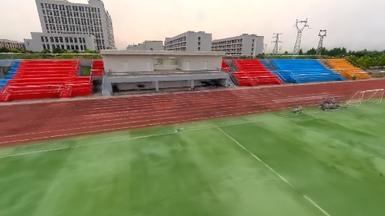
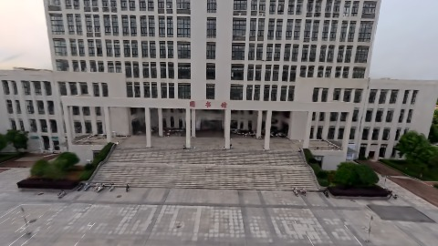
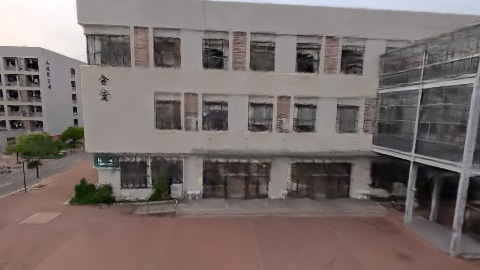

# Scene Profile Benchmark — 2026-07-29

## 本轮维度: profile

Suite: `/Users/leqiwan/Desktop/shuyuan_wlq/大场景渲染/supersplat-viewer/public/benchmark-suites/scene-wuhan-scale-align-after.json`

Renderer: `webgpu`

## 运行条件

- Cold start: yes
- Browser session: fresh-chromium-per-case
- Chromium HTTP cache: disabled-cdp-clearBrowserCache-zero-disk-cache
- Cold start (default): fresh Chromium per case, HTTP cache disabled
- OS 页缓存 / GPU 编译缓存：脚本不控制，跨次运行可能仍有差异

| label | presetId | budget | lodMode | lodRuntime | firstFrameMs | jsHeap@1st | vram@1st | jsHeapPeak | vramPeak | fpsP50 | fpsP95 | gsplatsAvgM |
|-------|----------|--------|---------|------------|--------------|------------|----------|------------|----------|--------|--------|-------------|
| wuhan-scale-align-after | undefined | - | - | refinement | 18183.89999985695 | 168 | 212 | 276 | 291 | 27.0 | 28.0 | 2.45 |

## 交互巡检（糊→清晰）

### wuhan-scale-align-after

播放段 FPS: P50=27.0, P95=28.0, min=23.0, 总播放=2887ms

| waypoint | animTimeSec | moveMs | pendingPeak | blurToClearMs | fpsP50(refine) | fpsP95(refine) | fpsMin | gsplatsAtClearM | jsHeap@clear | vram@clear | jsHeapPeak | vramPeak | timeout |
|----------|-------------|--------|-------------|---------------|----------------|----------------|--------|-----------------|--------------|------------|------------|----------|---------|
| kf-0 | 0.00 | 0 | 3 | 1203 | 30.0 | 31.0 | 27.0 | 2.29 | 150 | 214 | 174 | 216 | N |
| kf-1 | 1.00 | 953 | 0 | 0 | 27.0 | 27.0 | 27.0 | 2.30 | 168 | 220 | 168 | 225 | N |
| kf-2 | 2.00 | 955 | 16 | 17601 | 33.0 | 45.0 | 23.0 | 2.61 | 257 | 277 | 257 | 278 | N |
| kf-3 | 3.00 | 979 | 16 | 8401 | 31.0 | 39.0 | 26.0 | 2.62 | 251 | 285 | 276 | 291 | N |

变清晰截图（480×270 JPEG）：

**kf-0**

**kf-1**

**kf-2**

**kf-3**

## 优化前 vs 优化后

### default（基线 `wuhan-scale-align-after`）

| case | lodMode | lodRuntime | firstFrameMs | kf-1 blur | kf-2 blur | blur P90 | vramPeak | poolEvictions |
|------|---------|------------|--------------|-----------|-----------|----------|----------|---------------|
| wuhan-scale-align-after | - | refinement | 18184 (—) | 0 (—) | 17601 | 17601 | 291 | - |

## 结论

- 见上方对比表；`bottleneckHint` 见 `results.json`（scheduler / asset-http / mixed）