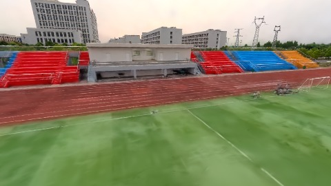
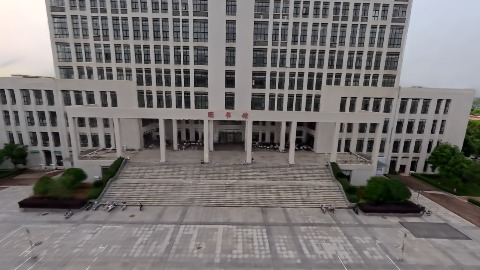
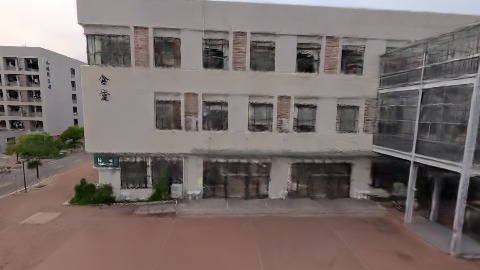

# Scene Profile Benchmark — 2026-07-29

## 本轮维度: profile

Suite: `/Users/leqiwan/Desktop/shuyuan_wlq/大场景渲染/supersplat-viewer/public/benchmark-suites/scene-wuhan-scale-align-before.json`

Renderer: `webgpu`

## 运行条件

- Cold start: yes
- Browser session: fresh-chromium-per-case
- Chromium HTTP cache: disabled-cdp-clearBrowserCache-zero-disk-cache
- Cold start (default): fresh Chromium per case, HTTP cache disabled
- OS 页缓存 / GPU 编译缓存：脚本不控制，跨次运行可能仍有差异

| label | presetId | budget | lodMode | lodRuntime | firstFrameMs | jsHeap@1st | vram@1st | jsHeapPeak | vramPeak | fpsP50 | fpsP95 | gsplatsAvgM |
|-------|----------|--------|---------|------------|--------------|------------|----------|------------|----------|--------|--------|-------------|
| wuhan-scale-align-before | undefined | - | - | refinement | 26330.599999904633 | 218 | 242 | 310 | 315 | 44.0 | 53.0 | 3.22 |

## 交互巡检（糊→清晰）

### wuhan-scale-align-before

播放段 FPS: P50=44.0, P95=53.0, min=39.0, 总播放=2879ms

| waypoint | animTimeSec | moveMs | pendingPeak | blurToClearMs | fpsP50(refine) | fpsP95(refine) | fpsMin | gsplatsAtClearM | jsHeap@clear | vram@clear | jsHeapPeak | vramPeak | timeout |
|----------|-------------|--------|-------------|---------------|----------------|----------------|--------|-----------------|--------------|------------|------------|----------|---------|
| kf-0 | 0.00 | 0 | 4 | 2201 | 41.0 | 45.0 | 15.0 | 3.02 | 207 | 252 | 228 | 252 | N |
| kf-1 | 1.00 | 953 | 0 | 0 | 39.0 | 39.0 | 39.0 | 3.08 | 218 | 252 | 218 | 252 | N |
| kf-2 | 2.00 | 964 | 24 | 16401 | 58.0 | 60.0 | 38.0 | 3.37 | 271 | 294 | 272 | 294 | N |
| kf-3 | 3.00 | 962 | 25 | 11801 | 60.0 | 60.0 | 52.0 | 3.40 | 287 | 313 | 310 | 315 | N |

变清晰截图（480×270 JPEG）：

**kf-0**

**kf-1**

**kf-2**

**kf-3**

## 优化前 vs 优化后

### default（基线 `wuhan-scale-align-before`）

| case | lodMode | lodRuntime | firstFrameMs | kf-1 blur | kf-2 blur | blur P90 | vramPeak | poolEvictions |
|------|---------|------------|--------------|-----------|-----------|----------|----------|---------------|
| wuhan-scale-align-before | - | refinement | 26331 (—) | 0 (—) | 16401 | 16401 | 315 | - |

## 结论

- 见上方对比表；`bottleneckHint` 见 `results.json`（scheduler / asset-http / mixed）