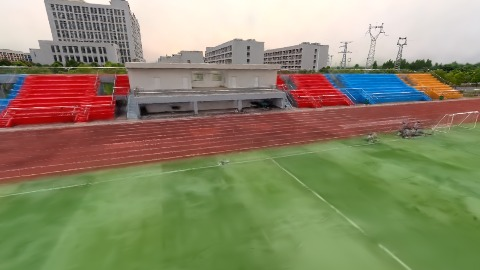
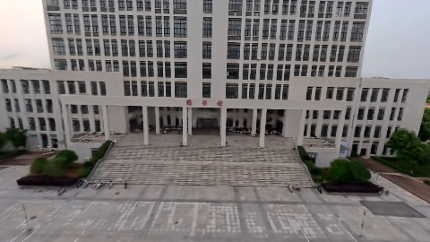
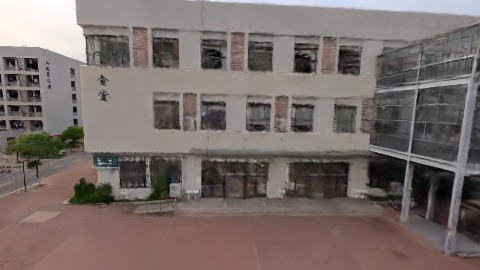

# Scene Profile Benchmark — 2026-07-30

## 本轮维度: profile

Suite: `/Users/leqiwan/Desktop/shuyuan_wlq/大场景渲染/supersplat-viewer/public/benchmark-suites/scene-wuhan-v8-midstop-after.json`

Renderer: `webgpu`

## 运行条件

- Cold start: yes
- Browser session: fresh-chromium-per-case
- Chromium HTTP cache: disabled-cdp-clearBrowserCache-zero-disk-cache
- Cold start (default): fresh Chromium per case, HTTP cache disabled
- OS 页缓存 / GPU 编译缓存：脚本不控制，跨次运行可能仍有差异

| label | presetId | budget | lodMode | lodRuntime | firstFrameMs | jsHeap@1st | vram@1st | jsHeapPeak | vramPeak | fpsP50 | fpsP95 | gsplatsAvgM |
|-------|----------|--------|---------|------------|--------------|------------|----------|------------|----------|--------|--------|-------------|
| wuhan-v8-midstop-after | undefined | - | - | refinement | 5625.5 | 99 | 155 | 304 | 313 | 44.0 | 57.0 | 2.58 |

## 交互巡检（糊→清晰）

### wuhan-v8-midstop-after

播放段 FPS: P50=44.0, P95=57.0, min=44.0, 总播放=2868ms

| waypoint | animTimeSec | moveMs | pendingPeak | blurToClearMs | fpsP50(refine) | fpsP95(refine) | fpsMin | gsplatsAtClearM | jsHeap@clear | vram@clear | jsHeapPeak | vramPeak | timeout |
|----------|-------------|--------|-------------|---------------|----------------|----------------|--------|-----------------|--------------|------------|------------|----------|---------|
| kf-0 | 0.00 | 0 | 38 | 15801 | 77.0 | 120.0 | 44.0 | 2.33 | 178 | 226 | 195 | 229 | N |
| kf-1 | 1.00 | 956 | 0 | 0 | 46.0 | 46.0 | 46.0 | 2.33 | 166 | 226 | 187 | 226 | N |
| kf-2 | 2.00 | 956 | 20 | 14201 | 59.0 | 83.0 | 44.0 | 2.68 | 237 | 274 | 246 | 275 | N |
| kf-3 | 3.00 | 957 | 15 | 8001 | 71.0 | 90.0 | 55.0 | 2.97 | 282 | 313 | 304 | 313 | N |

变清晰截图（480×270 JPEG）：

**kf-0**

**kf-1**

**kf-2**

**kf-3**

## 优化前 vs 优化后

### default（基线 `wuhan-v8-midstop-after`）

| case | lodMode | lodRuntime | firstFrameMs | kf-1 blur | kf-2 blur | blur P90 | vramPeak | poolEvictions |
|------|---------|------------|--------------|-----------|-----------|----------|----------|---------------|
| wuhan-v8-midstop-after | - | refinement | 5626 (—) | 0 (—) | 14201 | 15801 | 313 | - |

## 结论

- 见上方对比表；`bottleneckHint` 见 `results.json`（scheduler / asset-http / mixed）