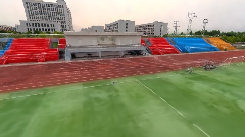
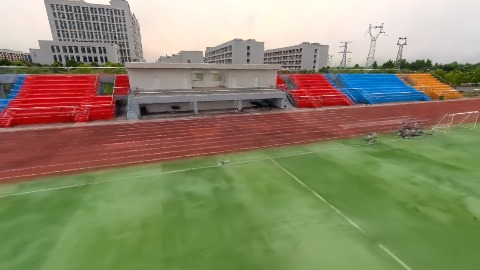
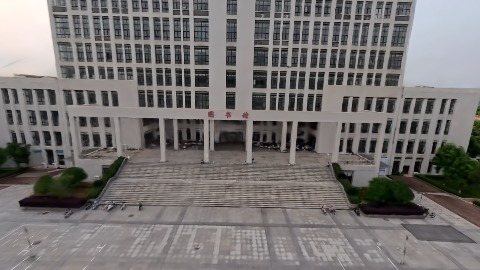
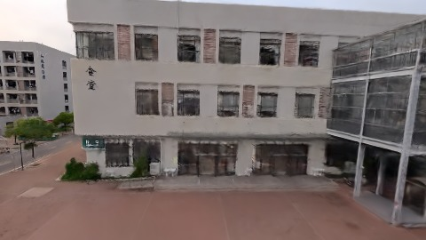

# Scene Profile Benchmark — 2026-07-30

## 本轮维度: profile

Suite: `public/benchmark-suites/scene-wuhan-v8-scale-align-after.json`

Renderer: `webgpu`

## 运行条件

- Cold start: yes
- Browser session: fresh-chromium-per-case
- Chromium HTTP cache: disabled-cdp-clearBrowserCache-zero-disk-cache
- Cold start (default): fresh Chromium per case, HTTP cache disabled
- OS 页缓存 / GPU 编译缓存：脚本不控制，跨次运行可能仍有差异

| label | presetId | budget | lodMode | lodRuntime | firstFrameMs | jsHeap@1st | vram@1st | jsHeapPeak | vramPeak | fpsP50 | fpsP95 | gsplatsAvgM |
|-------|----------|--------|---------|------------|--------------|------------|----------|------------|----------|--------|--------|-------------|
| wuhan-v8-scale-align-after | undefined | - | - | refinement | 5756.299999952316 | 75 | 158 | 323 | 339 | 42.0 | 50.0 | 2.93 |

## 交互巡检（糊→清晰）

### wuhan-v8-scale-align-after

播放段 FPS: P50=42.0, P95=50.0, min=39.0, 总播放=2877ms

| waypoint | animTimeSec | moveMs | pendingPeak | blurToClearMs | fpsP50(refine) | fpsP95(refine) | fpsMin | gsplatsAtClearM | jsHeap@clear | vram@clear | jsHeapPeak | vramPeak | timeout |
|----------|-------------|--------|-------------|---------------|----------------|----------------|--------|-----------------|--------------|------------|------------|----------|---------|
| kf-0 | 0.00 | 0 | 31 | 21200 | 70.0 | 120.0 | 42.0 | 2.64 | 210 | 245 | 210 | 245 | N |
| kf-1 | 1.00 | 966 | 0 | 0 | 41.0 | 41.0 | 39.0 | 2.67 | 187 | 245 | 204 | 245 | N |
| kf-2 | 2.00 | 956 | 19 | 17001 | 58.0 | 65.0 | 46.0 | 3.20 | 274 | 296 | 288 | 296 | N |
| kf-3 | 3.00 | 955 | 19 | 14002 | 64.0 | 73.0 | 46.0 | 3.20 | 320 | 336 | 323 | 339 | N |

变清晰截图（480×270 JPEG）：

**kf-0**

**kf-1**

**kf-2**

**kf-3**

## 优化前 vs 优化后

### default（基线 `wuhan-v8-scale-align-after`）

| case | lodMode | lodRuntime | firstFrameMs | kf-1 blur | kf-2 blur | blur P90 | vramPeak | poolEvictions |
|------|---------|------------|--------------|-----------|-----------|----------|----------|---------------|
| wuhan-v8-scale-align-after | - | refinement | 5756 (—) | 0 (—) | 17001 | 21200 | 339 | - |

## 结论

- 见上方对比表；`bottleneckHint` 见 `results.json`（scheduler / asset-http / mixed）