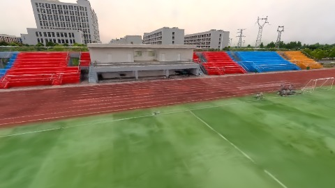
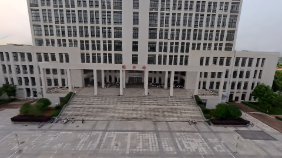
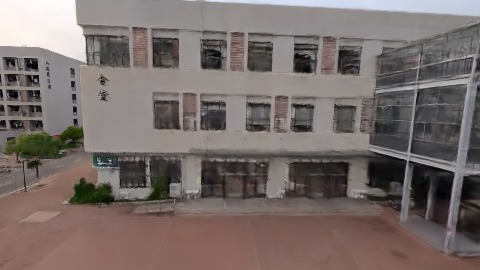

# Scene Profile Benchmark — 2026-07-30

## 本轮维度: profile

Suite: `public/benchmark-suites/scene-wuhan-v8-scale-align-before.json`

Renderer: `webgpu`

## 运行条件

- Cold start: yes
- Browser session: fresh-chromium-per-case
- Chromium HTTP cache: disabled-cdp-clearBrowserCache-zero-disk-cache
- Cold start (default): fresh Chromium per case, HTTP cache disabled
- OS 页缓存 / GPU 编译缓存：脚本不控制，跨次运行可能仍有差异

| label | presetId | budget | lodMode | lodRuntime | firstFrameMs | jsHeap@1st | vram@1st | jsHeapPeak | vramPeak | fpsP50 | fpsP95 | gsplatsAvgM |
|-------|----------|--------|---------|------------|--------------|------------|----------|------------|----------|--------|--------|-------------|
| wuhan-v8-scale-align-before | undefined | - | - | refinement | 5700.900000095367 | 101 | 157 | 348 | 344 | 34.0 | 41.0 | 3.28 |

## 交互巡检（糊→清晰）

### wuhan-v8-scale-align-before

播放段 FPS: P50=34.0, P95=41.0, min=30.0, 总播放=2897ms

| waypoint | animTimeSec | moveMs | pendingPeak | blurToClearMs | fpsP50(refine) | fpsP95(refine) | fpsMin | gsplatsAtClearM | jsHeap@clear | vram@clear | jsHeapPeak | vramPeak | timeout |
|----------|-------------|--------|-------------|---------------|----------------|----------------|--------|-----------------|--------------|------------|------------|----------|---------|
| kf-0 | 0.00 | 0 | 36 | 24001 | 62.0 | 119.0 | 35.0 | 3.02 | 240 | 276 | 241 | 279 | N |
| kf-1 | 1.00 | 967 | 0 | 0 | 30.0 | 30.0 | 30.0 | 3.12 | 238 | 274 | 238 | 274 | N |
| kf-2 | 2.00 | 971 | 26 | 17800 | 51.0 | 57.0 | 34.0 | 3.46 | 280 | 310 | 299 | 310 | N |
| kf-3 | 3.00 | 959 | 26 | 13600 | 56.0 | 61.0 | 41.0 | 3.52 | 310 | 342 | 348 | 344 | N |

变清晰截图（480×270 JPEG）：

**kf-0**

**kf-1**

**kf-2**

**kf-3**

## 优化前 vs 优化后

### default（基线 `wuhan-v8-scale-align-before`）

| case | lodMode | lodRuntime | firstFrameMs | kf-1 blur | kf-2 blur | blur P90 | vramPeak | poolEvictions |
|------|---------|------------|--------------|-----------|-----------|----------|----------|---------------|
| wuhan-v8-scale-align-before | - | refinement | 5701 (—) | 0 (—) | 17800 | 24001 | 344 | - |

## 结论

- 见上方对比表；`bottleneckHint` 见 `results.json`（scheduler / asset-http / mixed）