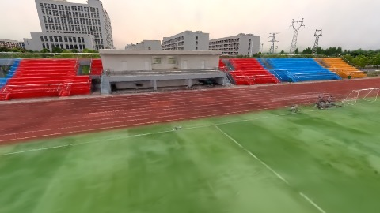
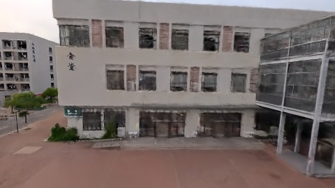
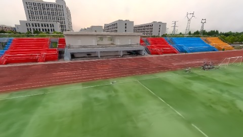
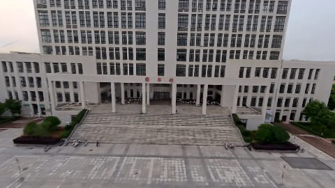
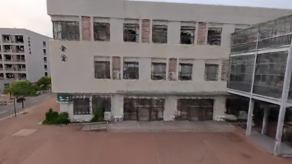

# Scene Profile Benchmark — 2026-08-03

## 本轮维度: profile

Suite: `/Users/leqiwan/Desktop/shuyuan_wlq/大场景渲染/supersplat-viewer/public/benchmark-suites/scene-wuhan-v6-scale-align-warm.json`

Renderer: `webgpu`

## 运行条件

- Cold start: no
- Browser session: shared-context-per-script
- Chromium HTTP cache: enabled-shared-after-warmup
- Warm start: discarded warmup `wuhan-v6-scale-align-after` (46079ms), then measured in same context
- OS 页缓存 / GPU 编译缓存：脚本不控制，跨次运行可能仍有差异

| label | presetId | budget | lodMode | lodRuntime | firstFrameMs | jsHeap@1st | vram@1st | jsHeapPeak | vramPeak | fpsP50 | fpsP95 | gsplatsAvgM |
|-------|----------|--------|---------|------------|--------------|------------|----------|------------|----------|--------|--------|-------------|
| wuhan-v6-scale-align-after | undefined | - | - | refinement | 6872.299999952316 | 354 | 160 | 354 | 283 | 54.0 | 60.0 | 2.30 |
| wuhan-v6-scale-align-before | undefined | - | - | refinement | 1458.2000000476837 | 284 | 137 | 356 | 352 | 35.0 | 43.0 | 3.29 |

## 交互巡检（糊→清晰）

### wuhan-v6-scale-align-after

播放段 FPS: P50=54.0, P95=60.0, min=51.0, 总播放=2844ms

| waypoint | animTimeSec | moveMs | pendingPeak | blurToClearMs | fpsP50(refine) | fpsP95(refine) | fpsMin | gsplatsAtClearM | jsHeap@clear | vram@clear | jsHeapPeak | vramPeak | timeout |
|----------|-------------|--------|-------------|---------------|----------------|----------------|--------|-----------------|--------------|------------|------------|----------|---------|
| kf-0 | 0.00 | 0 | 10 | 11400 | 60.0 | 60.0 | 59.0 | 2.15 | 165 | 218 | 354 | 218 | N |
| kf-1 | 1.00 | 950 | 0 | 0 | 53.0 | 53.0 | 51.0 | 2.15 | 151 | 214 | 161 | 216 | N |
| kf-2 | 2.00 | 949 | 15 | 10000 | 60.0 | 60.0 | 54.0 | 2.35 | 196 | 248 | 215 | 248 | N |
| kf-3 | 3.00 | 945 | 10 | 11001 | 60.0 | 60.0 | 58.0 | 2.54 | 228 | 279 | 252 | 283 | N |

变清晰截图（480×270 JPEG）：

**kf-0**

**kf-1**

**kf-2**

**kf-3**

### wuhan-v6-scale-align-before

播放段 FPS: P50=35.0, P95=43.0, min=32.0, 总播放=2884ms

| waypoint | animTimeSec | moveMs | pendingPeak | blurToClearMs | fpsP50(refine) | fpsP95(refine) | fpsMin | gsplatsAtClearM | jsHeap@clear | vram@clear | jsHeapPeak | vramPeak | timeout |
|----------|-------------|--------|-------------|---------------|----------------|----------------|--------|-----------------|--------------|------------|------------|----------|---------|
| kf-0 | 0.00 | 0 | 33 | 21201 | 59.0 | 60.0 | 32.0 | 3.12 | 249 | 284 | 356 | 286 | N |
| kf-1 | 1.00 | 968 | 0 | 0 | 35.0 | 35.0 | 33.0 | 3.15 | 243 | 282 | 254 | 284 | N |
| kf-2 | 2.00 | 952 | 23 | 15401 | 53.0 | 60.0 | 33.0 | 3.38 | 301 | 312 | 301 | 313 | N |
| kf-3 | 3.00 | 964 | 25 | 14201 | 55.0 | 59.0 | 43.0 | 3.53 | 334 | 351 | 354 | 352 | N |

变清晰截图（480×270 JPEG）：

**kf-0**

**kf-1**

**kf-2**

**kf-3**

## 优化前 vs 优化后

### default（基线 `wuhan-v6-scale-align-after`）

| case | lodMode | lodRuntime | firstFrameMs | kf-1 blur | kf-2 blur | blur P90 | vramPeak | poolEvictions |
|------|---------|------------|--------------|-----------|-----------|----------|----------|---------------|
| wuhan-v6-scale-align-after | - | refinement | 6872 (—) | 0 (—) | 10000 | 11400 | 283 | - |
| wuhan-v6-scale-align-before | - | refinement | 1458 (-78.8%) | 0 (-%) | 15401 | 21201 | 352 | - |

## 结论

- 见上方对比表；`bottleneckHint` 见 `results.json`（scheduler / asset-http / mixed）