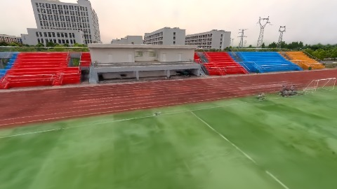
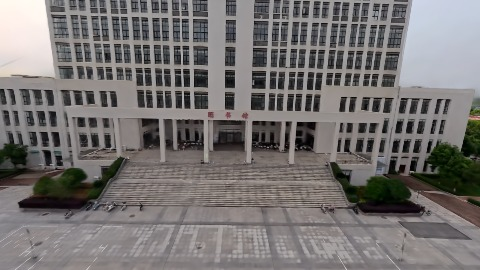
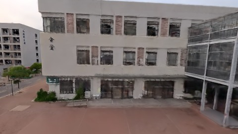
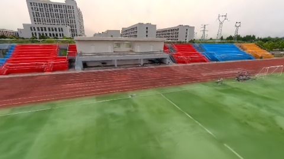
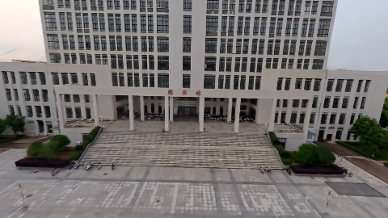

# Scene Profile Benchmark — 2026-08-04

## 本轮维度: profile

Suite: `public/benchmark-suites/scene-wuhan-v6-vs-pack40-center.json`

Renderer: `webgpu`

## 运行条件

- Cold start: yes
- Browser session: fresh-chromium-per-case
- Chromium HTTP cache: disabled-cdp-clearBrowserCache-zero-disk-cache
- Cold start (default): fresh Chromium per case, HTTP cache disabled
- OS 页缓存 / GPU 编译缓存：脚本不控制，跨次运行可能仍有差异

| label | presetId | budget | lodMode | lodRuntime | firstFrameMs | jsHeap@1st | vram@1st | jsHeapPeak | vramPeak | fpsP50 | fpsP95 | gsplatsAvgM |
|-------|----------|--------|---------|------------|--------------|------------|----------|------------|----------|--------|--------|-------------|
| wuhan-v6 | undefined | 2.5 | - | refinement | 67266.90000009537 | 230 | 232 | 302 | 276 | 41.0 | 56.0 | 2.35 |
| wuhan-v6-pack40 | undefined | 2.5 | - | refinement | 35462.59999990463 | 210 | 210 | 314 | 277 | 40.0 | 60.0 | 2.26 |

## 交互巡检（糊→清晰）

### wuhan-v6

播放段 FPS: P50=41.0, P95=56.0, min=40.0, 总播放=2918ms

| waypoint | animTimeSec | moveMs | pendingPeak | blurToClearMs | fpsP50(refine) | fpsP95(refine) | fpsMin | gsplatsAtClearM | jsHeap@clear | vram@clear | jsHeapPeak | vramPeak | timeout |
|----------|-------------|--------|-------------|---------------|----------------|----------------|--------|-----------------|--------------|------------|------------|----------|---------|
| kf-0 | 0.00 | 0 | 2 | 17400 | 25.0 | 43.0 | 22.0 | 2.34 | 236 | 236 | 255 | 238 | N |
| kf-1 | 1.00 | 989 | 0 | 0 | 40.0 | 40.0 | 40.0 | 2.34 | 236 | 236 | 244 | 236 | N |
| kf-2 | 2.00 | 967 | 15 | 21601 | 60.0 | 60.0 | 46.0 | 2.35 | 253 | 251 | 276 | 255 | N |
| kf-3 | 3.00 | 963 | 19 | 12800 | 54.0 | 60.0 | 45.0 | 2.36 | 294 | 276 | 302 | 276 | N |

变清晰截图（480×270 JPEG）：

**kf-0**

**kf-1**

**kf-2**

**kf-3**

### wuhan-v6-pack40

播放段 FPS: P50=40.0, P95=60.0, min=39.0, 总播放=2868ms

| waypoint | animTimeSec | moveMs | pendingPeak | blurToClearMs | fpsP50(refine) | fpsP95(refine) | fpsMin | gsplatsAtClearM | jsHeap@clear | vram@clear | jsHeapPeak | vramPeak | timeout |
|----------|-------------|--------|-------------|---------------|----------------|----------------|--------|-----------------|--------------|------------|------------|----------|---------|
| kf-0 | 0.00 | 0 | 6 | 2001 | 41.0 | 42.0 | 40.0 | 2.23 | 198 | 218 | 228 | 219 | N |
| kf-1 | 1.00 | 957 | 0 | 0 | 44.0 | 44.0 | 39.0 | 2.23 | 203 | 216 | 221 | 216 | N |
| kf-2 | 2.00 | 950 | 25 | 16400 | 60.0 | 60.0 | 40.0 | 2.29 | 260 | 240 | 266 | 240 | N |
| kf-3 | 3.00 | 961 | 33 | 18200 | 60.0 | 60.0 | 50.0 | 2.29 | 288 | 276 | 314 | 277 | N |

变清晰截图（480×270 JPEG）：

**kf-0**

**kf-1**

**kf-2**

**kf-3**

## 优化前 vs 优化后

### wuhan-v6-vs-pack40-center（基线 `wuhan-v6`）

| case | lodMode | lodRuntime | firstFrameMs | kf-1 blur | kf-2 blur | blur P90 | vramPeak | poolEvictions |
|------|---------|------------|--------------|-----------|-----------|----------|----------|---------------|
| wuhan-v6 | - | refinement | 67267 (—) | 0 (—) | 21601 | 21601 | 276 | - |
| wuhan-v6-pack40 | - | refinement | 35463 (-47.3%) | 0 (-%) | 16400 | 18200 | 277 | - |

## 结论

- 见上方对比表；`bottleneckHint` 见 `results.json`（scheduler / asset-http / mixed）