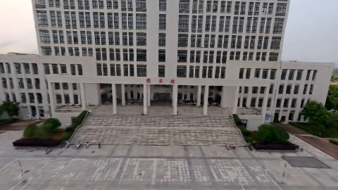
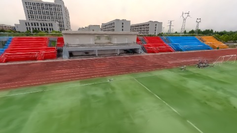
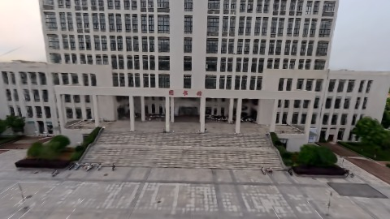
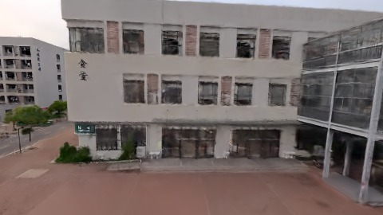

# Scene Profile Benchmark — 2026-08-04

## 本轮维度: profile

Suite: `public/benchmark-suites/scene-wuhan-v6-vs-pack40.json`

Renderer: `webgpu`

## 运行条件

- Cold start: yes
- Browser session: fresh-chromium-per-case
- Chromium HTTP cache: disabled-cdp-clearBrowserCache-zero-disk-cache
- Cold start (default): fresh Chromium per case, HTTP cache disabled
- OS 页缓存 / GPU 编译缓存：脚本不控制，跨次运行可能仍有差异

| label | presetId | budget | lodMode | lodRuntime | firstFrameMs | jsHeap@1st | vram@1st | jsHeapPeak | vramPeak | fpsP50 | fpsP95 | gsplatsAvgM |
|-------|----------|--------|---------|------------|--------------|------------|----------|------------|----------|--------|--------|-------------|
| wuhan-v6 | undefined | 2.5 | - | refinement | 17921.799999952316 | 159 | 176 | 253 | 241 | 60.0 | 60.0 | 1.84 |
| wuhan-v6-pack40 | undefined | 2.5 | - | refinement | 18250.599999904633 | 151 | 163 | 245 | 228 | 60.0 | 60.0 | 1.66 |

## 交互巡检（糊→清晰）

### wuhan-v6

播放段 FPS: P50=60.0, P95=60.0, min=54.0, 总播放=2906ms

| waypoint | animTimeSec | moveMs | pendingPeak | blurToClearMs | fpsP50(refine) | fpsP95(refine) | fpsMin | gsplatsAtClearM | jsHeap@clear | vram@clear | jsHeapPeak | vramPeak | timeout |
|----------|-------------|--------|-------------|---------------|----------------|----------------|--------|-----------------|--------------|------------|------------|----------|---------|
| kf-0 | 0.00 | 0 | 0 | 0 | 60.0 | 60.0 | 59.0 | 1.77 | 164 | 176 | 164 | 176 | N |
| kf-1 | 1.00 | 975 | 0 | 0 | 59.0 | 59.0 | 59.0 | 1.77 | 155 | 174 | 172 | 174 | N |
| kf-2 | 2.00 | 967 | 10 | 11600 | 60.0 | 60.0 | 54.0 | 1.85 | 190 | 210 | 207 | 210 | N |
| kf-3 | 3.00 | 964 | 11 | 11800 | 60.0 | 60.0 | 59.0 | 1.97 | 236 | 241 | 253 | 241 | N |

变清晰截图（480×270 JPEG）：

**kf-0**

**kf-1**

**kf-2**

**kf-3**

### wuhan-v6-pack40

播放段 FPS: P50=60.0, P95=60.0, min=56.0, 总播放=2879ms

| waypoint | animTimeSec | moveMs | pendingPeak | blurToClearMs | fpsP50(refine) | fpsP95(refine) | fpsMin | gsplatsAtClearM | jsHeap@clear | vram@clear | jsHeapPeak | vramPeak | timeout |
|----------|-------------|--------|-------------|---------------|----------------|----------------|--------|-----------------|--------------|------------|------------|----------|---------|
| kf-0 | 0.00 | 0 | 6 | 1401 | 59.0 | 59.0 | 56.0 | 1.57 | 144 | 168 | 160 | 170 | N |
| kf-1 | 1.00 | 966 | 0 | 0 | 56.0 | 60.0 | 56.0 | 1.57 | 164 | 163 | 164 | 165 | N |
| kf-2 | 2.00 | 950 | 17 | 8201 | 60.0 | 60.0 | 58.0 | 1.70 | 161 | 187 | 186 | 187 | N |
| kf-3 | 3.00 | 962 | 19 | 10400 | 60.0 | 60.0 | 59.0 | 1.78 | 232 | 228 | 245 | 228 | N |

变清晰截图（480×270 JPEG）：

**kf-0**

**kf-1**

**kf-2**

**kf-3**

## 优化前 vs 优化后

### wuhan-v6-vs-pack40（基线 `wuhan-v6`）

| case | lodMode | lodRuntime | firstFrameMs | kf-1 blur | kf-2 blur | blur P90 | vramPeak | poolEvictions |
|------|---------|------------|--------------|-----------|-----------|----------|----------|---------------|
| wuhan-v6 | - | refinement | 17922 (—) | 0 (—) | 11600 | 11800 | 241 | - |
| wuhan-v6-pack40 | - | refinement | 18251 (1.8%) | 0 (-%) | 8201 | 10400 | 228 | - |

## 结论

- 见上方对比表；`bottleneckHint` 见 `results.json`（scheduler / asset-http / mixed）