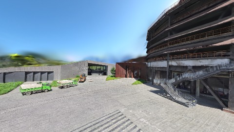

# Scene Profile Benchmark — 2026-08-05

## 本轮维度: profile

Suite: `public/benchmark-suites/scene-nanguangchang-v6-0.5-engine-pc-2.21.3.json`

Renderer: `webgpu`

## 运行条件

- Cold start: no
- Browser session: shared-context-per-script
- Chromium HTTP cache: enabled-shared-after-warmup
- Warm start: discarded warmup `pc-2.21.3-after` (74672ms), then measured in same context
- OS 页缓存 / GPU 编译缓存：脚本不控制，跨次运行可能仍有差异

| label | presetId | budget | lodMode | lodRuntime | firstFrameMs | jsHeap@1st | vram@1st | jsHeapPeak | vramPeak | fpsP50 | fpsP95 | gsplatsAvgM |
|-------|----------|--------|---------|------------|--------------|------------|----------|------------|----------|--------|--------|-------------|
| pc-2.21.3-after | undefined | - | - | refinement | 49611.09999990463 | 177 | 316 | 241 | 332 | 57.0 | 59.0 | 3.46 |

## 交互巡检（糊→清晰）

### pc-2.21.3-after

播放段 FPS: P50=57.0, P95=59.0, min=57.0, 总播放=967ms

| waypoint | animTimeSec | moveMs | pendingPeak | blurToClearMs | fpsP50(refine) | fpsP95(refine) | fpsMin | gsplatsAtClearM | jsHeap@clear | vram@clear | jsHeapPeak | vramPeak | timeout |
|----------|-------------|--------|-------------|---------------|----------------|----------------|--------|-----------------|--------------|------------|------------|----------|---------|
| kf-0 | 0.00 | 0 | 0 | 0 | 59.0 | 59.0 | 59.0 | 3.37 | 188 | 316 | 201 | 316 | N |
| kf-1 | 1.00 | 967 | 21 | 12800 | 60.0 | 60.0 | 57.0 | 3.54 | 189 | 332 | 241 | 332 | N |

变清晰截图（480×270 JPEG）：

**kf-0**

**kf-1**

## 优化前 vs 优化后

### nanguangchang-v6-0.5-engine（基线 `pc-2.21.3-after`）

| case | lodMode | lodRuntime | firstFrameMs | kf-1 blur | kf-2 blur | blur P90 | vramPeak | poolEvictions |
|------|---------|------------|--------------|-----------|-----------|----------|----------|---------------|
| pc-2.21.3-after | - | refinement | 49611 (—) | 12800 (—) | - | 12800 | 332 | - |

## 结论

- 见上方对比表；`bottleneckHint` 见 `results.json`（scheduler / asset-http / mixed）