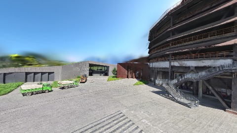

# Scene Profile Benchmark — 2026-08-05

## 本轮维度: profile

Suite: `public/benchmark-suites/scene-nanguangchang-v6-0.5-ladder-ab.json`

Renderer: `webgpu`

## 运行条件

- Cold start: no
- Browser session: shared-context-per-script
- Chromium HTTP cache: enabled-shared-after-warmup
- Warm start: discarded warmup `ladder-1-2-3-current` (79286ms), then measured in same context
- OS 页缓存 / GPU 编译缓存：脚本不控制，跨次运行可能仍有差异

| label | presetId | budget | lodMode | lodRuntime | firstFrameMs | jsHeap@1st | vram@1st | jsHeapPeak | vramPeak | fpsP50 | fpsP95 | gsplatsAvgM |
|-------|----------|--------|---------|------------|--------------|------------|----------|------------|----------|--------|--------|-------------|
| ladder-1-2-3-current | undefined | - | - | refinement | 50628.299999952316 | 296 | 311 | 340 | 330 | 52.0 | 55.0 | 3.42 |
| ladder-2-2-3-center2 | undefined | - | - | refinement | 52923.40000009537 | 306 | 303 | 328 | 330 | 57.0 | 57.0 | 3.43 |
| ladder-2-3-target-aggressive | undefined | - | - | refinement | 50965.59999990463 | 296 | 312 | 360 | 330 | 58.0 | 58.0 | 3.39 |
| ladder-1-3-target-edgeOnly | undefined | - | - | refinement | 54960.5 | 309 | 304 | 351 | 337 | 48.0 | 51.0 | 3.45 |

## 交互巡检（糊→清晰）

### ladder-1-2-3-current

播放段 FPS: P50=52.0, P95=55.0, min=52.0, 总播放=954ms

| waypoint | animTimeSec | moveMs | pendingPeak | blurToClearMs | fpsP50(refine) | fpsP95(refine) | fpsMin | gsplatsAtClearM | jsHeap@clear | vram@clear | jsHeapPeak | vramPeak | timeout |
|----------|-------------|--------|-------------|---------------|----------------|----------------|--------|-----------------|--------------|------------|------------|----------|---------|
| kf-0 | 0.00 | 0 | 0 | 0 | 55.0 | 55.0 | 55.0 | 3.36 | 297 | 311 | 311 | 311 | N |
| kf-1 | 1.00 | 954 | 21 | 10400 | 60.0 | 60.0 | 52.0 | 3.48 | 292 | 330 | 340 | 330 | N |

变清晰截图（480×270 JPEG）：

**kf-0**

**kf-1**

### ladder-2-2-3-center2

播放段 FPS: P50=57.0, P95=57.0, min=57.0, 总播放=970ms

| waypoint | animTimeSec | moveMs | pendingPeak | blurToClearMs | fpsP50(refine) | fpsP95(refine) | fpsMin | gsplatsAtClearM | jsHeap@clear | vram@clear | jsHeapPeak | vramPeak | timeout |
|----------|-------------|--------|-------------|---------------|----------------|----------------|--------|-----------------|--------------|------------|------------|----------|---------|
| kf-0 | 0.00 | 0 | 0 | 0 | 58.0 | 58.0 | 58.0 | 3.29 | 294 | 303 | 306 | 303 | N |
| kf-1 | 1.00 | 970 | 26 | 19401 | 60.0 | 60.0 | 56.0 | 3.57 | 300 | 330 | 328 | 330 | N |

变清晰截图（480×270 JPEG）：

**kf-0**

**kf-1**

### ladder-2-3-target-aggressive

播放段 FPS: P50=58.0, P95=58.0, min=57.0, 总播放=967ms

| waypoint | animTimeSec | moveMs | pendingPeak | blurToClearMs | fpsP50(refine) | fpsP95(refine) | fpsMin | gsplatsAtClearM | jsHeap@clear | vram@clear | jsHeapPeak | vramPeak | timeout |
|----------|-------------|--------|-------------|---------------|----------------|----------------|--------|-----------------|--------------|------------|------------|----------|---------|
| kf-0 | 0.00 | 0 | 0 | 0 | 57.0 | 57.0 | 57.0 | 3.26 | 315 | 312 | 315 | 312 | N |
| kf-1 | 1.00 | 967 | 29 | 21801 | 60.0 | 60.0 | 58.0 | 3.52 | 295 | 329 | 360 | 330 | N |

变清晰截图（480×270 JPEG）：

**kf-0**

**kf-1**

### ladder-1-3-target-edgeOnly

播放段 FPS: P50=48.0, P95=51.0, min=48.0, 总播放=968ms

| waypoint | animTimeSec | moveMs | pendingPeak | blurToClearMs | fpsP50(refine) | fpsP95(refine) | fpsMin | gsplatsAtClearM | jsHeap@clear | vram@clear | jsHeapPeak | vramPeak | timeout |
|----------|-------------|--------|-------------|---------------|----------------|----------------|--------|-----------------|--------------|------------|------------|----------|---------|
| kf-0 | 0.00 | 0 | 2 | 15607 | 59.0 | 60.0 | 51.0 | 3.32 | 285 | 312 | 309 | 312 | N |
| kf-1 | 1.00 | 968 | 21 | 12400 | 60.0 | 60.0 | 48.0 | 3.59 | 323 | 337 | 351 | 337 | N |

变清晰截图（480×270 JPEG）：

**kf-0**

**kf-1**

## 优化前 vs 优化后

### nanguangchang-v6-0.5-ladder（基线 `ladder-1-2-3-current`）

| case | lodMode | lodRuntime | firstFrameMs | kf-1 blur | kf-2 blur | blur P90 | vramPeak | poolEvictions |
|------|---------|------------|--------------|-----------|-----------|----------|----------|---------------|
| ladder-1-2-3-current | - | refinement | 50628 (—) | 10400 (—) | - | 10400 | 330 | - |
| ladder-2-2-3-center2 | - | refinement | 52923 (4.5%) | 19401 (86.5%) | - | 19401 | 330 | - |
| ladder-2-3-target-aggressive | - | refinement | 50966 (0.7%) | 21801 (109.6%) | - | 21801 | 330 | - |
| ladder-1-3-target-edgeOnly | - | refinement | 54961 (8.6%) | 12400 (19.2%) | - | 15607 | 337 | - |

## 结论

- 见上方对比表；`bottleneckHint` 见 `results.json`（scheduler / asset-http / mixed）