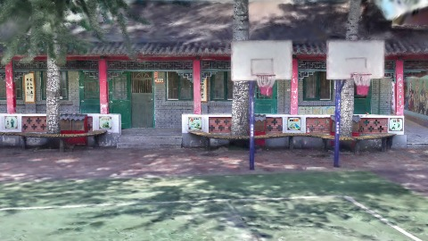
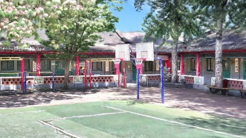
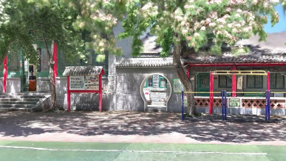
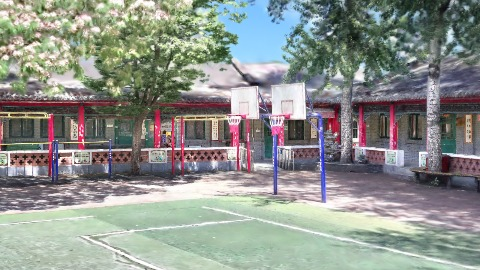
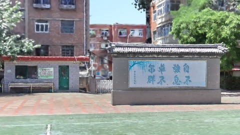

# Scene Profile Benchmark — 2026-08-06

## 本轮维度: profile

Suite: `public/benchmark-suites/scene-chengjian-school-v3-vs-v4.json`

Renderer: `webgpu`

## 运行条件

- Cold start: yes
- Browser session: fresh-chromium-per-case
- Chromium HTTP cache: disabled-cdp-clearBrowserCache-zero-disk-cache
- Cold start (default): fresh Chromium per case, HTTP cache disabled
- OS 页缓存 / GPU 编译缓存：脚本不控制，跨次运行可能仍有差异

| label | presetId | budget | lodMode | lodRuntime | firstFrameMs | jsHeap@1st | vram@1st | jsHeapPeak | vramPeak | fpsP50 | fpsP95 | gsplatsAvgM |
|-------|----------|--------|---------|------------|--------------|------------|----------|------------|----------|--------|--------|-------------|
| chengjian-school-v3 | undefined | 6 | - | refinement | 34001.299999952316 | 225 | 324 | 379 | 407 | 103.0 | 113.0 | 4.32 |
| chengjian-school-v4 | undefined | 6 | - | refinement | 30874.599999904633 | 231 | 317 | 438 | 475 | 94.0 | 120.0 | 4.86 |

## 交互巡检（糊→清晰）

### chengjian-school-v3

播放段 FPS: P50=103.0, P95=113.0, min=66.0, 总播放=2860ms

| waypoint | animTimeSec | moveMs | pendingPeak | blurToClearMs | fpsP50(refine) | fpsP95(refine) | fpsMin | gsplatsAtClearM | jsHeap@clear | vram@clear | jsHeapPeak | vramPeak | timeout |
|----------|-------------|--------|-------------|---------------|----------------|----------------|--------|-----------------|--------------|------------|------------|----------|---------|
| kf-0 | 0.00 | 0 | 0 | 0 | 105.0 | 113.0 | 105.0 | 3.26 | 245 | 324 | 245 | 326 | N |
| kf-1 | 1.00 | 950 | 23 | 10201 | 111.0 | 120.0 | 97.0 | 3.80 | 278 | 355 | 293 | 355 | N |
| kf-2 | 2.00 | 954 | 28 | 16801 | 84.0 | 112.0 | 66.0 | 5.07 | 334 | 405 | 359 | 406 | N |
| kf-3 | 3.00 | 957 | 24 | 13000 | 120.0 | 120.0 | 82.0 | 5.17 | 355 | 405 | 379 | 406 | N |

变清晰截图（480×270 JPEG）：

**kf-0**

**kf-1**

**kf-2**

**kf-3**

### chengjian-school-v4

播放段 FPS: P50=94.0, P95=120.0, min=64.0, 总播放=2863ms

| waypoint | animTimeSec | moveMs | pendingPeak | blurToClearMs | fpsP50(refine) | fpsP95(refine) | fpsMin | gsplatsAtClearM | jsHeap@clear | vram@clear | jsHeapPeak | vramPeak | timeout |
|----------|-------------|--------|-------------|---------------|----------------|----------------|--------|-----------------|--------------|------------|------------|----------|---------|
| kf-0 | 0.00 | 0 | 0 | 0 | 120.0 | 120.0 | 119.0 | 3.78 | 230 | 310 | 231 | 317 | N |
| kf-1 | 1.00 | 958 | 16 | 18601 | 104.0 | 120.0 | 95.0 | 4.46 | 343 | 406 | 359 | 409 | N |
| kf-2 | 2.00 | 955 | 16 | 14801 | 74.0 | 94.0 | 65.0 | 5.51 | 414 | 461 | 434 | 468 | N |
| kf-3 | 3.00 | 950 | 17 | 13000 | 120.0 | 120.0 | 64.0 | 5.71 | 404 | 475 | 438 | 475 | N |

变清晰截图（480×270 JPEG）：

**kf-0**

**kf-1**

**kf-2**

**kf-3**

## 优化前 vs 优化后

### chengjian-school-v3-vs-v4（基线 `chengjian-school-v3`）

| case | lodMode | lodRuntime | firstFrameMs | kf-1 blur | kf-2 blur | blur P90 | vramPeak | poolEvictions |
|------|---------|------------|--------------|-----------|-----------|----------|----------|---------------|
| chengjian-school-v3 | - | refinement | 34001 (—) | 10201 (—) | 16801 | 16801 | 407 | - |
| chengjian-school-v4 | - | refinement | 30875 (-9.2%) | 18601 (82.3%) | 14801 | 18601 | 475 | - |

## 结论

- 见上方对比表；`bottleneckHint` 见 `results.json`（scheduler / asset-http / mixed）