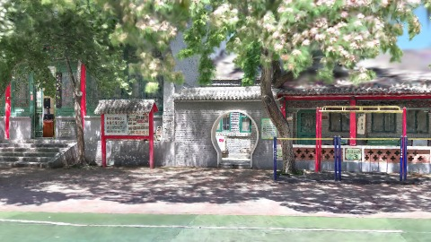
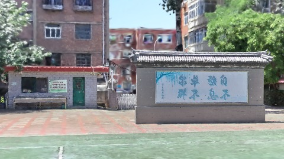
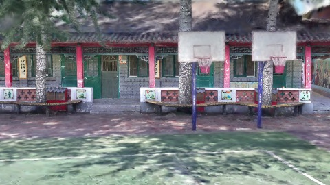
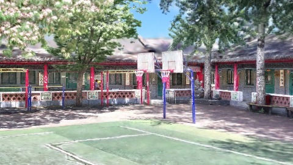
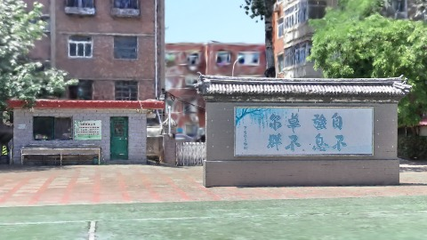

# Scene Profile Benchmark — 2026-08-07

## 本轮维度: profile

Suite: `public/benchmark-suites/scene-chengjian-repscale-ab.json`

Renderer: `webgpu`

## 运行条件

- Cold start: yes
- Browser session: fresh-chromium-per-case
- Chromium HTTP cache: disabled-cdp-clearBrowserCache-zero-disk-cache
- Cold start (default): fresh Chromium per case, HTTP cache disabled
- OS 页缓存 / GPU 编译缓存：脚本不控制，跨次运行可能仍有差异

| label | presetId | budget | lodMode | lodRuntime | firstFrameMs | jsHeap@1st | vram@1st | jsHeapPeak | vramPeak | fpsP50 | fpsP95 | gsplatsAvgM |
|-------|----------|--------|---------|------------|--------------|------------|----------|------------|----------|--------|--------|-------------|
| chengjian-v6-repscale-meta | undefined | 4 | - | refinement | 25703.700000047684 | 195 | 247 | 316 | 316 | 119.0 | 120.0 | 3.21 |
| chengjian-v3-aabb-fallback | undefined | 4 | - | refinement | 25740.799999952316 | 205 | 249 | 316 | 318 | 120.0 | 120.0 | 3.22 |

## 交互巡检（糊→清晰）

### chengjian-v6-repscale-meta

播放段 FPS: P50=119.0, P95=120.0, min=100.0, 总播放=2860ms

| waypoint | animTimeSec | moveMs | pendingPeak | blurToClearMs | fpsP50(refine) | fpsP95(refine) | fpsMin | gsplatsAtClearM | jsHeap@clear | vram@clear | jsHeapPeak | vramPeak | timeout |
|----------|-------------|--------|-------------|---------------|----------------|----------------|--------|-----------------|--------------|------------|------------|----------|---------|
| kf-0 | 0.00 | 0 | 0 | 0 | 120.0 | 120.0 | 119.0 | 2.38 | 209 | 251 | 213 | 252 | N |
| kf-1 | 1.00 | 951 | 21 | 14001 | 120.0 | 120.0 | 119.0 | 3.20 | 243 | 284 | 262 | 285 | N |
| kf-2 | 2.00 | 954 | 29 | 11401 | 119.0 | 120.0 | 100.0 | 3.66 | 298 | 316 | 308 | 316 | N |
| kf-3 | 3.00 | 956 | 21 | 8000 | 120.0 | 120.0 | 102.0 | 3.59 | 295 | 315 | 316 | 315 | N |

变清晰截图（480×270 JPEG）：

**kf-0**

**kf-1**

**kf-2**

**kf-3**

### chengjian-v3-aabb-fallback

播放段 FPS: P50=120.0, P95=120.0, min=100.0, 总播放=2861ms

| waypoint | animTimeSec | moveMs | pendingPeak | blurToClearMs | fpsP50(refine) | fpsP95(refine) | fpsMin | gsplatsAtClearM | jsHeap@clear | vram@clear | jsHeapPeak | vramPeak | timeout |
|----------|-------------|--------|-------------|---------------|----------------|----------------|--------|-----------------|--------------|------------|------------|----------|---------|
| kf-0 | 0.00 | 0 | 0 | 0 | 120.0 | 120.0 | 119.0 | 2.39 | 221 | 251 | 221 | 251 | N |
| kf-1 | 1.00 | 950 | 20 | 13600 | 120.0 | 120.0 | 119.0 | 3.20 | 259 | 284 | 268 | 284 | N |
| kf-2 | 2.00 | 954 | 29 | 11601 | 110.0 | 120.0 | 100.0 | 3.66 | 294 | 318 | 301 | 318 | N |
| kf-3 | 3.00 | 957 | 21 | 8601 | 120.0 | 120.0 | 101.0 | 3.64 | 295 | 318 | 316 | 318 | N |

变清晰截图（480×270 JPEG）：

**kf-0**

**kf-1**

**kf-2**

**kf-3**

## 优化前 vs 优化后

### default（基线 `chengjian-v6-repscale-meta`）

| case | lodMode | lodRuntime | firstFrameMs | kf-1 blur | kf-2 blur | blur P90 | vramPeak | poolEvictions |
|------|---------|------------|--------------|-----------|-----------|----------|----------|---------------|
| chengjian-v6-repscale-meta | - | refinement | 25704 (—) | 14001 (—) | 11401 | 14001 | 316 | - |
| chengjian-v3-aabb-fallback | - | refinement | 25741 (0.1%) | 13600 (-2.9%) | 11601 | 13600 | 318 | - |

## 结论

- 见上方对比表；`bottleneckHint` 见 `results.json`（scheduler / asset-http / mixed）