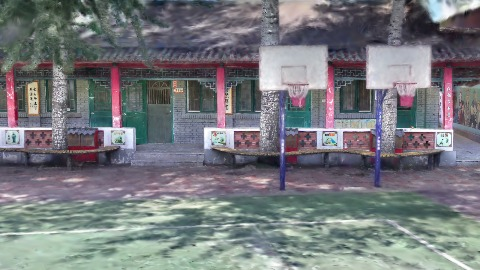
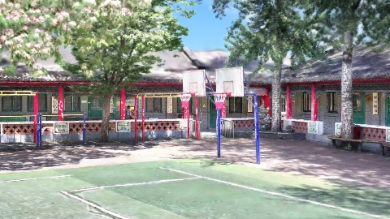
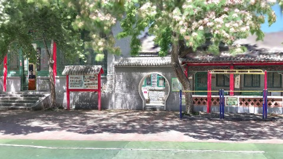
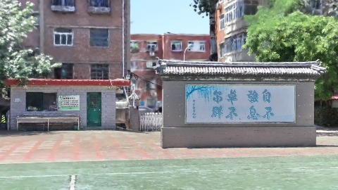

# Scene Profile Benchmark — 2026-08-07

## 本轮维度: profile

Suite: `public/benchmark-suites/scene-chengjian-v3-budget-6.json`

Renderer: `webgpu`

## 运行条件

- Cold start: yes
- Browser session: fresh-chromium-per-case
- Chromium HTTP cache: disabled-cdp-clearBrowserCache-zero-disk-cache
- Cold start (default): fresh Chromium per case, HTTP cache disabled
- OS 页缓存 / GPU 编译缓存：脚本不控制，跨次运行可能仍有差异

| label | presetId | budget | lodMode | lodRuntime | firstFrameMs | jsHeap@1st | vram@1st | jsHeapPeak | vramPeak | fpsP50 | fpsP95 | gsplatsAvgM |
|-------|----------|--------|---------|------------|--------------|------------|----------|------------|----------|--------|--------|-------------|
| chengjian-v3-distance-budget-6 | undefined | 6 | - | refinement | 18749.900000095367 | 167 | 263 | 358 | 414 | 96.0 | 120.0 | 4.20 |

## 交互巡检（糊→清晰）

### chengjian-v3-distance-budget-6

播放段 FPS: P50=96.0, P95=120.0, min=66.0, 总播放=2865ms

| waypoint | animTimeSec | moveMs | pendingPeak | blurToClearMs | fpsP50(refine) | fpsP95(refine) | fpsMin | gsplatsAtClearM | jsHeap@clear | vram@clear | jsHeapPeak | vramPeak | timeout |
|----------|-------------|--------|-------------|---------------|----------------|----------------|--------|-----------------|--------------|------------|------------|----------|---------|
| kf-0 | 0.00 | 0 | 0 | 0 | 120.0 | 120.0 | 119.0 | 2.66 | 145 | 263 | 167 | 263 | N |
| kf-1 | 1.00 | 950 | 30 | 14995 | 119.0 | 120.0 | 92.0 | 3.57 | 225 | 325 | 243 | 325 | N |
| kf-2 | 2.00 | 958 | 34 | 18200 | 80.0 | 113.0 | 65.0 | 4.98 | 310 | 385 | 336 | 386 | N |
| kf-3 | 3.00 | 957 | 28 | 12400 | 120.0 | 120.0 | 69.0 | 5.58 | 345 | 410 | 358 | 414 | N |

变清晰截图（480×270 JPEG）：

**kf-0**

**kf-1**

**kf-2**

**kf-3**

## 优化前 vs 优化后

### default（基线 `chengjian-v3-distance-budget-6`）

| case | lodMode | lodRuntime | firstFrameMs | kf-1 blur | kf-2 blur | blur P90 | vramPeak | poolEvictions |
|------|---------|------------|--------------|-----------|-----------|----------|----------|---------------|
| chengjian-v3-distance-budget-6 | - | refinement | 18750 (—) | 14995 (—) | 18200 | 18200 | 414 | - |

## 结论

- 见上方对比表；`bottleneckHint` 见 `results.json`（scheduler / asset-http / mixed）