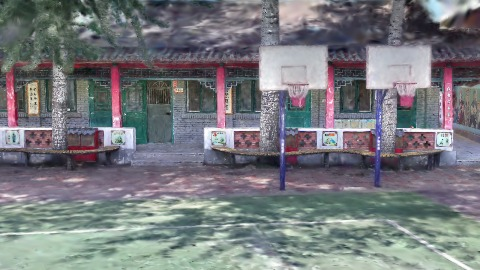
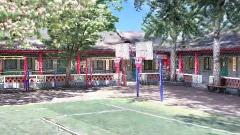
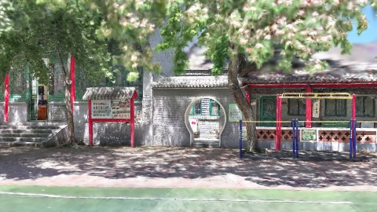
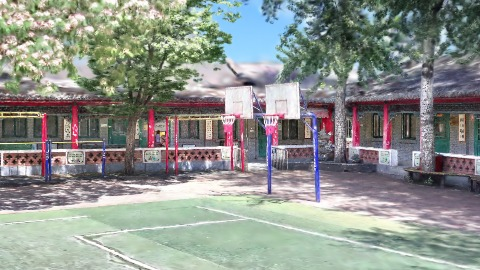
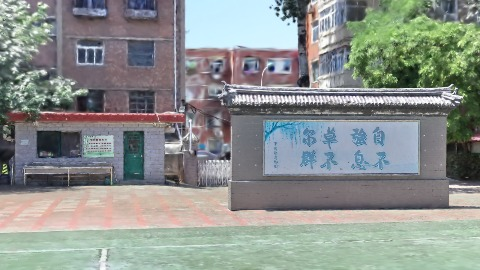

# Scene Profile Benchmark — 2026-08-07

## 本轮维度: profile

Suite: `public/benchmark-suites/scene-chengjian-v3-budget-ab.json`

Renderer: `webgpu`

## 运行条件

- Cold start: yes
- Browser session: fresh-chromium-per-case
- Chromium HTTP cache: disabled-cdp-clearBrowserCache-zero-disk-cache
- Cold start (default): fresh Chromium per case, HTTP cache disabled
- OS 页缓存 / GPU 编译缓存：脚本不控制，跨次运行可能仍有差异

| label | presetId | budget | lodMode | lodRuntime | firstFrameMs | jsHeap@1st | vram@1st | jsHeapPeak | vramPeak | fpsP50 | fpsP95 | gsplatsAvgM |
|-------|----------|--------|---------|------------|--------------|------------|----------|------------|----------|--------|--------|-------------|
| chengjian-v3-distance-budget-2.5 | undefined | 2.5 | - | refinement | 21485.89999985695 | 176 | 178 | 249 | 224 | 120.0 | 120.0 | 2.14 |
| chengjian-v3-distance-budget-4 | undefined | 4 | - | refinement | 25859.299999952316 | 197 | 247 | 314 | 320 | 119.0 | 120.0 | 3.15 |

## 交互巡检（糊→清晰）

### chengjian-v3-distance-budget-2.5

播放段 FPS: P50=120.0, P95=120.0, min=119.0, 总播放=2872ms

| waypoint | animTimeSec | moveMs | pendingPeak | blurToClearMs | fpsP50(refine) | fpsP95(refine) | fpsMin | gsplatsAtClearM | jsHeap@clear | vram@clear | jsHeapPeak | vramPeak | timeout |
|----------|-------------|--------|-------------|---------------|----------------|----------------|--------|-----------------|--------------|------------|------------|----------|---------|
| kf-0 | 0.00 | 0 | 0 | 0 | 119.0 | 119.0 | 119.0 | 1.62 | 157 | 178 | 176 | 178 | N |
| kf-1 | 1.00 | 958 | 10 | 6000 | 120.0 | 120.0 | 119.0 | 2.18 | 178 | 200 | 211 | 200 | N |
| kf-2 | 2.00 | 956 | 7 | 3600 | 120.0 | 120.0 | 119.0 | 2.36 | 216 | 212 | 216 | 212 | N |
| kf-3 | 3.00 | 958 | 12 | 5001 | 120.0 | 120.0 | 119.0 | 2.40 | 217 | 224 | 249 | 224 | N |

变清晰截图（480×270 JPEG）：

**kf-0**

**kf-1**

**kf-2**

**kf-3**

### chengjian-v3-distance-budget-4

播放段 FPS: P50=119.0, P95=120.0, min=98.0, 总播放=2861ms

| waypoint | animTimeSec | moveMs | pendingPeak | blurToClearMs | fpsP50(refine) | fpsP95(refine) | fpsMin | gsplatsAtClearM | jsHeap@clear | vram@clear | jsHeapPeak | vramPeak | timeout |
|----------|-------------|--------|-------------|---------------|----------------|----------------|--------|-----------------|--------------|------------|------------|----------|---------|
| kf-0 | 0.00 | 0 | 0 | 0 | 120.0 | 120.0 | 120.0 | 2.28 | 201 | 245 | 208 | 247 | N |
| kf-1 | 1.00 | 950 | 20 | 12801 | 120.0 | 120.0 | 119.0 | 3.15 | 244 | 280 | 247 | 280 | N |
| kf-2 | 2.00 | 955 | 29 | 11401 | 105.0 | 120.0 | 96.0 | 3.62 | 283 | 312 | 297 | 314 | N |
| kf-3 | 3.00 | 957 | 21 | 10000 | 120.0 | 120.0 | 101.0 | 3.54 | 295 | 318 | 314 | 320 | N |

变清晰截图（480×270 JPEG）：

**kf-0**

**kf-1**

**kf-2**

**kf-3**

## 优化前 vs 优化后

### default（基线 `chengjian-v3-distance-budget-2.5`）

| case | lodMode | lodRuntime | firstFrameMs | kf-1 blur | kf-2 blur | blur P90 | vramPeak | poolEvictions |
|------|---------|------------|--------------|-----------|-----------|----------|----------|---------------|
| chengjian-v3-distance-budget-2.5 | - | refinement | 21486 (—) | 6000 (—) | 3600 | 6000 | 224 | - |
| chengjian-v3-distance-budget-4 | - | refinement | 25859 (20.4%) | 12801 (113.3%) | 11401 | 12801 | 320 | - |

## 结论

- 见上方对比表；`bottleneckHint` 见 `results.json`（scheduler / asset-http / mixed）