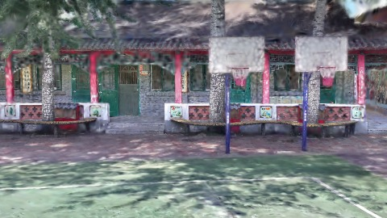
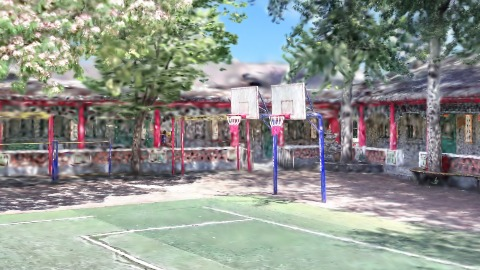
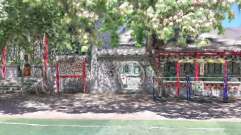
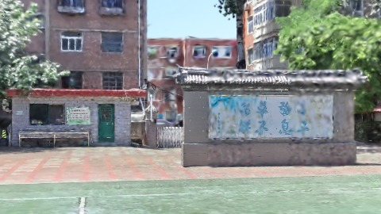
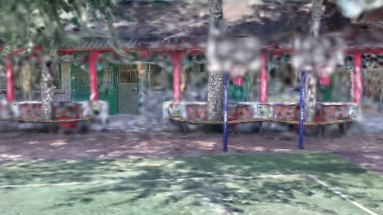
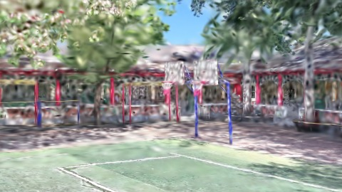
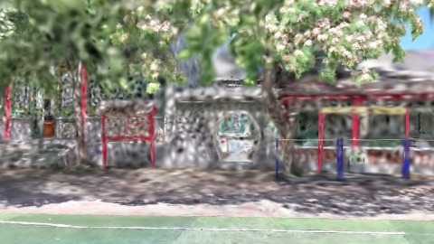
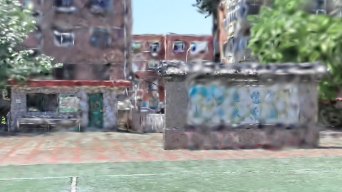

# Scene Profile Benchmark — 2026-08-07

## 本轮维度: profile

Suite: `public/benchmark-suites/scene-chengjian-v6-renderscale-16-32.json`

Renderer: `webgpu`

## 运行条件

- Cold start: yes
- Browser session: fresh-chromium-per-case
- Chromium HTTP cache: disabled-cdp-clearBrowserCache-zero-disk-cache
- Cold start (default): fresh Chromium per case, HTTP cache disabled
- OS 页缓存 / GPU 编译缓存：脚本不控制，跨次运行可能仍有差异

| label | presetId | budget | lodMode | lodRuntime | firstFrameMs | jsHeap@1st | vram@1st | jsHeapPeak | vramPeak | fpsP50 | fpsP95 | gsplatsAvgM |
|-------|----------|--------|---------|------------|--------------|------------|----------|------------|----------|--------|--------|-------------|
| chengjian-v6-rs16 | undefined | 4 | - | refinement | 24748.900000095367 | 190 | 240 | 283 | 295 | 120.0 | 120.0 | 1.27 |
| chengjian-v6-rs32 | undefined | 4 | - | refinement | 17780.10000014305 | 143 | 208 | 221 | 255 | 120.0 | 120.0 | 0.53 |

## 交互巡检（糊→清晰）

### chengjian-v6-rs16

播放段 FPS: P50=120.0, P95=120.0, min=119.0, 总播放=2868ms

| waypoint | animTimeSec | moveMs | pendingPeak | blurToClearMs | fpsP50(refine) | fpsP95(refine) | fpsMin | gsplatsAtClearM | jsHeap@clear | vram@clear | jsHeapPeak | vramPeak | timeout |
|----------|-------------|--------|-------------|---------------|----------------|----------------|--------|-----------------|--------------|------------|------------|----------|---------|
| kf-0 | 0.00 | 0 | 0 | 0 | 120.0 | 120.0 | 119.0 | 1.14 | 211 | 242 | 211 | 243 | N |
| kf-1 | 1.00 | 958 | 15 | 8801 | 120.0 | 120.0 | 119.0 | 1.34 | 230 | 265 | 234 | 265 | N |
| kf-2 | 2.00 | 954 | 19 | 8000 | 120.0 | 120.0 | 119.0 | 1.37 | 246 | 286 | 261 | 287 | N |
| kf-3 | 3.00 | 957 | 14 | 6600 | 120.0 | 120.0 | 119.0 | 1.23 | 268 | 295 | 283 | 295 | N |

变清晰截图（480×270 JPEG）：

**kf-0**

**kf-1**

**kf-2**

**kf-3**

### chengjian-v6-rs32

播放段 FPS: P50=120.0, P95=120.0, min=120.0, 总播放=2870ms

| waypoint | animTimeSec | moveMs | pendingPeak | blurToClearMs | fpsP50(refine) | fpsP95(refine) | fpsMin | gsplatsAtClearM | jsHeap@clear | vram@clear | jsHeapPeak | vramPeak | timeout |
|----------|-------------|--------|-------------|---------------|----------------|----------------|--------|-----------------|--------------|------------|------------|----------|---------|
| kf-0 | 0.00 | 0 | 1 | 801 | 120.0 | 120.0 | 120.0 | 0.48 | 173 | 211 | 173 | 213 | N |
| kf-1 | 1.00 | 958 | 9 | 5001 | 120.0 | 120.0 | 120.0 | 0.59 | 185 | 228 | 191 | 228 | N |
| kf-2 | 2.00 | 955 | 5 | 3801 | 120.0 | 120.0 | 120.0 | 0.68 | 183 | 241 | 212 | 241 | N |
| kf-3 | 3.00 | 957 | 7 | 4201 | 119.0 | 120.0 | 119.0 | 0.40 | 206 | 255 | 221 | 255 | N |

变清晰截图（480×270 JPEG）：

**kf-0**

**kf-1**

**kf-2**

**kf-3**

## 优化前 vs 优化后

### default（基线 `chengjian-v6-rs16`）

| case | lodMode | lodRuntime | firstFrameMs | kf-1 blur | kf-2 blur | blur P90 | vramPeak | poolEvictions |
|------|---------|------------|--------------|-----------|-----------|----------|----------|---------------|
| chengjian-v6-rs16 | - | refinement | 24749 (—) | 8801 (—) | 8000 | 8801 | 295 | - |
| chengjian-v6-rs32 | - | refinement | 17780 (-28.2%) | 5001 (-43.2%) | 3801 | 5001 | 255 | - |

## 结论

- 见上方对比表；`bottleneckHint` 见 `results.json`（scheduler / asset-http / mixed）