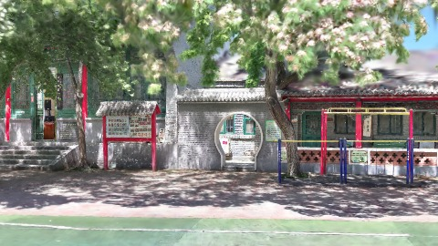
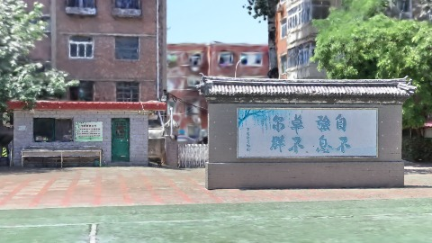
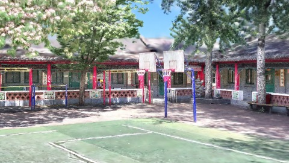
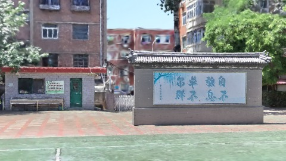
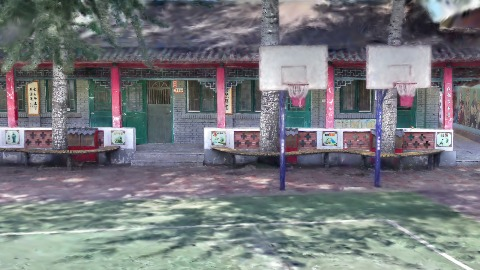
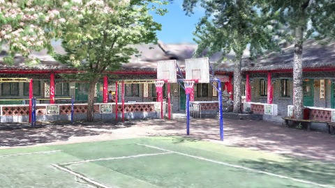

# Scene Profile Benchmark — 2026-08-07

## 本轮维度: profile

Suite: `public/benchmark-suites/scene-chengjian-v6-renderscale-sweep.json`

Renderer: `webgpu`

## 运行条件

- Cold start: yes
- Browser session: fresh-chromium-per-case
- Chromium HTTP cache: disabled-cdp-clearBrowserCache-zero-disk-cache
- Cold start (default): fresh Chromium per case, HTTP cache disabled
- OS 页缓存 / GPU 编译缓存：脚本不控制，跨次运行可能仍有差异

| label | presetId | budget | lodMode | lodRuntime | firstFrameMs | jsHeap@1st | vram@1st | jsHeapPeak | vramPeak | fpsP50 | fpsP95 | gsplatsAvgM |
|-------|----------|--------|---------|------------|--------------|------------|----------|------------|----------|--------|--------|-------------|
| chengjian-v6-rs1 | undefined | 4 | - | refinement | 26017.60000014305 | 209 | 249 | 322 | 325 | 119.0 | 120.0 | 3.25 |
| chengjian-v6-rs2 | undefined | 4 | - | refinement | 26563.10000014305 | 210 | 249 | 318 | 322 | 106.0 | 110.0 | 3.21 |
| chengjian-v6-rs4 | undefined | 4 | - | refinement | 25237.200000047684 | 210 | 247 | 324 | 324 | 120.0 | 120.0 | 3.07 |

## 交互巡检（糊→清晰）

### chengjian-v6-rs1

播放段 FPS: P50=119.0, P95=120.0, min=100.0, 总播放=2862ms

| waypoint | animTimeSec | moveMs | pendingPeak | blurToClearMs | fpsP50(refine) | fpsP95(refine) | fpsMin | gsplatsAtClearM | jsHeap@clear | vram@clear | jsHeapPeak | vramPeak | timeout |
|----------|-------------|--------|-------------|---------------|----------------|----------------|--------|-----------------|--------------|------------|------------|----------|---------|
| kf-0 | 0.00 | 0 | 0 | 0 | 120.0 | 120.0 | 120.0 | 2.42 | 200 | 252 | 209 | 252 | N |
| kf-1 | 1.00 | 950 | 20 | 13403 | 120.0 | 120.0 | 119.0 | 3.21 | 264 | 286 | 264 | 286 | N |
| kf-2 | 2.00 | 955 | 29 | 12401 | 119.0 | 120.0 | 99.0 | 3.67 | 291 | 320 | 308 | 321 | N |
| kf-3 | 3.00 | 957 | 20 | 9200 | 120.0 | 120.0 | 103.0 | 3.70 | 317 | 325 | 322 | 325 | N |

变清晰截图（480×270 JPEG）：

**kf-0**

**kf-1**

**kf-2**

**kf-3**

### chengjian-v6-rs2

播放段 FPS: P50=106.0, P95=110.0, min=94.0, 总播放=2861ms

| waypoint | animTimeSec | moveMs | pendingPeak | blurToClearMs | fpsP50(refine) | fpsP95(refine) | fpsMin | gsplatsAtClearM | jsHeap@clear | vram@clear | jsHeapPeak | vramPeak | timeout |
|----------|-------------|--------|-------------|---------------|----------------|----------------|--------|-----------------|--------------|------------|------------|----------|---------|
| kf-0 | 0.00 | 0 | 0 | 0 | 111.0 | 111.0 | 111.0 | 2.42 | 218 | 253 | 230 | 253 | N |
| kf-1 | 1.00 | 956 | 20 | 13401 | 119.0 | 120.0 | 110.0 | 3.21 | 285 | 286 | 285 | 286 | N |
| kf-2 | 2.00 | 955 | 27 | 11401 | 103.0 | 113.0 | 95.0 | 3.64 | 301 | 316 | 312 | 316 | N |
| kf-3 | 3.00 | 950 | 20 | 8800 | 120.0 | 120.0 | 94.0 | 3.58 | 300 | 322 | 318 | 322 | N |

变清晰截图（480×270 JPEG）：

**kf-0**

**kf-1**

**kf-2**

**kf-3**

### chengjian-v6-rs4

播放段 FPS: P50=120.0, P95=120.0, min=100.0, 总播放=2861ms

| waypoint | animTimeSec | moveMs | pendingPeak | blurToClearMs | fpsP50(refine) | fpsP95(refine) | fpsMin | gsplatsAtClearM | jsHeap@clear | vram@clear | jsHeapPeak | vramPeak | timeout |
|----------|-------------|--------|-------------|---------------|----------------|----------------|--------|-----------------|--------------|------------|------------|----------|---------|
| kf-0 | 0.00 | 0 | 0 | 0 | 119.0 | 119.0 | 119.0 | 2.31 | 225 | 250 | 241 | 250 | N |
| kf-1 | 1.00 | 949 | 24 | 13600 | 120.0 | 120.0 | 119.0 | 3.10 | 259 | 285 | 263 | 285 | N |
| kf-2 | 2.00 | 955 | 29 | 11801 | 119.0 | 120.0 | 100.0 | 3.57 | 287 | 319 | 303 | 319 | N |
| kf-3 | 3.00 | 957 | 20 | 8401 | 119.0 | 120.0 | 101.0 | 3.31 | 304 | 324 | 324 | 324 | N |

变清晰截图（480×270 JPEG）：

**kf-0**

**kf-1**

**kf-2**

**kf-3**

## 优化前 vs 优化后

### default（基线 `chengjian-v6-rs1`）

| case | lodMode | lodRuntime | firstFrameMs | kf-1 blur | kf-2 blur | blur P90 | vramPeak | poolEvictions |
|------|---------|------------|--------------|-----------|-----------|----------|----------|---------------|
| chengjian-v6-rs1 | - | refinement | 26018 (—) | 13403 (—) | 12401 | 13403 | 325 | - |
| chengjian-v6-rs2 | - | refinement | 26563 (2.1%) | 13401 (-0.0%) | 11401 | 13401 | 322 | - |
| chengjian-v6-rs4 | - | refinement | 25237 (-3.0%) | 13600 (1.5%) | 11801 | 13600 | 324 | - |

## 结论

- 见上方对比表；`bottleneckHint` 见 `results.json`（scheduler / asset-http / mixed）