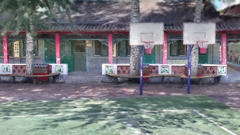
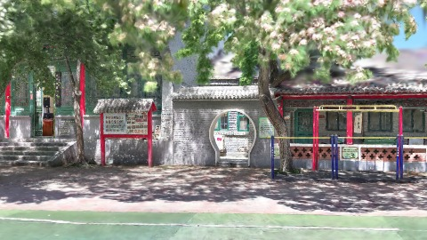
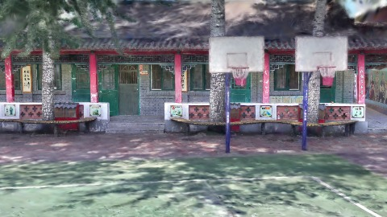
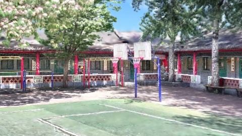
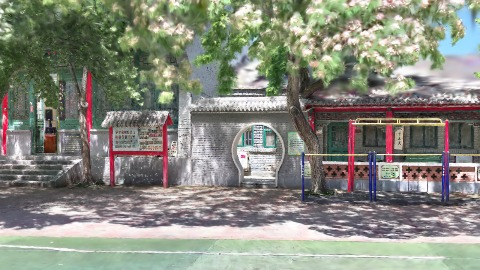
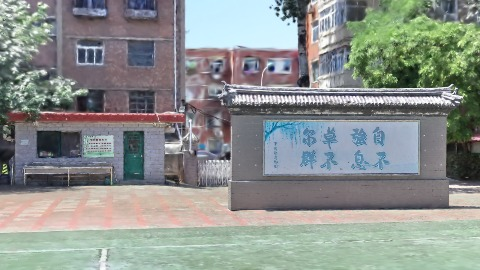

# Scene Profile Benchmark — 2026-08-07

## 本轮维度: profile

Suite: `public/benchmark-suites/scene-chengjian-v6-selectmode-ab.json`

Renderer: `webgpu`

## 运行条件

- Cold start: yes
- Browser session: fresh-chromium-per-case
- Chromium HTTP cache: disabled-cdp-clearBrowserCache-zero-disk-cache
- Cold start (default): fresh Chromium per case, HTTP cache disabled
- OS 页缓存 / GPU 编译缓存：脚本不控制，跨次运行可能仍有差异

| label | presetId | budget | lodMode | lodRuntime | firstFrameMs | jsHeap@1st | vram@1st | jsHeapPeak | vramPeak | fpsP50 | fpsP95 | gsplatsAvgM |
|-------|----------|--------|---------|------------|--------------|------------|----------|------------|----------|--------|--------|-------------|
| chengjian-v6-renderScale | undefined | 4 | - | refinement | 25790.60000014305 | 209 | 247 | 316 | 317 | 120.0 | 120.0 | 3.22 |
| chengjian-v6-distance | undefined | 4 | - | refinement | 23731.299999952316 | 193 | 237 | 316 | 323 | 120.0 | 120.0 | 3.09 |

## 交互巡检（糊→清晰）

### chengjian-v6-renderScale

播放段 FPS: P50=120.0, P95=120.0, min=104.0, 总播放=2863ms

| waypoint | animTimeSec | moveMs | pendingPeak | blurToClearMs | fpsP50(refine) | fpsP95(refine) | fpsMin | gsplatsAtClearM | jsHeap@clear | vram@clear | jsHeapPeak | vramPeak | timeout |
|----------|-------------|--------|-------------|---------------|----------------|----------------|--------|-----------------|--------------|------------|------------|----------|---------|
| kf-0 | 0.00 | 0 | 0 | 0 | 120.0 | 120.0 | 120.0 | 2.42 | 201 | 251 | 209 | 251 | N |
| kf-1 | 1.00 | 951 | 20 | 12801 | 120.0 | 120.0 | 119.0 | 3.19 | 233 | 282 | 259 | 282 | N |
| kf-2 | 2.00 | 955 | 29 | 11401 | 119.0 | 120.0 | 104.0 | 3.63 | 297 | 314 | 302 | 314 | N |
| kf-3 | 3.00 | 958 | 20 | 8401 | 120.0 | 121.0 | 104.0 | 3.62 | 303 | 317 | 316 | 317 | N |

变清晰截图（480×270 JPEG）：

**kf-0**

**kf-1**

**kf-2**

**kf-3**

### chengjian-v6-distance

播放段 FPS: P50=120.0, P95=120.0, min=98.0, 总播放=2850ms

| waypoint | animTimeSec | moveMs | pendingPeak | blurToClearMs | fpsP50(refine) | fpsP95(refine) | fpsMin | gsplatsAtClearM | jsHeap@clear | vram@clear | jsHeapPeak | vramPeak | timeout |
|----------|-------------|--------|-------------|---------------|----------------|----------------|--------|-----------------|--------------|------------|------------|----------|---------|
| kf-0 | 0.00 | 0 | 0 | 0 | 120.0 | 120.0 | 119.0 | 2.18 | 182 | 239 | 195 | 241 | N |
| kf-1 | 1.00 | 950 | 19 | 13001 | 120.0 | 120.0 | 119.0 | 3.02 | 235 | 274 | 249 | 274 | N |
| kf-2 | 2.00 | 947 | 31 | 13401 | 115.0 | 120.0 | 98.0 | 3.61 | 278 | 308 | 294 | 310 | N |
| kf-3 | 3.00 | 954 | 21 | 9801 | 120.0 | 120.0 | 98.0 | 3.54 | 305 | 323 | 316 | 323 | N |

变清晰截图（480×270 JPEG）：

**kf-0**

**kf-1**

**kf-2**

**kf-3**

## 优化前 vs 优化后

### default（基线 `chengjian-v6-renderScale`）

| case | lodMode | lodRuntime | firstFrameMs | kf-1 blur | kf-2 blur | blur P90 | vramPeak | poolEvictions |
|------|---------|------------|--------------|-----------|-----------|----------|----------|---------------|
| chengjian-v6-renderScale | - | refinement | 25791 (—) | 12801 (—) | 11401 | 12801 | 317 | - |
| chengjian-v6-distance | - | refinement | 23731 (-8.0%) | 13001 (1.6%) | 13401 | 13401 | 323 | - |

## 结论

- 见上方对比表；`bottleneckHint` 见 `results.json`（scheduler / asset-http / mixed）